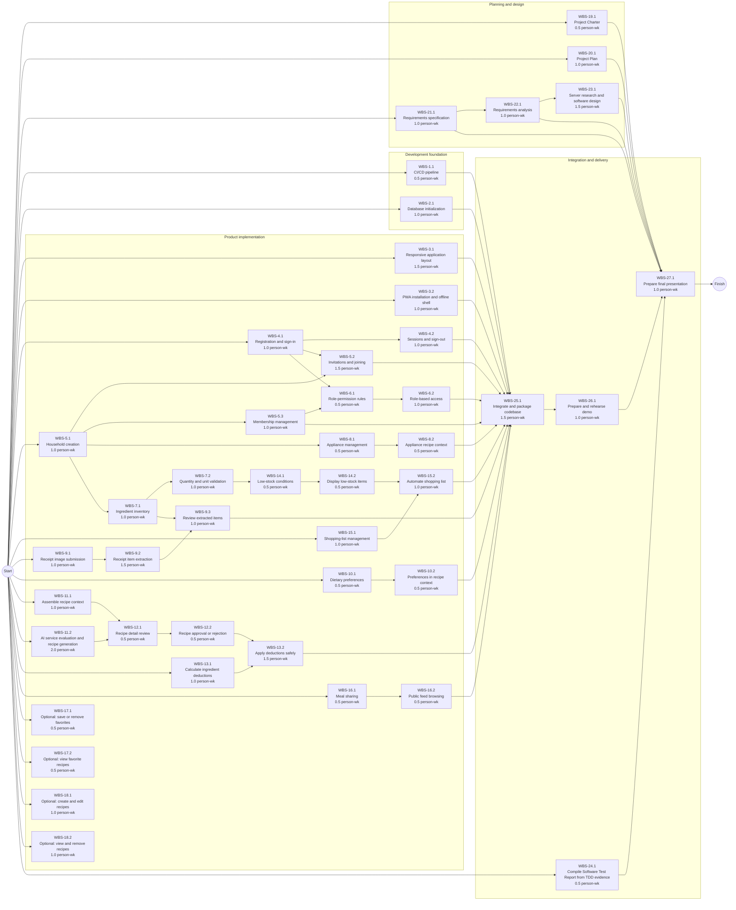
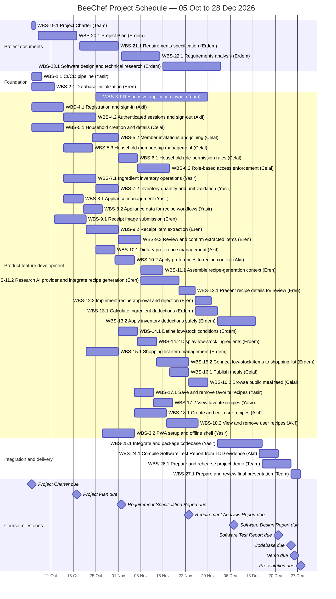

# Software Engineering — Project Plan

## Cover Page

| Field | Details |
|---|---|
| **Course** | BLG 411E Software Engineering |
| **Report name** | Project Plan |
| **Project title** | BeeChef |
| **Group name / number** | Softies |
| **Group members** | Erdem Toruk 150220083, Eren Söylemez 150230045, Ahmet Yasir Göktepe 150220036, Mehmet Akif Ögrenir 150230097, Celal Gündoğdu 150230007 |
| **Instructor** | Tolga Ovatman |
| **Submission date** | 2026-10-24 |
| **Document version** | 1.0 |

---

## 1. Introduction

### 1.1 Scope

**Project overview:**  
Families and shared student apartments often struggle to keep track of food inventory, decide what to cook, and avoid food waste. BeeChef will provide a shared, responsive web application with PWA capabilities to manage household inventory and preferences, generate AI-driven recipes, and support meal planning and shopping.

**In scope:**
- A responsive web application with installable PWA capabilities.
- User authentication, household creation, member invitations, and role-based access management.
- Manual management of household ingredients and appliances.
- Receipt-image scanning to extract inventory items.
- Personal dietary preferences and restrictions.
- AI-generated recipe review and approval or rejection, with automatic stock deduction for approved meals.
- Automatic identification of low-stock items and an interactive shopping list.
- A public social feed for sharing meals.

**Optional scope:**
- Saving recipes as favorites.
- Manually entering user-created recipes.

**Out of scope:**
- Direct grocery purchasing or delivery-service checkout.
- Smart-fridge or other IoT integration.
- Medical diet planning, nutrient tracking, or health-data integration.
- Paid subscriptions or premium tiers.
- Ingredient expiration-date tracking or spoilage alerts.

**Assumptions and constraints:**  
- Built on our planned stack (React, FastAPI, PostgreSQL, Docker, LangChain).
- Constrained by fixed BLG 411E deadlines, including the 25 December 2026 codebase delivery.
- Developed by full-time students; weekly capacity will fluctuate with academic exam schedules.
- All external services and infrastructure must remain free. 

### 1.2 Deliverables

| Deliverable ID | Deliverable name | Description / contents | Acceptance criterion |
|---|---|---|---|
| D-01 | Responsive web application and PWA | User-facing application built with responsive layouts, installable PWA capabilities, and the supported offline application shell. | Verify installation, cached application-shell behavior when offline, and usability of the in-scope workflows on representative desktop and mobile layouts. |
| D-02 | User accounts and authentication | Account registration, sign-in, sign-out, and authenticated access to the application. | Verify that a user can register and sign in, invalid credentials are rejected, and protected functionality is unavailable to unauthenticated users. |
| D-03 | Household creation, membership, and invitations | Create a household, join an existing household through an invitation, and manage household membership. | Verify that a household can be created, an invitation can be sent and accepted, and the invited user becomes a member of the correct household. |
| D-04 | Household roles and permissions | Owner and Member roles with permissions enforced for household operations. | Verify permitted and forbidden operations for each role, including attempts made through both the user interface and backend endpoints. |
| D-05 | Manual ingredient inventory management | Add, view, update, and remove ingredients in a household's inventory. | Verify that authorized household members can create, edit, and remove inventory items and that changes are reflected in the household inventory. |
| D-06 | Appliance management | Add, view, update, and remove the appliances available to a household. | Verify that authorized household members can manage appliances and that the current appliance list is available to recipe generation. |
| D-07 | Receipt-image scanning and inventory review | Submit a receipt image for item extraction, review extracted items, and choose which items to add to inventory. | Verify that extracted items are presented for review, users can correct or discard results, and only confirmed items are added to inventory. |
| D-08 | Personal dietary preferences and restrictions | Save and update user-specific dietary preferences, restrictions, and allergies. | Verify that users can save and edit their preferences and that the saved values are available to relevant recipe-generation workflows. |
| D-09 | AI recipe generation | Generate recipe suggestions using available household ingredients, appliances, and relevant user preferences. | Verify that recipe requests use the applicable inventory, appliances, and preferences and that an API failure is shown clearly without changing inventory. |
| D-10 | Recipe review and decision | Present generated recipes for review and allow a user to approve or reject a suggestion. | Verify that a user can inspect a generated recipe and explicitly approve or reject it; rejection does not trigger stock deduction. |
| D-11 | Inventory deduction for approved meals | Deduct the ingredients used by a meal from household inventory after approval. | Verify that approving a recipe deducts the correct quantities once, while rejection or a failed approval leaves inventory unchanged. |
| D-12 | Low-stock identification | Identify household ingredients that meet the configured low-stock condition. | Verify that qualifying items are identified from inventory quantities and that items above the condition are not marked low-stock. |
| D-13 | Interactive shopping list | View and manage shopping-list entries, including items identified as low-stock. | Verify that low-stock items can be added to or represented on the list and that users can update or remove list entries. |
| D-14 | Public meal-sharing feed | Publish meals to a public feed and browse shared meals. | Verify that a user can publish a meal and that it appears in the feed for other users to view. |
| D-15 | Optional: Favorite recipes | Optional capability to save and revisit recipes as favorites. | Verify that a user can add and remove a favorite and retrieve their saved favorites. |
| D-16 | Optional: User-created recipes | Optional capability to enter and manage recipes created by users. | Verify that a user can create, view, edit, and remove their own recipe. |
| D-17 | Project Charter | Approved project charter defining the project vision, scope, stakeholders, constraints, and milestones. | Submit the completed Project Charter by the stated deadline and verify that it contains the agreed project definition and milestone schedule. |
| D-18 | Project Plan | This project plan, including scope, deliverables, tasks, WBS, estimates, resources, schedule, and risks. | Submit the completed Project Plan by the stated deadline and verify consistency among deliverable, task, WBS, estimate, resource, schedule, and risk references. |
| D-19 | Requirement Specification Report | Requirements specification report describing the system requirements and agreed user-facing behavior. | Submit the report by the stated deadline and verify that requirements are clearly documented and traceable to the project scope. |
| D-20 | Requirement Analysis Report | Requirements analysis report documenting analysis models and the results of analyzing the specified requirements. | Submit the report by the stated deadline and verify that the analysis is consistent with the Requirement Specification Report. |
| D-21 | Software Design Report | Software design report covering system architecture and detailed design. | Submit the report by the stated deadline and verify that design decisions. |
| D-22 | Software Test Report | Test report compiled from test cases and results produced continuously during test-driven development. | Submit the report by the stated deadline and verify that reported results correspond to the tests written and run alongside implementation. |
| D-23 | Codebase | Integrated project source code, CI/CD pipeline configuration, database initialization scripts, and required configuration needed to build and run the BeeChef application. | Deliver the codebase by the stated deadline; verify that the CI/CD pipeline runs the agreed build and tests, and that database initialization creates the required schema so the documented setup can run the application. |
| D-24 | Demo | Demonstration of the completed BeeChef application and its principal workflows. | Deliver the demonstration by the stated deadline and verify that it presents the agreed core workflows using the final application. |
| D-25 | Presentation | Final project presentation summarizing the problem, solution, design, implementation, and evaluation. | Deliver the presentation by the stated deadline and verify that it accurately reflects the completed project and its results. |

### 1.3 Functional Requirements / Tasks

| Task ID | Functional requirement / task | Description | Related deliverable ID(s) |
|---|---|---|---|
| T-01 | Create the CI/CD pipeline | Configure an automated pipeline to build and run the agreed checks for project changes. | D-23 |
| T-02 | Initialize the project database | Create database initialization or migration scripts for the project schema and verify they can prepare a clean database for the application. | D-23 |
| T-03 | Provide the responsive PWA | Build the responsive user-facing application and provide the installable PWA capabilities and supported offline behavior in scope. | D-01 |
| T-04 | Register and authenticate users | Allow users to register, sign in, and sign out, and protect functionality that requires authentication. | D-02 |
| T-05 | Create households and manage membership | Allow users to create a household, invite members, and let invited users join the household. | D-03 |
| T-06 | Enforce household roles and permissions | Apply Owner and Member permissions to household operations and protect backend operations accordingly. | D-04 |
| T-07 | Manage ingredient inventory manually | Allow authorized users to add, view, update, and remove household ingredients. | D-05 |
| T-08 | Manage household appliances | Allow authorized users to add, view, update, and remove household appliances. | D-06 |
| T-09 | Scan receipts and review extracted items | Extract potential inventory items from receipt images and let users review, correct, or discard the results before adding them. | D-07 |
| T-10 | Maintain dietary preferences and restrictions | Allow users to save and update personal dietary preferences, restrictions, and allergies. | D-08 |
| T-11 | Generate context-aware AI recipes | Generate recipe suggestions using available ingredients, household appliances, and relevant dietary preferences. | D-09 |
| T-12 | Review, approve, or reject recipes | Let users inspect generated recipes and explicitly approve or reject them. | D-10 |
| T-13 | Deduct ingredients for approved meals | Update household inventory quantities for ingredients used by an approved meal without deducting stock for rejected recipes. | D-11 |
| T-14 | Identify low-stock ingredients | Identify inventory items that meet the low-stock condition. | D-12 |
| T-15 | Manage the shopping list | Show low-stock items in an interactive shopping list and let users update or remove list entries. | D-13 |
| T-16 | Share meals on the public feed | Allow users to publish meals and browse meals shared by other users. | D-14 |
| T-17 | Optional: Save favorite recipes | If selected for implementation, let users save, view, and remove favorite recipes. | D-15 |
| T-18 | Optional: Manage user-created recipes | If selected for implementation, let users create, view, edit, and remove their own recipes. | D-16 |
| T-19 | Prepare the Project Charter | Complete and submit the Project Charter, documenting the agreed project vision, scope, stakeholders, constraints, and milestones. | D-17 |
| T-20 | Prepare the Project Plan | Complete and submit the Project Plan, including the project work breakdown, estimates, resources, schedule, and risks. | D-18 |
| T-21 | Prepare the Requirement Specification Report | Specify and document the system requirements and user-facing behavior, maintaining traceability to the project scope. | D-19 |
| T-22 | Prepare the Requirement Analysis Report | Analyze the specified requirements and document the resulting analysis models and conclusions. | D-20 |
| T-23 | Prepare the Software Design Report | Define and document the system architecture and detailed design. | D-21 |
| T-24 | Prepare the Software Test Report | Compile the test cases, results, and relevant defects produced alongside implementation using TDD. | D-22 |
| T-25 | Integrate and deliver the codebase | Integrate the implemented application features, maintain build and run instructions, and deliver the runnable source code. | D-23 |
| T-26 | Prepare and deliver the project demo | Prepare and deliver a demonstration of the application’s principal workflows. | D-24 |
| T-27 | Prepare and deliver the final presentation | Prepare and deliver a presentation of the problem, solution, design, implementation, and evaluation. | D-25 |

### 1.4 Non-functional Issues

| Quality attribute | Requirement / concern | How it will be assessed |
|---|---|---|
| Security | Authenticate users with JWT and enforce household role-based permissions; protect household and personal preference data from unauthorized access. | Test authenticated and unauthenticated requests and verify that each household role can access only permitted operations and data. |
| Performance | Common non-AI actions, such as opening the inventory, viewing a household, and saving an item, should complete within 2 seconds under normal expected usage. | Measure response times for representative non-AI user flows under normal expected usage; verify that at least 95% complete within 2 seconds. Assess AI-powered operations separately because their response times depend on external services. |
| Usability | Provide a responsive experience optimized for desktop and mobile use, with clear workflows for inventory, recipe review, and shopping lists. | Walk through representative tasks on desktop and mobile and collect usability feedback from intended users. |
| Reliability | Handle failures or unavailable responses from receipt-scanning and recipe-generation APIs without silently applying incorrect inventory changes. | Simulate API errors and verify that users receive clear feedback, inventory remains consistent, and failed operations can be retried. |

---

## 2. Project Plan — Work Breakdown Structure (WBS)

| WBS activity ID | Parent task ID | Activity / subtask | Description / completion condition | Size (T/S/M/L/XL) |
|---|---|---|---|---|
| WBS-1.1 | T-01 | Configure CI/CD pipeline | Configure automated build and agreed checks for project changes; verify the pipeline completes successfully on the repository. | T |
| WBS-2.1 | T-02 | Create database initialization and migration setup | Define the initial database schema and initialization/migration scripts; verify a clean database can be prepared for the application. | M |
| WBS-3.1 | T-03 | Build responsive application layout | Implement shared navigation and responsive page layouts for the main application screens; verify at representative desktop and mobile widths. | L |
| WBS-3.2 | T-03 | Add PWA installation and offline shell | Configure the web app manifest and service worker; verify installation and cached application-shell behavior when offline. | M |
| WBS-4.1 | T-04 | Implement account registration and sign-in | Build registration and sign-in flows with input validation and clear success and error feedback. | M |
| WBS-4.2 | T-04 | Implement authenticated sessions and sign-out | Integrate JWT-based session handling, protected routes, token expiry handling, and sign-out. | M |
| WBS-5.1 | T-05 | Implement household creation and details | Allow an authenticated user to create a household and view or update its basic details. | M |
| WBS-5.2 | T-05 | Implement member invitations and joining | Allow household members to invite users and invited users to accept an invitation and join the correct household. | M |
| WBS-5.3 | T-05 | Display and manage household membership | Show household members and support the membership changes permitted by the product requirements. | M |
| WBS-6.1 | T-06 | Define household role-permission rules | Document permitted actions for Owner and Member roles as an implementable permission matrix. | S |
| WBS-6.2 | T-06 | Enforce and verify role-based access | Enforce the permission matrix in backend operations and relevant UI actions; verify allowed and denied access for each role. | M |
| WBS-7.1 | T-07 | Implement ingredient inventory operations | Allow authorized household members to add, view, update, and remove inventory items. | M |
| WBS-7.2 | T-07 | Validate inventory quantities and units | Support quantity and unit entry and validation; verify inventory changes are persisted and displayed consistently. | M |
| WBS-8.1 | T-08 | Implement appliance management | Allow authorized household members to add, view, update, and remove household appliances. | S |
| WBS-8.2 | T-08 | Make appliance data available to recipe workflows | Provide the household appliance list to recipe-generation requests and verify the selected context is included. | S |
| WBS-9.1 | T-09 | Implement receipt image submission | Allow a user to select and submit a receipt image with appropriate input validation and upload feedback. | M |
| WBS-9.2 | T-09 | Integrate receipt item extraction | Send the image to the selected vision service and convert its response into candidate inventory items; handle service errors. | M |
| WBS-9.3 | T-09 | Review and confirm extracted items | Let users inspect, correct, select, or discard extracted candidates; add only confirmed items to inventory. | M |
| WBS-10.1 | T-10 | Implement dietary preference management | Allow users to enter, view, and update dietary preferences, restrictions, and allergies. | S |
| WBS-10.2 | T-10 | Apply saved preferences to recipe requests | Retrieve the applicable user's saved preferences and include them in recipe-generation context. | S |
| WBS-11.1 | T-11 | Assemble household context for recipe generation | Collect available ingredients, appliances, and applicable dietary preferences for a recipe request. | M |
| WBS-11.2 | T-11 | Research, integrate, and present AI recipe suggestions | Evaluate generative-AI service options, integrate the selected service, parse and present returned recipes, and handle service errors. | L |
| WBS-12.1 | T-12 | Present recipe details for review | Display recipe ingredients, instructions, and relevant context so users can review a suggestion. | S |
| WBS-12.2 | T-12 | Implement recipe approval and rejection | Record the user's explicit approval or rejection and verify that rejection does not alter inventory. | S |
| WBS-13.1 | T-13 | Calculate ingredient deductions | Match approved recipe quantities to inventory items and calculate the resulting stock changes. | M |
| WBS-13.2 | T-13 | Apply deductions safely to inventory | Persist deductions only for approved meals and prevent duplicate or partial updates if an operation fails or is retried. | L |
| WBS-14.1 | T-14 | Define and apply low-stock conditions | Establish the low-stock condition and evaluate household inventory quantities against it. | S |
| WBS-14.2 | T-14 | Display low-stock inventory items | Identify qualifying items in the application and verify that items above the condition are not marked low-stock. | S |
| WBS-15.1 | T-15 | Implement shopping-list item management | Allow household members to view, add, update, and remove shopping-list entries. | M |
| WBS-15.2 | T-15 | Connect low-stock items to the shopping list | Add or represent qualifying low-stock ingredients on the shopping list and verify list changes remain consistent. | M |
| WBS-16.1 | T-16 | Implement meal sharing | Allow a user to publish a meal with the agreed shareable details and provide confirmation of publication. | S |
| WBS-16.2 | T-16 | Implement public feed browsing | Retrieve and display meals shared by users and verify that newly published meals appear in the feed. | S |
| WBS-17.1 | T-17 | Optional: Save and remove favorite recipes | If selected for implementation, allow a user to add or remove a recipe from their favorites and persist the change. | S |
| WBS-17.2 | T-17 | Optional: View saved favorite recipes | If selected for implementation, display a user's saved recipes and verify the list reflects additions and removals. | S |
| WBS-18.1 | T-18 | Optional: Create and edit user-created recipes | If selected for implementation, allow a user to create a recipe and update recipes they own. | M |
| WBS-18.2 | T-18 | Optional: View and remove user-created recipes | If selected for implementation, allow a user to view their recipes and remove recipes they own. | M |
| WBS-19.1 | T-19 | Complete and submit the Project Charter | Finalize the project vision, scope, stakeholders, constraints, and milestone schedule; submit the charter. | S |
| WBS-20.1 | T-20 | Complete and submit the Project Plan | Finalize scope, deliverables, tasks, WBS, estimates, resources, schedule, and risks; submit the plan. | M |
| WBS-21.1 | T-21 | Specify and document system requirements | Elicit, organize, and review system requirements; ensure they are clear and traceable to project scope. | M |
| WBS-22.1 | T-22 | Analyze requirements and prepare analysis models | Analyze specified requirements, prepare the required analysis models, and review consistency with the specification. | M |
| WBS-23.1 | T-23 | Research and document software design | Research server/hosting and infrastructure options; define architecture and document the AI integration design. | L |
| WBS-24.1 | T-24 | Compile the Software Test Report from TDD evidence | Summarize test cases and results produced alongside implementation and document relevant defects. | S |
| WBS-25.1 | T-25 | Integrate, verify, and package the codebase | Integrate application features, verify build and run instructions, and prepare the deliverable codebase. | L |
| WBS-26.1 | T-26 | Prepare and rehearse the project demo | Select core workflows, prepare the demo environment, and rehearse the demonstration. | M |
| WBS-27.1 | T-27 | Prepare and review the final presentation | Create presentation materials, verify technical and project claims, and rehearse the delivery. | M |

---

## 3. Estimates

| WBS activity ID | Size | Estimated effort (man-weeks) | Basis / assumptions |
|---|---|---|---|
| WBS-1.1 | T | 0.20 | Minimal CI/CD configuration and verification of the agreed automated build/checks. |
| WBS-2.1 | M | 1.00 | Initial schema setup and repeatable database initialization/migration verification. |
| WBS-3.1 | L | 1.50 | Responsive layouts across the main application screens and representative device widths. |
| WBS-3.2 | M | 1.00 | PWA configuration, installation, and offline-shell verification. |
| WBS-4.1 | M | 1.00 | Registration and sign-in workflows, validation, and user feedback. |
| WBS-4.2 | M | 1.00 | JWT session handling, protected routes, expiry, and sign-out. |
| WBS-5.1 | M | 1.00 | Household creation and basic household details. |
| WBS-5.2 | M | 1.00 | Invitation creation, delivery, acceptance, and household joining flows. |
| WBS-5.3 | M | 1.00 | Membership display and permitted membership management. |
| WBS-6.1 | S | 0.50 | Defining and reviewing the role-permission matrix. |
| WBS-6.2 | M | 1.00 | Backend/UI permission enforcement and role-based access verification. |
| WBS-7.1 | M | 1.00 | Ingredient inventory create, view, update, and delete operations using shared CRUD patterns. |
| WBS-7.2 | M | 1.00 | Quantity/unit handling, validation, persistence, and display. |
| WBS-8.1 | S | 0.50 | Appliance create, view, update, and delete operations using the existing household CRUD patterns. |
| WBS-8.2 | S | 0.50 | Making household appliance data available to recipe requests. |
| WBS-9.1 | M | 1.00 | Receipt image selection, file type/size validation, upload, and progress/error feedback. |
| WBS-9.2 | M | 1.00 | Focused vision-service integration, response mapping, and error handling. |
| WBS-9.3 | M | 1.00 | Candidate review, correction, selection, and confirmed inventory updates. |
| WBS-10.1 | S | 0.50 | Preference entry, retrieval, and update workflows using existing account and form patterns. |
| WBS-10.2 | S | 0.50 | Including saved preferences in recipe-generation context. |
| WBS-11.1 | M | 1.00 | Collecting inventory, appliance, and preference context. |
| WBS-11.2 | L | 1.50 | Generative-AI service evaluation and integration, recipe response handling and presentation, and failure feedback. |
| WBS-12.1 | S | 0.50 | Recipe detail presentation for user review using the generated recipe data. |
| WBS-12.2 | S | 0.50 | Approval/rejection workflows and decision-state handling. |
| WBS-13.1 | M | 1.00 | Matching recipe quantities to inventory and calculating deductions. |
| WBS-13.2 | L | 1.50 | Reliable deduction persistence, duplicate prevention, and failure handling. |
| WBS-14.1 | S | 0.50 | Defining and evaluating the low-stock condition using inventory quantities. |
| WBS-14.2 | S | 0.50 | Identifying and displaying qualifying low-stock items. |
| WBS-15.1 | M | 1.00 | Shopping-list viewing and item management operations. |
| WBS-15.2 | M | 1.00 | Connecting qualifying low-stock items to shopping-list state. |
| WBS-16.1 | S | 0.50 | Meal publication and confirmation using the shared meal data model. |
| WBS-16.2 | S | 0.50 | Retrieving and displaying the public meal feed using the published meal data. |
| WBS-17.1 | S | 0.50 | Optional effort for saving/removing favorites and persisting those changes, if T-17 is selected. |
| WBS-17.2 | S | 0.50 | Optional effort for displaying and refreshing a user's favorite recipes, if T-17 is selected. |
| WBS-18.1 | M | 1.00 | Optional effort for creating and editing user-owned recipes, if T-18 is selected. |
| WBS-18.2 | M | 1.00 | Optional effort for viewing and removing user-owned recipes, if T-18 is selected. |
| WBS-19.1 | S | 0.50 | Finalizing and submitting the Project Charter. |
| WBS-20.1 | M | 1.00 | Finalizing and submitting the Project Plan. |
| WBS-21.1 | M | 1.00 | Requirements elicitation, specification, review, and traceability. |
| WBS-22.1 | M | 1.00 | Requirements analysis, modeling, and consistency review. |
| WBS-23.1 | L | 1.50 | Server/hosting and infrastructure research, AI integration design, and report preparation. |
| WBS-24.1 | S | 0.50 | Compile test cases and results generated during TDD into the Software Test Report. |
| WBS-25.1 | L | 1.50 | Feature integration, build/run verification, and codebase packaging. |
| WBS-26.1 | M | 1.00 | Prepare and rehearse the project demo, including core workflow selection and demo environment setup. |
| WBS-27.1 | M | 1.00 | Prepare and review the final presentation, including verification of claims and rehearsal. |
| **Total** | — | **39.20** | **Estimated person-weeks for all listed WBS activities.** |

**Estimation method:**  
Effort is estimated in person-weeks using the team's planning scale: T = 0.2, S = 0.5, M = 1, L = 1.5, and XL = 2 person-weeks. Each estimate matches the corresponding WBS size. The all-activities total averages 7.84 person-weeks per member across five members.

---

## 4. Resources

### 4.1 Team Structure and Member Roles

| Member | Student ID | Role(s) | Main responsibilities |
|---|---|---|---|
| Eren Söylemez | 150230045 | Product Owner / Developer | Database setup, receipt scanning, and AI recipe generation and review. |
| Erdem Toruk | 150220083 | Scrum Master / Developer | Inventory deduction, low-stock and shopping-list features, and project documentation. |
| Ahmet Yasir Göktepe | 150220036 | DevOps Manager / Developer | Inventory and appliance management, favorites, infrastructure, and delivery. |
| Mehmet Akif Ögrenir | 150230097 | Test Manager / Developer | Authentication, dietary preferences, and responsive application layout. |
| Celal Gündoğdu | 150230007 | UX Manager / Developer | Household and role management, public meal-sharing feed, and optional user-created recipes. |

### 4.2 Member-to-Activity Assignment

| WBS activity ID | Assigned member | Responsibility | Allocation to activity (FTE) |
|---|---|---|---|
| WBS-1.1 | Ahmet Yasir Göktepe | Configure CI/CD workflows and verify automated builds/checks | 0.467 |
| WBS-2.1 | Eren Söylemez | Define the initial database schema and implement initialization/migration scripts | 1.000 |
| WBS-3.1 | Erdem Toruk | Build responsive application layouts and screens | 0.060 |
| WBS-3.1 | Eren Söylemez | Build responsive application layouts and screens | 0.060 |
| WBS-3.1 | Ahmet Yasir Göktepe | Build responsive application layouts and screens | 0.060 |
| WBS-3.1 | Mehmet Akif Ögrenir | Build responsive application layouts and screens | 0.060 |
| WBS-3.1 | Celal Gündoğdu | Build responsive application layouts and screens | 0.060 |
| WBS-3.2 | Ahmet Yasir Göktepe | Configure the PWA manifest, service worker, installation, and offline shell | 0.700 |
| WBS-4.1 | Mehmet Akif Ögrenir | Full-stack registration and sign-in flows | 0.700 |
| WBS-4.2 | Mehmet Akif Ögrenir | Full-stack session, JWT integration, protected access, and sign-out | 0.700 |
| WBS-5.1 | Celal Gündoğdu | Full-stack household creation and details | 0.700 |
| WBS-5.2 | Celal Gündoğdu | Full-stack invitations and household joining | 0.875 |
| WBS-5.3 | Celal Gündoğdu | Full-stack household membership display and management | 0.778 |
| WBS-6.1 | Celal Gündoğdu | Owner/Member permission rules and feature documentation | 0.584 |
| WBS-6.2 | Celal Gündoğdu | Full-stack role-based permission enforcement and verification | 0.700 |
| WBS-7.1 | Ahmet Yasir Göktepe | Full-stack ingredient inventory operations | 0.700 |
| WBS-7.2 | Ahmet Yasir Göktepe | Full-stack inventory quantity and unit validation | 1.000 |
| WBS-8.1 | Ahmet Yasir Göktepe | Full-stack household appliance management | 0.584 |
| WBS-8.2 | Ahmet Yasir Göktepe | Appliance integration with recipe-generation context | 0.584 |
| WBS-9.1 | Eren Söylemez | Full-stack receipt image selection, validation, and upload | 0.700 |
| WBS-9.2 | Eren Söylemez | Receipt vision-AI integration and extraction response handling | 0.700 |
| WBS-9.3 | Eren Söylemez | Full-stack review and confirmation of extracted items | 1.000 |
| WBS-10.1 | Mehmet Akif Ögrenir | Full-stack dietary preferences, restrictions, and allergies | 0.584 |
| WBS-10.2 | Mehmet Akif Ögrenir | Apply saved preferences to recipe requests | 0.584 |
| WBS-11.1 | Eren Söylemez | Assemble household and user context for AI recipe generation | 1.000 |
| WBS-11.2 | Eren Söylemez | Full-stack recipe-generation AI integration, recipe presentation, and error handling | 0.875 |
| WBS-12.1 | Eren Söylemez | Full-stack recipe details and review | 0.700 |
| WBS-12.2 | Eren Söylemez | Full-stack recipe approval and rejection handling | 0.700 |
| WBS-13.1 | Erdem Toruk | Calculate inventory deductions from approved recipes | 1.000 |
| WBS-13.2 | Erdem Toruk | Persist stock deductions safely and prevent duplicate updates | 0.875 |
| WBS-14.1 | Erdem Toruk | Define and implement low-stock conditions | 0.584 |
| WBS-14.2 | Erdem Toruk | Identify and display low-stock ingredients | 0.584 |
| WBS-15.1 | Erdem Toruk | Full-stack shopping-list item management | 0.700 |
| WBS-15.2 | Erdem Toruk | Connect low-stock inventory items to the shopping list | 0.700 |
| WBS-16.1 | Celal Gündoğdu | Full-stack meal publishing | 0.584 |
| WBS-16.2 | Celal Gündoğdu | Full-stack public meal-feed browsing | 0.584 |
| WBS-17.1 | Ahmet Yasir Göktepe | If optional scope is selected: full-stack saving and removing favorite recipes | 0.584 |
| WBS-17.2 | Ahmet Yasir Göktepe | If optional scope is selected: full-stack favorite recipe list | 0.584 |
| WBS-18.1 | Mehmet Akif Ögrenir | If optional scope is selected: full-stack user-created recipe authoring and editing; allocated to a lower-workload member | 0.700 |
| WBS-18.2 | Mehmet Akif Ögrenir | If optional scope is selected: full-stack viewing and removal of user-created recipes; allocated to a lower-workload member | 0.700 |
| WBS-19.1 | Erdem Toruk | Prepare and submit the Project Charter | 0.700 |
| WBS-19.1 | Eren Söylemez | Prepare and submit the Project Charter | 0.700 |
| WBS-19.1 | Ahmet Yasir Göktepe | Prepare and submit the Project Charter | 0.700 |
| WBS-19.1 | Mehmet Akif Ögrenir | Prepare and submit the Project Charter | 0.700 |
| WBS-19.1 | Celal Gündoğdu | Prepare and submit the Project Charter | 0.700 |
| WBS-20.1 | Erdem Toruk | Prepare and submit the Project Plan | 0.584 |
| WBS-21.1 | Erdem Toruk | Prepare and submit the Requirement Specification Report | 0.584 |
| WBS-22.1 | Erdem Toruk | Prepare and submit the Requirement Analysis Report | 0.584 |
| WBS-23.1 | Erdem Toruk | Prepare and submit the Software Design Report, including paper UX, research, and design materials | 0.584 |
| WBS-24.1 | Mehmet Akif Ögrenir | Compile the Software Test Report from TDD test cases, results, and defect records; no final test run | 0.584 |
| WBS-25.1 | Ahmet Yasir Göktepe | Lead codebase integration, build/run verification, and packaging for delivery | 0.750 |
| WBS-26.1 | Erdem Toruk | Prepare and rehearse the project demo and its delivery environment | 0.156 |
| WBS-26.1 | Eren Söylemez | Prepare and rehearse the project demo and its delivery environment | 0.156 |
| WBS-26.1 | Ahmet Yasir Göktepe | Prepare and rehearse the project demo and its delivery environment | 0.156 |
| WBS-26.1 | Mehmet Akif Ögrenir | Prepare and rehearse the project demo and its delivery environment | 0.156 |
| WBS-26.1 | Celal Gündoğdu | Prepare and rehearse the project demo and its delivery environment | 0.156 |
| WBS-27.1 | Erdem Toruk | Collaborate on and present the final project presentation | 0.467 |
| WBS-27.1 | Eren Söylemez | Collaborate on and present the final project presentation | 0.467 |
| WBS-27.1 | Ahmet Yasir Göktepe | Collaborate on and present the final project presentation | 0.467 |
| WBS-27.1 | Mehmet Akif Ögrenir | Collaborate on and present the final project presentation | 0.467 |
| WBS-27.1 | Celal Gündoğdu | Collaborate on and present the final project presentation | 0.467 |

**Availability or allocation constraints:**  
Allocations in this table are calculated from each Gantt activity's estimated duration and effort; for activities marked Team, the total FTE is divided across the five members.

---

## 5. Schedule

### 5.1 PERT Chart — Activity Sequence

The diagram shows the planned activity dependencies. Labels show estimated effort in person-weeks from Section 3, not elapsed calendar duration. Activities on separate branches may proceed in parallel; actual calendar timing depends on member availability and the schedule.

**PERT notes (activity durations and dependencies):**  
- **Parallel Execution:** Documentation, infrastructure, PWA setup, and optional features run independently across the timeline based on member availability.

- **Core Dependencies:** Foundational flows are strictly sequenced; for example, authentication unblocks household creation, which in turn unblocks inventory and membership management.

- **AI & External Integrations:** Recipe generation and receipt extraction leverage agreed contracts and mock data to proceed in parallel with source features, converging only for the final user review tasks.

- **Testing & Delivery:** Feature tests are developed continuously alongside implementation using test-driven development (TDD). Final codebase integration waits for all in-scope product branches, PWA setup, and CI/CD foundations.

### 5.2 Critical Path and Total Project Duration

**Critical path (in activity order):**  
The current dependency and estimate network has one critical path:

`WBS-5.1 → WBS-7.1 → WBS-7.2 → WBS-14.1 → WBS-14.2 → WBS-15.2 → WBS-25.1 → WBS-26.1 → WBS-27.1`

| Critical-path activity ID | Duration (weeks) | Reason it is critical |
|---|---|---|
| WBS-5.1 | 1.43 | Household creation starts the longest current feature dependency chain. |
| WBS-7.1 | 1.43 | Ingredient inventory operations require the household created in WBS-5.1. |
| WBS-7.2 | 1.43 | Quantity and unit validation follows the core inventory operations. |
| WBS-14.1 | 0.83 | Low-stock conditions depend on validated inventory quantities. |
| WBS-14.2 | 0.83 | Low-stock item display follows the definition and application of the condition. |
| WBS-15.2 | 1.43 | Connecting low-stock items to the shopping list requires the low-stock results. |
| WBS-25.1 | 1.88 | Codebase integration waits for all listed in-scope product branches and the development foundation. |
| WBS-26.1 | 1.25 | Demo preparation and rehearsal follow codebase integration. |
| WBS-27.1 | 0.33 | The final presentation follows demo preparation and completes the delivery sequence. |

**Critical-path duration:** **10.84 weeks**.  
**Planned project schedule:** **12.00 weeks**, from **2026-10-05** to **2026-12-28**.

**Critical-path explanation:**  
The path and duration were recalculated from the current Section 5.1 dependencies and Section 3 estimates, using each activity's person-week effort divided by its total assigned FTE in Section 4.2. The longest chain now runs from household creation through inventory validation and low-stock handling to the shopping-list connection, followed by codebase integration, demo preparation, and the final presentation. This gives a 10.84-week critical path within the 12.00-week project window, leaving approximately 1.16 weeks of schedule margin.

### 5.3 Gantt Chart — Project Timeline

The chart is aligned with the dependencies in Section 5.1 while retaining the assigned members. The household, inventory, and low-stock dependency chain starts early; other independent feature work remains staggered through the middle period. Activity durations use the Section 3 effort estimates divided by the total assigned FTE in Section 4.2, rounded up to whole calendar days; the Project Charter is shown on its due date. Dates are provisional and may be adjusted as academic workloads fluctuate, while course milestones remain fixed.

**Schedule consistency check:**  
The activity dates satisfy the Section 5.1 dependencies, and the existing member assignments are unchanged. The estimated codebase integration finishes on 16 December, demo preparation on 25 December, and the final presentation on 28 December, in line with the course milestones. This remains an initial estimate: dates and durations may change as implementation progresses and actual workloads become clearer.

---

## 6. Risks

### 6.1 Risk Impact / Probability Chart

| Risk ID | Risk description | Probability (1–5) | Impact (1–5) | Risk score (P × I) | Affected WBS activity ID(s) |
|---|---|---|---|---|---|
| R-06 | Incorrect or duplicate ingredient deductions may leave inventory inconsistent after recipe approval or a retried operation. | 1 | 5 | 5 | WBS-12.2, WBS-13.1, WBS-13.2 |
| R-04 | CI/CD, container, database, or environment configuration problems may block a reproducible build or deployment. | 2 | 4 | 8 | WBS-1.1, WBS-2.1, WBS-25.1 |
| R-05 | Authentication, household isolation, or role-permission defects may expose or allow unauthorized changes to household data. | 2 | 4 | 8 | WBS-4.1, WBS-4.2, WBS-5.1, WBS-6.2 |
| R-01 | Requirements or optional-feature scope changes may create rework and reduce time available for committed deliverables. | 3 | 3 | 9 | WBS-20.1, WBS-21.1, WBS-22.1 |
| R-02 | Inconsistent data contracts or schema assumptions between feature branches may delay integration or cause defects. | 3 | 3 | 9 | WBS-2.1, WBS-11.1, WBS-25.1 |
| R-03 | Generative AI service availability, quotas, latency, or inconsistent responses may prevent reliable recipe generation. | 3 | 5 | 15 | WBS-11.1, WBS-11.2, WBS-12.1 |
| R-07 | Receipt image quality or vision-service extraction errors may produce incomplete or incorrect candidate ingredients. | 4 | 4 | 16 | WBS-9.1, WBS-9.2, WBS-9.3 |
| R-08 | Underestimated implementation effort or late integration may put the 25 December codebase deadline and final deliverables at risk. | 4 | 5 | 20 | WBS-3.1–18.2, WBS-24.1–27.1 |
| R-09 | Exam periods and other academic commitments may substantially reduce team members' available project time. | 5 | 3 | 15 | WBS-1.1–27.1 |

| Impact ↓ / Probability → | 1 (Very low) | 2 (Low) | 3 (Medium) | 4 (High) | 5 (Very high) |
|---|---|---|---|---|---|
| **1 — Very low** | — | — | — | — | — |
| **2 — Low** | — | — | — | — | — |
| **3 — Medium** | — | — | R-01, R-02 | — | R-09 |
| **4 — High** | — | R-04, R-05 | — | R-07 | — |
| **5 — Very high** | R-06 | — | R-03 | R-08 | — |

### 6.2 Risk Mitigation / Aversion Plan

| Risk ID | Related WBS activity ID(s) | Mitigation / avoidance strategy | Responsible member | Contingency if risk occurs |
|---|---|---|---|---|
| R-06 | WBS-12.2, WBS-13.1, WBS-13.2 | Apply deductions only after explicit approval; validate quantities and available stock; make updates atomic and safe to retry; add tests for rejection, duplicate requests, and failures during persistence. | Eren Söylemez, Erdem Toruk | Stop automated deductions for the affected flow, preserve the last consistent inventory state, reconcile affected quantities, and re-enable only after regression tests pass. |
| R-04 | WBS-1.1, WBS-2.1, WBS-25.1 | Run the CI build and checks early; document environment variables and setup steps; verify database initialization and container startup from a clean environment throughout development. | Ahmet Yasir Göktepe, Eren Söylemez | Revert to the last known working configuration, use the documented local setup for verification, and reserve integration time to repair the pipeline before codebase submission. |
| R-05 | WBS-4.1, WBS-4.2, WBS-5.1, WBS-6.2 | Enforce authentication and household authorization on backend operations, default to denying unapproved access, and test both allowed and forbidden actions for multiple households and roles. Never rely only on UI restrictions. | Mehmet Akif Ögrenir, Celal Gündoğdu | Disable or restrict the affected operation, correct authorization checks, and rerun relevant access-control tests before restoring it. |
| R-01 | WBS-20.1, WBS-21.1, WBS-22.1 | Use Scrum's iterative planning and review practices to adapt to changing requirements. | Erdem Toruk, Eren Söylemez | Reprioritize the backlog at the next planning/review, defer lower-priority scope if needed, and communicate any impact on committed deliverables or milestones. |
| R-02 | WBS-2.1, WBS-11.1, WBS-25.1 | Agree on shared data models, API contracts, and error formats before parallel implementation; review changes and integrate small increments regularly. | Eren Söylemez, Ahmet Yasir Göktepe | Align affected branches on one contract, add or update migration/adapter code, and prioritize the affected end-to-end flow for integration. |
| R-03 | WBS-11.1, WBS-11.2, WBS-12.1 | Keep the AI provider behind a small service boundary; validate and normalize returned data, handle timeouts and quota errors explicitly, and test with representative fixtures. Do not apply inventory changes based on an unreviewed or failed AI response. | Eren Söylemez | Show a clear unavailable/error state and retain a sample or manually entered recipe path for demo/testing; continue development against fixtures until service access returns. |
| R-07 | WBS-9.1, WBS-9.2, WBS-9.3 | Validate image uploads, test representative receipt images, treat extraction results as untrusted candidates, and require users to review and confirm each item before inventory changes. | Eren Söylemez | Allow manual correction or entry of receipt items and continue to add only user-confirmed data; report provider failures without silently accepting results. |
| R-08 | WBS-3.1–18.2, WBS-24.1–27.1 | Review progress weekly against Section 5.3; deliver small integrated increments; keep feature tests with implementation; surface technical blockers early and protect time for integration and submission. | Erdem Toruk | Prioritize required features and acceptance criteria, defer optional scope, and agree on a recovery schedule focused on the codebase and course deadlines. |
| R-09 | WBS-1.1–27.1 | At sprint planning, account for published exam dates and academic workload; agree on realistic weekly availability, set short sprint goals, and identify backup owners for critical-path activities. | Erdem Toruk | During exam periods, focus on the highest-priority critical-path items, redistribute blocked work to available members, and replan scope and milestones promptly if capacity falls below the schedule assumption. |