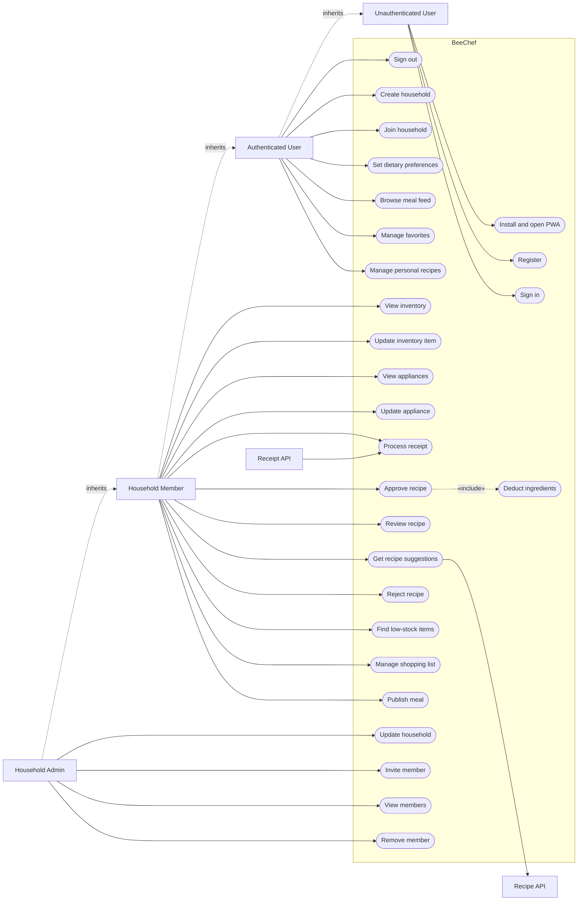
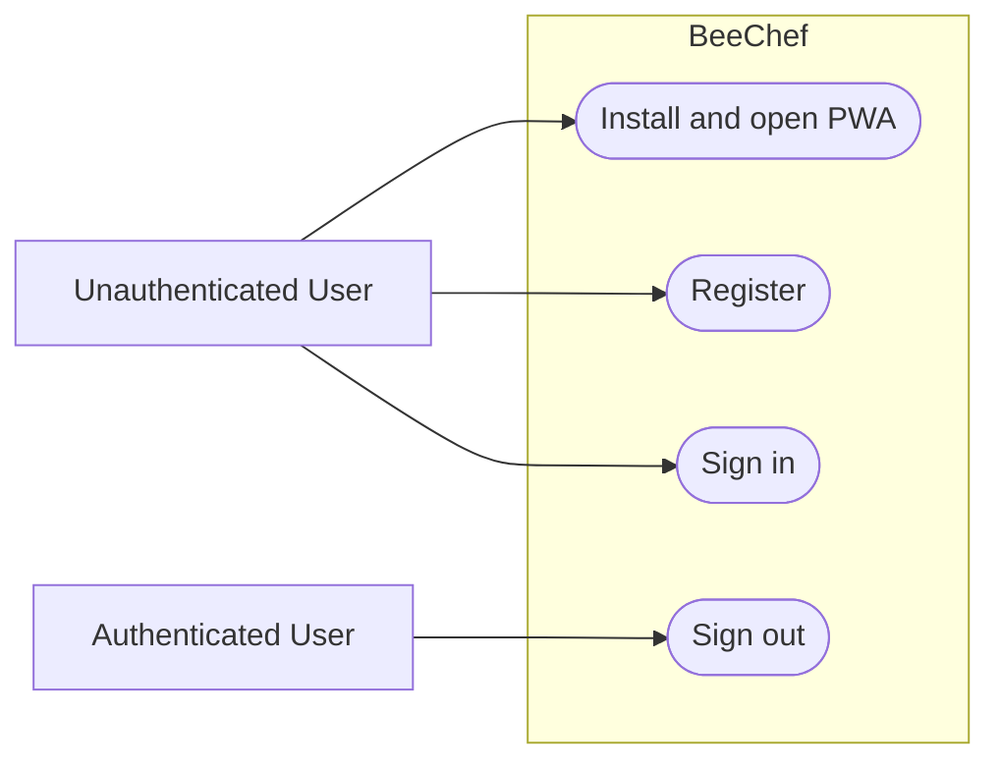
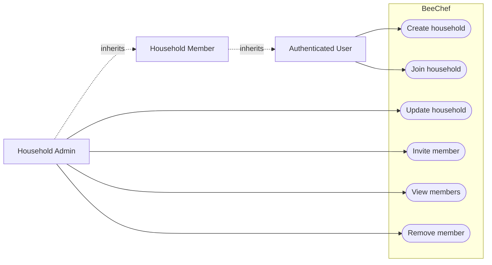
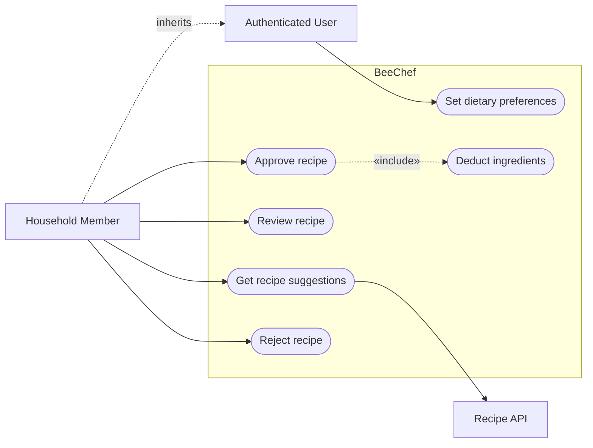
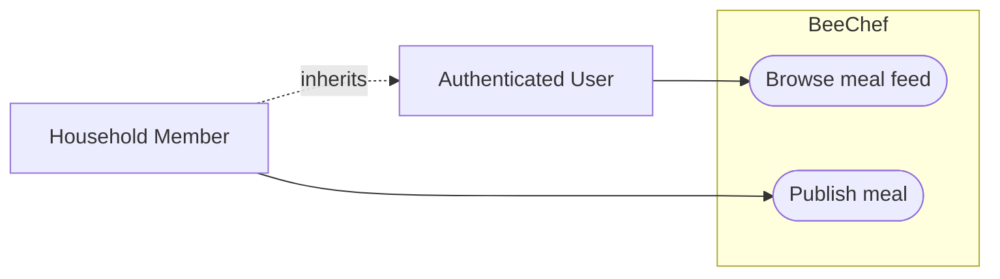
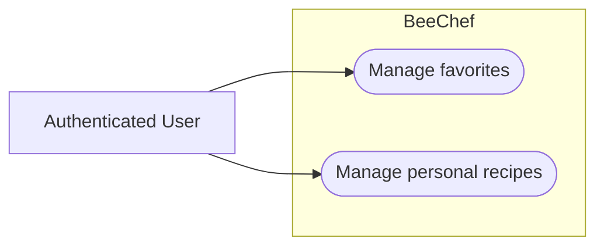
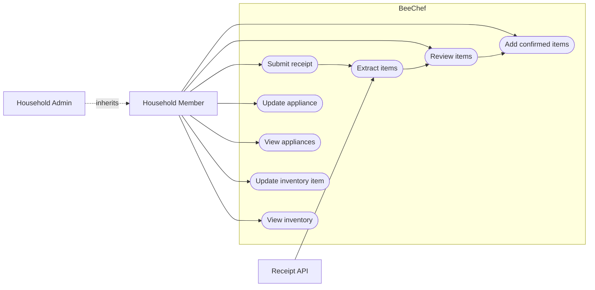
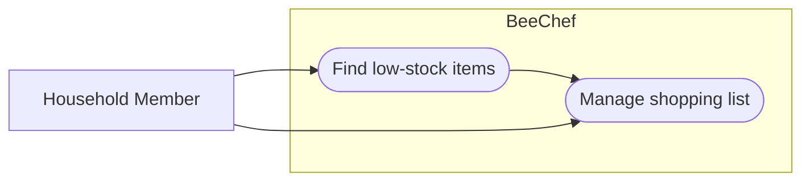

# Software Engineering — Requirements Specification

> **Template instructions:** Replace all text in `[square brackets]` with your project's information. Add or remove rows and repeatable subsections as needed. Keep task (`T-##`), deliverable (`D-##`), and work-breakdown (`WBS-#.#`) IDs consistent with your **Project Plan**; assign unique functional requirement (`FR-##`), non-functional requirement (`NFR-##`), user type (`UT-##`), persona (`P-##`), scenario (`SC-##`), user story (`US-##`), and use case (`UC-##`) IDs in this document. **Cover every planned feature/task with at least one corresponding requirement and use case.** The diagram and table entries below are placeholders, not completed project content.

## Cover Page

| Field | Details |
|---|---|
| **Course** | BLG 411E Software Engineering |
| **Report name** | Requirements Specification |
| **Project title** | BeeChef |
| **Group name / number** | Softies |
| **Group members** | Erdem Toruk 150220083, Eren Söylemez 150230045, Ahmet Yasir Göktepe 150220036, Mehmet Akif Ögrenir 150230097, Celal Gündoğdu 150230007 |
| **Instructor** | Tolga Ovatman |
| **Submission date** | 2026-11-29 |
| **Document version** | 1.2 |

---

## Change Log

Record which parts were added, removed, or updated in each revision. Use the lecture-slide example if the course specifies a format.

| Version | Date | Author(s) | Section(s) affected | Change type | Description of change |
|---|---|---|---|---|---|
| [Version] | [YYYY-MM-DD] | [Name(s)] | [Section number and title] | [Added / Removed / Updated] | [What changed and why] |

---

## 1. Introduction

BeeChef is a web application with PWA capabilities for managing shared household food inventory and supporting meal planning. Users can manage ingredients and appliances, add items manually or from scanned receipts, maintain dietary preferences, and receive AI-generated recipe suggestions based on the household's available resources. Users can review and approve or reject suggestions; approved meals update inventory, while low-stock items can be managed through a shopping list. The system also provides a public feed for sharing meals.

---

## 2. System Requirements

### 2.1 Functional Requirements

| Requirement ID | Related task ID(s) | Related deliverable ID(s) | Functional requirement | Priority | Verification / acceptance condition |
|---|---|---|---|---|---|
| FR-01 | T-01 | D-18 | The CI/CD pipeline shall build the application and run the checks configured for the project. | Must | Submit a change; verify that the pipeline runs and reports its configured build and checks. |
| FR-02 | T-02 | D-18 | The database setup shall provide initialization or migration scripts that prepare a clean PostgreSQL database with the schema required by the application. | Must | Run scripts on a clean PostgreSQL database; verify the schema and application access. |
| FR-03 | T-03 | D-01 | The application shall provide responsive layouts. | Must | Test representative workflows at desktop and mobile widths. |
| FR-04 | T-03 | D-01 | The application shall support installation as a PWA. | Must | Install in a supported browser; verify standalone launch. |
| FR-05 | T-03 | D-01 | After the application shell has been cached, the application shall make that shell available when the device is offline. | Must | Cache the shell, disconnect from the network, and verify it loads. |
| FR-06 | T-04 | D-02 | The system shall allow a user to register an account. | Must | Register valid input and verify account creation; verify invalid input is rejected. |
| FR-07 | T-04 | D-02 | The system shall allow a registered user to sign in with valid credentials and reject invalid credentials. | Must | Verify valid credentials start a session and invalid ones are rejected. |
| FR-08 | T-04 | D-02 | The system shall allow a signed-in user to sign out. | Must | Sign out and verify the session ends. |
| FR-09 | T-04 | D-02 | The system shall restrict functionality requiring authentication to signed-in users. | Must | Request protected functionality while signed out; verify access is denied. |
| FR-10 | T-05 | D-03 | The system shall allow an authenticated user to create a household. | Must | Create a household and verify the creator can access it. |
| FR-11 | T-05 | D-03 | The system shall allow an authorized household member to view and update the household's basic details. | Must | View and update details; verify the changes persist and display. |
| FR-12 | T-05 | D-03 | The system shall allow an authorized household member to invite a user to the household. | Must | Send an invitation; verify its household and invitee. |
| FR-13 | T-05 | D-03 | The system shall allow an invited user to accept an invitation and join the household associated with it. | Must | Accept an invitation; verify membership in the associated household. |
| FR-14 | T-06 | D-04 | The system shall enforce the agreed Admin and Member permission rules for household operations in both the user interface and backend. | Must | Test allowed and denied operations for each role in the UI and backend against the permission matrix. |
| FR-15 | T-07 | D-05 | The system shall allow authorized household members to view household ingredient inventory. | Must | Open inventory; verify items, quantities, and units. |
| FR-16 | T-07 | D-05 | The system shall allow authorized household members to update an inventory ingredient, including its quantity and unit. | Must | Update an ingredient's details, quantity, and unit; verify persistence. |
| FR-17 | T-08 | D-06 | The system shall allow authorized household members to view the household's appliance list. | Must | Open the appliance list; verify current appliances. |
| FR-18 | T-08 | D-06 | The system shall allow authorized household members to update a household appliance. | Must | Update an appliance; verify the change persists and displays. |
| FR-19 | T-08 | D-06 | The system shall make the household's current appliance list available to recipe-generation workflows. | Must | Request recipes; verify the current appliance list is provided. |
| FR-20 | T-09 | D-07 | The system shall allow a user to submit a receipt image for item extraction. | Must | Submit a supported image; verify acceptance and rejection of invalid input. |
| FR-21 | T-09 | D-07 | The system shall extract potential inventory items from a submitted receipt image and present them as candidates. | Must | Submit a receipt; verify candidates are presented for review. |
| FR-22 | T-09 | D-07 | The system shall allow a user to review, correct, select, or discard extracted item candidates before adding them to inventory. | Must | Edit, select, and discard candidates; verify selections are retained for confirmation. |
| FR-23 | T-09 | D-07 | The system shall add only user-confirmed receipt candidates to household inventory. | Must | Confirm candidates; verify only selected items are added. |
| FR-24 | T-10 | D-08 | The system shall allow a user to save and update personal dietary preferences, restrictions, and allergies. | Must | Save and edit preferences; verify they persist for the user. |
| FR-25 | T-11 | D-09 | When a user requests recipe suggestions, the system shall generate them using the applicable household ingredients, appliances, and dietary preferences. | Must | Verify the recipe request uses applicable inventory, appliances, and preferences. |
| FR-26 | T-11 | D-09 | The system shall present the recipe suggestions returned by the recipe-generation service to the user. | Must | Request recipes; verify returned suggestions are displayed. |
| FR-27 | T-11 | D-09 | When the recipe-generation service fails or is unavailable, the system shall inform the user and leave household inventory unchanged. | Must | Simulate service failure; verify feedback and unchanged inventory. |
| FR-28 | T-12 | D-10 | The system shall present generated recipe details to the user for review. | Must | Open a suggestion; verify its details display. |
| FR-29 | T-12 | D-10 | The system shall allow a user to explicitly approve a generated recipe. | Must | Approve a recipe; verify the approval is recorded. |
| FR-30 | T-12 | D-10 | The system shall allow a user to explicitly reject a generated recipe without deducting inventory. | Must | Reject a recipe; verify the rejection is recorded and inventory unchanged. |
| FR-31 | T-13 | D-11 | When a user approves a meal, the system shall deduct the quantities of its used ingredients from household inventory. | Must | Approve a meal; verify its ingredient quantities are deducted. |
| FR-32 | T-13 | D-11 | The system shall apply an approved meal's inventory deduction only once. | Must | Retry the same approval; verify ingredients are deducted only once. |
| FR-33 | T-13 | D-11 | If applying an approved meal's inventory deduction fails, the system shall leave inventory unchanged. | Must | Simulate deduction failure; verify no partial changes persist. |
| FR-34 | T-14 | D-12 | The system shall identify household inventory items whose quantities meet the agreed low-stock condition. | Must | Verify qualifying items are identified and non-qualifying items are not. |
| FR-35 | T-15 | D-13 | The system shall show qualifying low-stock items in the household's interactive shopping list. | Must | Verify qualifying items appear in the shopping list. |
| FR-36 | T-15 | D-13 | The system shall allow authorized household members to update or remove shopping-list entries. | Must | Update and remove entries; verify changes persist and removed items disappear. |
| FR-37 | T-16 | D-14 | The system shall allow a user to publish a meal to the public feed. | Must | Publish a meal; verify it appears in the feed. |
| FR-38 | T-16 | D-14 | The system shall allow a user to browse meals published by other users on the public feed. | Must | Open the feed as another user; verify the meal is visible. |
| FR-39 | T-17 | D-15 | The system should allow a user to save, view, and remove favorite recipes. | Should | Save a favorite, verify it appears, then remove it. |
| FR-40 | T-18 | D-16 | The system should allow a user to create, view, edit, and remove their own recipes. | Should | Create a recipe; verify its owner can view, edit, and remove it. |
| FR-41 | T-05 | D-03 | The system shall allow a household Admin to view the household's current members. | Must | Open household membership; verify current members are displayed. |
| FR-42 | T-05 | D-03 | The system shall allow a household Admin to remove a member from the household. | Must | Remove a member; verify the membership ends and household access is revoked. |

### 2.2 Non-functional Requirements

| Requirement ID | Quality attribute | Non-functional requirement | Applies to | Verification / measurement |
|---|---|---|---|---|
| NFR-01 | Security | The system shall authenticate users with JWT, enforce household role-based permissions, and prevent unauthorized access to household and personal preference data. | Whole system | Test authenticated and unauthenticated requests and verify that each household role can access only permitted operations and data. |
| NFR-02 | Performance | Under normal expected usage, at least 95% of common non-AI actions shall complete within 2 seconds. | FR-11, FR-15–FR-16 | Measure response times for representative non-AI user flows under normal expected usage and verify that at least 95% complete within 2 seconds. Assess AI-powered operations separately because their response times depend on external services. |
| NFR-03 | Usability | The system shall provide a responsive experience optimized for desktop and mobile use, with clear workflows for inventory management, recipe review, and shopping lists. | FR-03, FR-15–FR-16, FR-28, FR-35–FR-36 | Walk through representative tasks on desktop and mobile and collect usability feedback from intended users. |
| NFR-04 | Reliability | The system shall handle failures or unavailable responses from receipt-scanning and recipe-generation APIs without silently applying incorrect inventory changes, and shall allow failed operations to be retried. | FR-20–FR-23, FR-27, FR-31–FR-33 | Simulate API errors and verify that users receive clear feedback, inventory remains consistent, and failed operations can be retried. |

**Non-functional requirement notes / assumptions:**  
The 2-second performance target applies to common non-AI actions.

---

## 3. Use Cases

### 3.1 User Types

| User type ID | User type / actor | Description and responsibilities | Goals / typical actions | Related requirement ID(s) |
|---|---|---|---|---|
| UT-01 | Unauthenticated User | A visitor who has not registered or signed in. | Access the landing page and register or sign in. | FR-06–FR-09 |
| UT-02 | Authenticated User | A registered user who is signed in but has not yet joined or created a household. | Create a household, accept an invitation to join one, and manage personal dietary preferences. | FR-10, FR-13, FR-24 |
| UT-03 | Household Member | An authenticated user who joins a household by accepting an invitation and uses its shared features according to their permissions. | Use shared household features according to the agreed Member permissions. | FR-13–FR-14, FR-15–FR-40 |
| UT-04 | Household Admin | The authenticated user who creates and administers a household. The Admin has all Household Member capabilities. | Perform all actions available to a Household Member and change household settings. | FR-10–FR-12, FR-14–FR-40 |
| UT-05 | AI Recipe Generation API | An external AI service that receives applicable household ingredients, appliances, and user dietary preferences and returns recipe suggestions. | Generate and return recipe suggestions for the user to review. | FR-25–FR-27 |
| UT-06 | Receipt API | An external image-processing service that reads uploaded receipt images and returns extracted item candidates for review. | Process a submitted receipt image and return potential inventory items. | FR-20–FR-23 |

**Access or role distinctions:**  
Guests must register or sign in before accessing protected functionality. An authenticated individual who accepts a household invitation becomes a Household Member; a user who creates a household becomes its Household Admin. The Household Admin inherits Member capabilities and can additionally change household settings. The recipe-generation and receipt-scanning APIs are external system actors, not human user roles.

### 3.2 User Scenarios

#### Personas

Create personas for the user types in Section 3.1. Describe each persona’s goals, context, and needs that affect how they interact with the system.

| Persona ID | Persona name | User type ID | Goals and context | Relevant needs or constraints |
|---|---|---|---|---|
| P-01 | Alex | UT-01, UT-02, UT-04 | Starts as a new user, creates a household, and administers its members and shared resources. | Needs clear role controls and reliable household, inventory, and appliance updates. |
| P-02 | Maya | UT-02, UT-03 | Accepts an invitation and uses household features, including inventory, recipes, and meal sharing. | Needs accurate shared stock, review before receipt items are added, and recipe suggestions that reflect her preferences. |
| P-03 | Omar | UT-01, UT-02 | A returning user who signs in to access personal features and browse the public meal feed. | Needs a clear sign-in state and straightforward access to public content. |

#### Scenario Narratives

**SC-01 — Install and Open BeeChef on a Mobile Device**  
**Persona:** P-01 — Alex  
**Related requirements:** FR-03–FR-05

Alex installs BeeChef as a PWA on his phone. Once its shell is cached, he opens it offline.

**SC-02 — Manage Account Access**  
**Persona:** P-01 — Alex  
**Related requirements:** FR-06–FR-09

Alex registers, signs in to access BeeChef, and later signs out. BeeChef validates registration and credentials, maintains his authenticated session, and blocks protected features after sign-out.

**SC-03 — Manage a Household**  
**Personas:** P-01 — Alex; P-02 — Maya  
**Related requirements:** FR-10–FR-14, FR-41–FR-42

Alex creates a household, updates its details, and invites Maya. Maya accepts the invitation and joins as a Member. Alex can view the member list and remove a member when needed; BeeChef applies household permissions.

**SC-04 — View and Update Inventory**  
**Persona:** P-02 — Maya  
**Related requirements:** FR-14–FR-16

Maya views household ingredients, quantities, and units, then updates an item. BeeChef saves and displays the change if her role permits it.

**SC-05 — View and Update Appliances**  
**Persona:** P-02 — Maya  
**Related requirements:** FR-14, FR-17–FR-19

Maya views and updates the household appliance list. BeeChef saves the change and provides the current list to recipe-generation requests.

**SC-06 — Add Confirmed Receipt Items**  
**Persona:** P-02 — Maya  
**Related requirements:** FR-14, FR-20–FR-23

Maya submits a receipt image and reviews the extracted candidates. She corrects or discards items and confirms which to add; BeeChef adds only confirmed items to inventory.

**SC-07 — Save Dietary Preferences**  
**Persona:** P-02 — Maya  
**Related requirements:** FR-24

Maya saves her dietary preferences, restrictions, and allergies. BeeChef associates them with her account for recipe requests.

**SC-08 — Get Recipe Suggestions**  
**Persona:** P-02 — Maya  
**Related requirements:** FR-19, FR-24–FR-27

Maya requests recipes. BeeChef sends applicable household and preference data to the generation service and displays its suggestions. If the service fails, BeeChef reports the issue and leaves inventory unchanged.

**SC-09 — Review a Suggested Recipe**  
**Persona:** P-02 — Maya  
**Related requirements:** FR-28–FR-33

Maya reviews and may edit a suggestion, then approves or rejects it. Approval deducts required ingredients once; rejection or a failed deduction leaves inventory unchanged.

**SC-10 — Manage the Shopping List**  
**Persona:** P-02 — Maya  
**Related requirements:** FR-34–FR-36

Maya opens the shopping list. BeeChef identifies qualifying low-stock items, which she can update or remove.

**SC-11 — Publish and Browse the Meal Feed**  
**Personas:** P-02 — Maya; P-03 — Omar  
**Related requirements:** FR-37–FR-38

Maya publishes a meal to the public feed. Omar browses the feed and sees meals shared by users, including Maya's.

**SC-12 — Manage Favorite Recipes**  
**Persona:** P-02 — Maya  
**Related requirements:** FR-39

Maya saves a recipe as a favorite, views it later, and removes it when no longer needed.

**SC-13 — Manage Personal Recipes**  
**Persona:** P-02 — Maya  
**Related requirements:** FR-40

Maya creates a personal recipe, then views, edits, or removes it.

#### User Stories Linked to the Project Plan

| Scenario ID | Project Plan WBS activity ID | User story | Related requirement ID(s) |
|---|---|---|---|
| SC-01 | WBS-3.1 | As a BeeChef user, I want a responsive layout for desktop and mobile. | FR-03 |
| SC-01 | WBS-3.2 | As a BeeChef user, I want to install the app and open its cached shell offline. | FR-04–FR-05 |
| SC-02 | WBS-4.1 | As a visitor, I want to register or sign in to access my account's features. | FR-06–FR-07 |
| SC-02 | WBS-4.2 | As a signed-in user, I want secure sessions and sign-out to protect my account. | FR-07–FR-09 |
| SC-03 | WBS-5.1 | As an authenticated user, I want to create a household and maintain its details. | FR-10–FR-11 |
| SC-03 | WBS-5.2 | As a household user, I want to send or accept invitations to join a household. | FR-12–FR-13 |
| SC-03 | WBS-5.3 | As a household Admin, I want to view members and remove a member to manage household membership. | FR-41–FR-42 |
| SC-03–SC-06, SC-08–SC-11 | WBS-6.2 | As a household user, I want role-based permissions enforced for household data and operations. | FR-14 |
| SC-04 | WBS-7.1 | As a household member, I want to view and update ingredient inventory to keep stock current. | FR-15–FR-16 |
| SC-04 | WBS-7.2 | As a household member, I want quantity and unit validation for consistent inventory updates. | FR-16 |
| SC-05 | WBS-8.1 | As a household member, I want to view and update the appliance list to reflect available equipment. | FR-17–FR-18 |
| SC-05, SC-08 | WBS-8.2 | As a recipe requester, I want suggestions to use current household appliances. | FR-19, FR-25 |
| SC-06 | WBS-9.1 | As a household member, I want to submit a receipt image for item extraction. | FR-20 |
| SC-06 | WBS-9.3 | As a household member, I want to review, correct, and confirm receipt items before adding them. | FR-22–FR-23 |
| SC-07 | WBS-10.1 | As a user, I want to save and update my dietary preferences and restrictions. | FR-24 |
| SC-08 | WBS-11.2 | As a household user, I want context-based recipe suggestions to find suitable meals. | FR-25–FR-27 |
| SC-09 | WBS-12.1 | As a household user, I want to review a suggested recipe before deciding to prepare it. | FR-28 |
| SC-09 | WBS-12.2 | As a household user, I want my approval or rejection recorded before stock changes. | FR-29–FR-30 |
| SC-09 | WBS-13.2 | As a household user, I want approved recipes to deduct ingredients once without partial updates on failure. | FR-31–FR-33 |
| SC-10 | WBS-14.2 | As a household member, I want low-stock ingredients identified for replenishment. | FR-34 |
| SC-10 | WBS-15.1 | As a household member, I want to view and manage shopping-list entries. | FR-35–FR-36 |
| SC-10 | WBS-15.2 | As a household member, I want qualifying low-stock items added to the shopping list. | FR-34–FR-35 |
| SC-11 | WBS-16.1 | As a user, I want to publish meals for others to see. | FR-37 |
| SC-11 | WBS-16.2 | As a user, I want to browse meals shared by others. | FR-38 |
| SC-12 | WBS-17.1 | As a user, I want to save and remove favorite recipes. | FR-39 |
| SC-12 | WBS-17.2 | As a user, I want to view my favorites later. | FR-39 |
| SC-13 | WBS-18.1 | As a user, I want to create and edit personal recipes. | FR-40 |
| SC-13 | WBS-18.2 | As a user, I want to view and remove personal recipes. | FR-40 |

### 3.3 Use Case Diagrams

#### 3.3.1 Whole-System Use Case Diagram

**Whole-system diagram notes:**  
The diagram shows BeeChef's actors, system boundary, and use cases. Household roles inherit the capabilities of the roles below them.

#### 3.3.2 Application Access and Authentication

**Functionality covered:** T-03–T-04 / FR-03–FR-09  
**Diagram notes:** Covers PWA access, account registration, sign-in, and sign-out.

#### 3.3.3 Household Creation and Membership

**Functionality covered:** T-05–T-06 / FR-10–FR-14, FR-41–FR-42  
**Diagram notes:** Household Admin inherits Household Member capabilities and can manage household details, invitations, and membership.

#### 3.3.4 Recipe Planning and Preparation

**Functionality covered:** T-08, T-10–T-13 / FR-19, FR-24–FR-33  
**Diagram notes:** Suggestions use household appliances and saved dietary preferences. Approval deducts ingredients once; rejection leaves inventory unchanged.

#### 3.3.5 Public Meal Feed

**Functionality covered:** T-16 / FR-37–FR-38  
**Diagram notes:** Users browse the public feed; household members can publish meals.

#### 3.3.6 Favorite and User-Created Recipes

**Functionality covered:** T-17–T-18 / FR-39–FR-40  
**Diagram notes:** Covers the personal recipe features.

#### 3.3.7 Household Inventory and Receipt Intake

**Functionality covered:** T-06–T-09 / FR-14–FR-23  
**Diagram notes:** Authorized household members manage inventory and appliances. Only receipt candidates they confirm are added to inventory.

#### 3.3.8 Low-Stock Items and Shopping List

**Functionality covered:** T-14–T-15 / FR-34–FR-36  
**Diagram notes:** Qualifying low-stock ingredients are shown in the shopping list.

### 3.4 Use Cases

Write **at least one detailed use case for each feature/functional requirement from the Project Plan**, including **alternative flows**. One use case may reference multiple requirements if they form a single user goal, but no planned feature should be left undocumented. Use matching IDs across tables, diagrams, and use case descriptions.

#### 3.4.1 Use Case Coverage Matrix

| Project Plan task ID | Functional requirement ID(s) | Use case ID(s) | Scenario ID(s) |
|---|---|---|---|
| T-01 | FR-01 | — | — |
| T-02 | FR-02 | — | — |
| T-03 | FR-03–FR-05 | UC-01 | SC-01 |
| T-04 | FR-06–FR-09 | UC-02 | SC-02 |
| T-05 | FR-10–FR-13, FR-41–FR-42 | UC-03 | SC-03 |
| T-06 | FR-14 | UC-03–UC-06 | SC-03–SC-06 |
| T-07 | FR-15–FR-16 | UC-04 | SC-04 |
| T-08 | FR-17–FR-19 | UC-05, UC-08 | SC-05, SC-08 |
| T-09 | FR-20–FR-23 | UC-06 | SC-06 |
| T-10 | FR-24 | UC-07–UC-08 | SC-07–SC-08 |
| T-11 | FR-25–FR-27 | UC-08 | SC-08 |
| T-12 | FR-28–FR-30 | UC-09 | SC-09 |
| T-13 | FR-31–FR-33 | UC-09 | SC-09 |
| T-14 | FR-34 | UC-10 | SC-10 |
| T-15 | FR-35–FR-36 | UC-10 | SC-10 |
| T-16 | FR-37–FR-38 | UC-11 | SC-11 |
| T-17 | FR-39 | UC-12 | SC-12 |
| T-18 | FR-40 | UC-13 | SC-13 |
| T-19–T-24 | — | — | — |

T-01 (CI/CD configuration), T-02 (database initialization), and T-19–T-24 (documentation and delivery) are internal project activities, not user-goal use cases.

#### 3.4.2 UC-01 — Install BeeChef PWA

| Field | Description |
|---|---|
| **Use case ID** | UC-01 |
| **Use case name** | Install BeeChef PWA |
| **Goal** | Use BeeChef on mobile and open its cached shell offline. |
| **Actor(s)** | UT-01 — Unauthenticated User |
| **Related Project Plan task(s)** | T-03 |
| **Related functional requirement(s)** | FR-03–FR-05 |

**Pre-condition(s):**  
BeeChef is online; the user has a supported mobile browser.

**Main success flow:**

1. **Actor:** Opens BeeChef in a mobile browser.
2. **System:** Displays a responsive layout.
3. **Actor:** Installs BeeChef as a PWA.
4. **System:** Installs the app and caches its shell.
5. **Actor:** Disconnects from the network and opens the app.
6. **System:** Loads the cached shell.

**Alternative flows:**

- **A1 — Continue in the browser (branches from step 3):**
  1. The actor skips installation and continues in the browser.
  2. BeeChef retains its responsive layout; offline availability is not established.

**Exception / error flows (if applicable):**

None specified.

**Post-condition(s):**  
The installed app loads its cached shell offline. BeeChef remains available in the responsive browser while online.

#### 3.4.3 UC-02 — Manage Account Access

| Field | Description |
|---|---|
| **Use case ID** | UC-02 |
| **Use case name** | Manage Account Access |
| **Goal** | Register, sign in, and sign out of BeeChef. |
| **Actor(s)** | UT-01 — Unauthenticated User; UT-02 — Authenticated User |
| **Related Project Plan task(s)** | T-04 |
| **Related functional requirement(s)** | FR-06–FR-09 |

**Pre-condition(s):**  
The actor can access BeeChef; signing out requires an active session.

**Main success flow:**

1. **Actor:** Opens account access and chooses registration.
2. **System:** Displays the registration form.
3. **Actor:** Enters and submits the required information.
4. **System:** Validates the input, creates the account, and confirms registration.
5. **Actor:** Submits the account credentials.
6. **System:** Verifies them, starts a session, and grants permitted access.
7. **Actor:** Later selects sign out and confirms.
8. **System:** Ends the session and blocks access to protected features.

**Alternative flows:**

- **A1 — Existing account (branches from step 1):** The actor chooses sign-in and continues at step 5.
- **A2 — Invalid registration input (step 4):** The system reports the error and creates no account; the actor may correct and resubmit at step 3.
- **A3 — Invalid credentials (step 6):** The system rejects sign-in; the actor may retry at step 5 or exit.
- **A4 — Cancel sign-out (step 7):** The actor cancels; the session remains active.

**Exception / error flows (if applicable):**

- **E1 — Registration fails (step 4):** The system reports failure and does not claim an account was created.
- **E2 — Sign-in fails (step 6):** The system reports failure and does not start a session.
- **E3 — Sign-out fails (step 8):** The system reports failure and does not claim the session ended.

**Post-condition(s):**  
The account exists and the session is ended in the main flow. Failed registration creates no account; failed sign-in leaves the actor unauthenticated; canceled or failed sign-out leaves the session active.

#### 3.4.4 UC-03 — Manage a Household

| Field | Description |
|---|---|
| **Use case ID** | UC-03 |
| **Use case name** | Manage a Household |
| **Goal** | Create and update a household, manage invitations, and view or remove members. |
| **Actor(s)** | UT-02 — Authenticated User; UT-04 — Household Admin |
| **Related Project Plan task(s)** | T-05, T-06 |
| **Related functional requirement(s)** | FR-10–FR-14, FR-41–FR-42 |

**Pre-condition(s):**  
The creator and invitee are signed in; household updates and invitations require Admin permission.

**Main success flow:**

1. **Actor:** Starts household creation.
2. **System:** Displays the creation form.
3. **Actor:** Submits household details.
4. **System:** Creates the household and assigns the creator as Admin.
5. **Admin:** Updates household details and submits the changes.
6. **System:** Saves the updated details.
7. **Admin:** Submits an invitation for another user.
8. **System:** Associates the invitation with the household and invitee.
9. **Invitee:** Opens and accepts the invitation.
10. **System:** Verifies it, adds the invitee as a Member, and confirms membership.
11. **Admin:** Opens the household member list.
12. **System:** Displays the current members.
13. **Admin:** Selects a member and confirms removal.
14. **System:** Removes the member and confirms the change.

**Alternative flows:**

- **A1 — Existing household (step 1):** The Admin opens household settings and continues at step 5.
- **A2 — Cancel creation (step 3):** No household is created.
- **A3 — Cancel update (step 5):** The system retains saved details; the Admin may continue at step 7.
- **A4 — Cancel invitation (step 7):** No invitation is created.
- **A5 — Decline invitation (step 9):** The invitee is not added to the household.
- **A6 — Manage existing membership (branches from step 1):** The Admin opens an existing household and continues at step 11. After step 12, the Admin may end the flow or continue at step 13 to remove a member.
- **A7 — Cancel removal (step 13):** Membership remains unchanged.

**Exception / error flows (if applicable):**

- **E1 — Creation fails (step 4):** The system reports failure and does not claim the household was created.
- **E2 — Update fails (step 6):** The system reports failure and retains the saved details.
- **E3 — Invitation fails (step 8):** The system reports failure and does not claim it was created.
- **E4 — Invitation cannot be accepted (step 10):** The system reports failure and does not add the invitee.
- **E5 — Member list fails to load (step 12):** The system reports failure and makes no membership change.
- **E6 — Removal fails (step 14):** The system reports failure and retains the member's membership.

**Post-condition(s):**  
In the main flow, the household, updates, invitation, and membership changes are saved. A2/E1 leave no new household; A3/E2 retain saved details; A4/E3 create no invitation; A5/E4 do not add the invitee; A6 views membership without changing it; A7/E6 retain the member.

#### 3.4.5 UC-04 — Manage Inventory

| Field | Description |
|---|---|
| **Use case ID** | UC-04 |
| **Use case name** | Manage Inventory |
| **Goal** | View and update household ingredients, quantities, and units. |
| **Actor(s)** | UT-03 — Household Member |
| **Related Project Plan task(s)** | T-06–T-07 |
| **Related functional requirement(s)** | FR-14–FR-16 |

**Pre-condition(s):**  
The signed-in actor belongs to the household and has inventory access.

**Main success flow:**

1. **Actor:** Opens the household inventory.
2. **System:** Displays current ingredients, quantities, and units.
3. **Actor:** Selects an item, edits its details, quantity, or unit, and submits.
4. **System:** Saves and displays the update.

**Alternative flows:**

- **A1 — Inventory is empty (step 2):** The system displays the empty state; no update is made.
- **A2 — Actor cancels the update (step 3):** The system retains the saved item.

**Exception / error flows (if applicable):**

- **E1 — Inventory cannot be retrieved (step 2):** The system reports that it could not load.
- **E2 — Update fails (step 4):** The system reports failure and retains the saved item.

**Post-condition(s):**  
The current inventory is displayed and any successful update is saved.

#### 3.4.6 UC-05 — Manage Appliances

| Field | Description |
|---|---|
| **Use case ID** | UC-05 |
| **Use case name** | Manage Appliances |
| **Goal** | View and update household appliances used for recipe suggestions. |
| **Actor(s)** | UT-03 — Household Member |
| **Related Project Plan task(s)** | T-06, T-08 |
| **Related functional requirement(s)** | FR-14, FR-17–FR-19 |

**Pre-condition(s):**  
The signed-in actor belongs to the household and has appliance access.

**Main success flow:**

1. **Actor:** Opens the household appliance list.
2. **System:** Displays current appliances.
3. **Actor:** Selects an appliance, edits its details, and submits.
4. **System:** Saves the update and makes the current list available to recipe-generation workflows.

**Alternative flows:**

- **A1 — No appliances are listed (step 2):** The system displays the empty state.
- **A2 — Actor cancels the update (step 3):** The system retains the saved appliance details.

**Exception / error flows (if applicable):**

- **E1 — Appliance list cannot be retrieved (step 2):** The system reports that it could not load.
- **E2 — Update fails (step 4):** The system reports failure and retains the saved appliance details.

**Post-condition(s):**  
The current appliance list is displayed and available to recipe-generation workflows.

#### 3.4.7 UC-06 — Add Receipt Items

| Field | Description |
|---|---|
| **Use case ID** | UC-06 |
| **Use case name** | Add Receipt Items |
| **Goal** | Extract receipt items and add only those the user confirms. |
| **Actor(s)** | UT-03 — Household Member; UT-06 — Receipt API |
| **Related Project Plan task(s)** | T-06, T-09 |
| **Related functional requirement(s)** | FR-14, FR-20–FR-23 |

**Pre-condition(s):**  
The signed-in actor belongs to the household and can add inventory items.

**Main success flow:**

1. **Actor:** Submits a receipt image.
2. **System:** Sends it to the receipt-scanning service.
3. **Receipt API:** Returns item candidates.
4. **System:** Presents candidates for review.
5. **Actor:** Corrects names, quantities, or units; selects items and confirms.
6. **System:** Adds only confirmed items to inventory and reports the result.

**Alternative flows:**

- **A1 — Actor discards candidates (branches from step 5):**
  1. The actor discards candidates and confirms the remaining selection.
  2. The system adds only confirmed candidates.
- **A2 — No candidates are confirmed (branches from step 5):**
  1. The actor confirms no candidates; inventory remains unchanged.

**Exception / error flows (if applicable):**

- **E1 — Invalid image (step 1):** The system rejects it and reports that it cannot be processed.
- **E2 — Scanning fails (step 2):** The system reports failure; inventory is unchanged.
- **E3 — Items cannot be added (step 6):** The system reports failure and does not claim items were added.

**Post-condition(s):**  
Only confirmed candidates are added.

#### 3.4.8 UC-07 — Set Dietary Preferences

| Field | Description |
|---|---|
| **Use case ID** | UC-07 |
| **Use case name** | Set Dietary Preferences |
| **Goal** | Save dietary preferences, restrictions, and allergies for recipe requests. |
| **Actor(s)** | UT-02 — Authenticated User |
| **Related Project Plan task(s)** | T-10 |
| **Related functional requirement(s)** | FR-24 |

**Pre-condition(s):**  
The actor is signed in and can access personal preferences.

**Main success flow:**

1. **Actor:** Opens personal dietary preferences.
2. **System:** Displays saved values, if any.
3. **Actor:** Enters or updates preferences, restrictions, and allergies, then submits.
4. **System:** Saves the values to the actor's account and confirms.

**Alternative flows:**

- **A1 — Actor cancels the update (branches from step 3):**
  1. The actor cancels; the system retains saved preferences.

**Exception / error flows (if applicable):**

- **E1 — Save fails (step 4):** The system reports failure and retains saved preferences.

**Post-condition(s):**  
Preferences are saved for recipe requests.

#### 3.4.9 UC-08 — Get Recipe Suggestions

| Field | Description |
|---|---|
| **Use case ID** | UC-08 |
| **Use case name** | Get Recipe Suggestions |
| **Goal** | Get suggestions based on household ingredients, appliances, and dietary preferences. |
| **Actor(s)** | UT-03 — Household Member; UT-05 — AI Recipe Generation API |
| **Related Project Plan task(s)** | T-08, T-10, T-11 |
| **Related functional requirement(s)** | FR-19, FR-24–FR-27 |

**Pre-condition(s):**  
The signed-in actor belongs to a household and can request recipes using household and personal data.

**Main success flow:**

1. **Actor:** Requests recipe suggestions.
2. **System:** Collects household ingredients, appliances, and the actor's saved preferences and sends them to the AI service.
3. **AI Recipe Generation API:** Returns suggestions.
4. **System:** Displays the suggestions.

**Alternative flows:**

- **A1 — No suggestions are returned (branches from step 4):**
  1. The service returns no suggestions; the system informs the actor.
  2. Inventory remains unchanged.

**Exception / error flows (if applicable):**

- **E1 — Service fails or is unavailable (step 2 or 3):** The system reports that suggestions could not be generated; inventory is unchanged.

**Post-condition(s):**  
Returned suggestions are displayed.

#### 3.4.10 UC-09 — Review Recipe

| Field | Description |
|---|---|
| **Use case ID** | UC-09 |
| **Use case name** | Review Recipe |
| **Goal** | Review, optionally edit, and approve or reject a suggestion; approval updates inventory once. |
| **Actor(s)** | UT-03 — Household Member |
| **Related Project Plan task(s)** | T-12, T-13 |
| **Related functional requirement(s)** | FR-28–FR-33 |

**Pre-condition(s):**  
The signed-in actor belongs to the household and has a suggestion to review.

**Main success flow:**

1. **Actor:** Opens a suggestion.
2. **System:** Displays its ingredients, instructions, and relevant context.
3. **Actor:** Approves the recipe.
4. **System:** Records approval, calculates required deductions, applies them once, and confirms.

**Alternative flows:**

- **A1 — Edit the suggested recipe (branches from step 2):**
  1. The actor edits ingredients or quantities and submits the changes.
  2. The system updates the suggestion and returns to step 2 for review.
- **A2 — Reject the recipe (branches from step 3):**
  1. The actor rejects the recipe; the system records the rejection and leaves inventory unchanged.
- **A3 — Approval request is repeated (branches from step 4):**
  1. The actor retries the same approval; the system recognizes it and does not deduct again.

**Exception / error flows (if applicable):**

- **E1 — Deduction fails (step 4):** The system reports failure and leaves inventory unchanged, without a partial deduction.

**Post-condition(s):**  
Approval is recorded and the final recipe's ingredient quantities are deducted once. Rejection or failure leaves inventory unchanged.

#### 3.4.11 UC-10 — Manage Shopping List

| Field | Description |
|---|---|
| **Use case ID** | UC-10 |
| **Use case name** | Manage Shopping List |
| **Goal** | Identify low-stock ingredients and manage shopping-list entries. |
| **Actor(s)** | UT-03 — Household Member |
| **Related Project Plan task(s)** | T-14, T-15 |
| **Related functional requirement(s)** | FR-34–FR-36 |

**Pre-condition(s):**  
The signed-in actor belongs to the household and can access its inventory and shopping list.

**Main success flow:**

1. **Actor:** Opens the household shopping list.
2. **System:** Identifies items meeting the agreed low-stock condition and displays them in the list.
3. **Actor:** Updates a list entry.
4. **System:** Saves and displays the change.

**Alternative flows:**

- **A1 — Remove a shopping-list entry (branches from step 3):**
  1. The actor removes the selected entry; the system updates the list.
- **A2 — No items meet the low-stock condition (branches from step 2):**
  1. The system displays no newly identified items; the actor may still manage existing entries.

**Exception / error flows (if applicable):**

- **E1 — List cannot be loaded or updated (step 2 or 4):** The system reports failure.

**Post-condition(s):**  
The list displays qualifying low-stock items and saved changes; removed entries no longer appear.

#### 3.4.12 UC-11 — Publish and Browse Meal Feed

| Field | Description |
|---|---|
| **Use case ID** | UC-11 |
| **Use case name** | Publish and Browse Meal Feed |
| **Goal** | Publish a meal and browse meals shared by users. |
| **Actor(s)** | UT-03 — Household Member; UT-02 — Authenticated User |
| **Related Project Plan task(s)** | T-16 |
| **Related functional requirement(s)** | FR-37–FR-38 |

**Pre-condition(s):**  
The actors are signed in; the publishing actor can access the meal form.

**Main success flow:**

1. **Household Member:** Submits meal information.
2. **System:** Publishes the meal and confirms.
3. **Authenticated User:** Opens the public feed.
4. **System:** Retrieves and displays published meals, including the new meal.

**Alternative flows:**

- **A1 — Browse without publishing (step 1):** The authenticated user skips publishing and continues at step 3.
- **A2 — No meals are available (step 4):** The system displays an empty-feed state.

**Exception / error flows (if applicable):**

- **E1 — Publishing fails (step 2):** The system reports failure and does not claim the meal was published.
- **E2 — Feed cannot be retrieved (step 4):** The system reports that it could not load.

**Post-condition(s):**  
In the main flow, the meal is published and displayed in the feed. A1 only browses; if that feed is empty, A2 displays its empty state.

#### 3.4.13 UC-12 — Manage Favorites

| Field | Description |
|---|---|
| **Use case ID** | UC-12 |
| **Use case name** | Manage Favorites |
| **Goal** | Save, view, and remove favorite recipes. |
| **Actor(s)** | UT-02 — Authenticated User |
| **Related Project Plan task(s)** | T-17 |
| **Related functional requirement(s)** | FR-39 |

**Pre-condition(s):**  
The actor is signed in and can access favorites.

**Main success flow:**

1. **Actor:** Opens the favorites list.
2. **System:** Displays saved recipes.
3. **Actor:** Opens a recipe and chooses to save it as a favorite.
4. **System:** Saves it and displays the updated list.

**Alternative flows:**

- **A1 — Remove a favorite (branches from step 2):**
  1. The actor removes a recipe; the system updates the list.
- **A2 — No favorites are saved (branches from step 2):**
  1. The system displays an empty favorites state.

**Exception / error flows (if applicable):**

- **E1 — Favorites cannot be retrieved or saved (step 2 or 4):** The system reports failure and does not claim unsaved changes.

**Post-condition(s):**  
The list reflects saved or removed recipes; the original recipe is unchanged.

#### 3.4.14 UC-13 — Manage Personal Recipes

| Field | Description |
|---|---|
| **Use case ID** | UC-13 |
| **Use case name** | Manage Personal Recipes |
| **Goal** | Create, view, edit, and remove personal recipes. |
| **Actor(s)** | UT-02 — Authenticated User |
| **Related Project Plan task(s)** | T-18 |
| **Related functional requirement(s)** | FR-40 |

**Pre-condition(s):**  
The actor is signed in and can access personal recipes.

**Main success flow:**

1. **Actor:** Opens personal recipes.
2. **System:** Displays saved recipes and the create option.
3. **Actor:** Chooses to create a recipe.
4. **System:** Displays the recipe form.
5. **Actor:** Enters and submits recipe information.
6. **System:** Saves it to the actor's account and displays it.

**Alternative flows:**

- **A1 — View an existing recipe (branches from step 2):**
  1. The actor selects a saved recipe; the system displays its details.
- **A2 — Edit an existing recipe (branches from step 2):**
  1. The actor selects and edits a saved recipe, then submits the changes.
  2. The system saves and displays the update.
- **A3 — Remove an existing recipe (branches from step 2):**
  1. The actor removes a saved recipe; the system updates the list.

**Exception / error flows (if applicable):**

- **E1 — Recipes cannot be loaded (step 2):** The system reports the failure.
- **E2 — Creation fails (step 6):** The system reports failure and does not claim the recipe was saved.
- **E3 — Update fails (A2, step 2):** The system reports failure and retains the saved recipe.
- **E4 — Removal fails (A3, step 1):** The system reports failure and retains the recipe.

**Post-condition(s):**  
Personal recipes reflect successful changes.

---

## 4. User Interface Model

Choose **7 to 10 distinct screens** that demonstrate the most important user workflows. Use one representative screen when layouts and interactions are similar. Prepare mock-ups with a tool of your choice and map each screen to its user stories and Project Plan components.

| Screen ID | Screen name | User story ID(s) | Project Plan component(s) | Related requirement or use case ID(s) |
|---|---|---|---|---|
| UI-01 | [Screen name] | US-01, [US-##] | [Component name and plan ID, if assigned] | FR-01, UC-01 |

### 4.1 UI-01 — [Screen Name]

[Embed the screen mock-up here. Repeat this subsection for each selected screen and add its row to the mapping table.]

[Explain who uses the screen, what each visible element does, how users reach and leave the screen, and how its interactions support the linked user stories and components. Describe any important feedback or error states shown.]

---

## 5. Flow Diagrams

### 5.1 General Data Model

[Insert an entity–relationship diagram for the data stored in the project database.]

[Explain each entity and its purpose, significant attributes, primary and foreign keys, and each relationship’s cardinality and optionality. Describe any business rules that affect these relationships.]

### 5.2 Important Data Considerations

Describe any applicable data formats and exchange mechanisms. Examples include JSON or XML payloads and asynchronous requests using Ajax.

| Interface or data exchange | Format or mechanism | Reason for choice | Validation or compatibility constraints |
|---|---|---|---|
| [Where data is exchanged or imported/exported] | [Format and/or mechanism] | [Why it fits this exchange] | [Schema, encoding, or relevant rules] |

[Explain how each choice affects the systems or components using it. If no special data considerations apply, briefly explain why.]

### 5.3 Data Flow Diagrams

Provide diagrams for **Levels 0, 1, and 2**. Explain all external entities, processes, data stores, and named data flows shown at each level. Use consistent names and check that the inputs and outputs of each decomposed process match its parent diagram.

#### 5.3.1 Level 0

[Insert the context diagram. Show the system as a single process and explain the data it exchanges with each external entity.]

#### 5.3.2 Level 1

[Insert the Level 1 diagram. Explain the system’s main processes, the data stores they use, and how data moves among processes, stores, and external entities.]

#### 5.3.3 Level 2

[Insert a Level 2 diagram for a Level 1 process. Identify the parent process, explain each subprocess and its data flows, and show how the parent’s inputs and outputs are accounted for. Repeat for additional processes where more detail is needed.]

