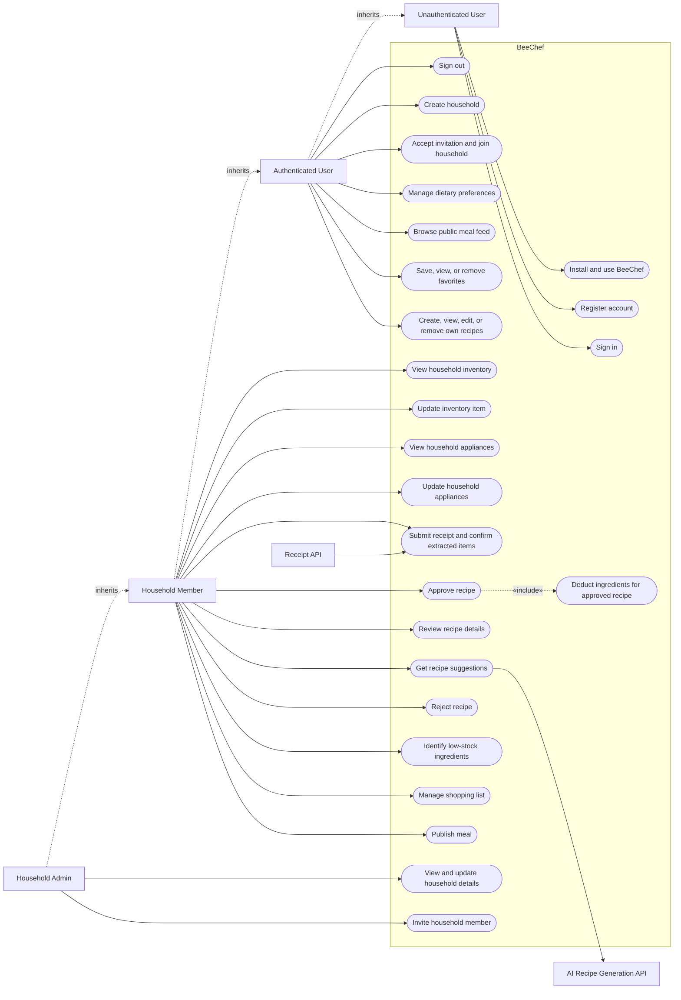
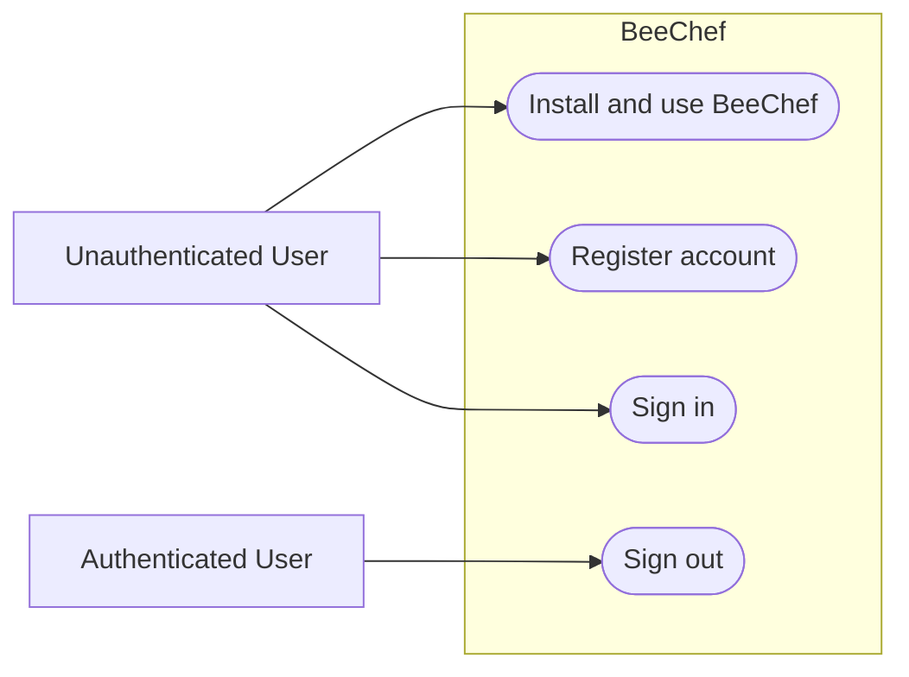
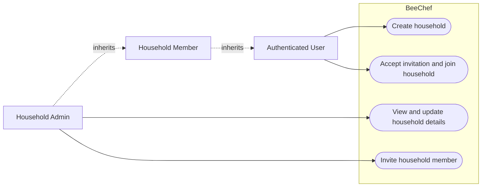
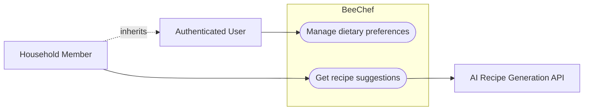
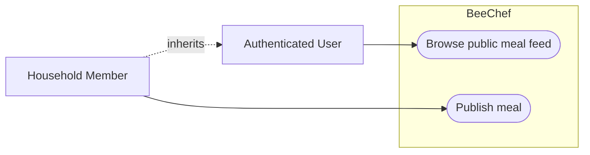
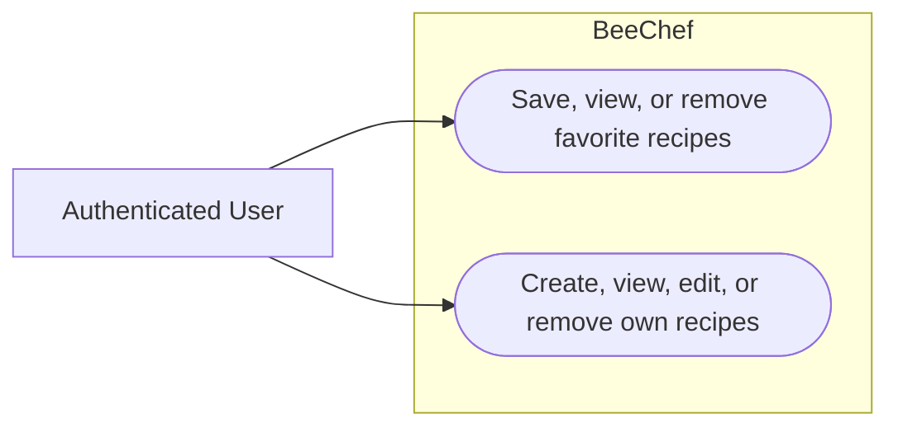
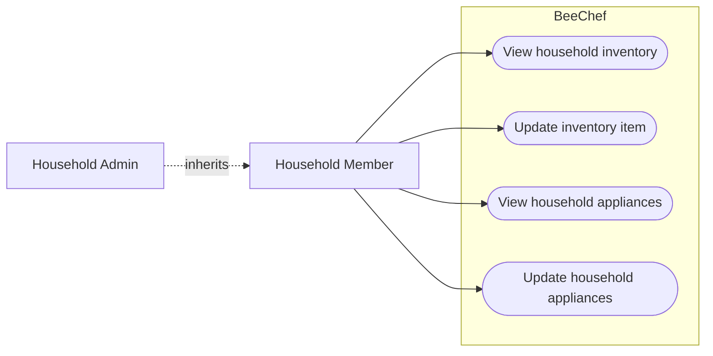
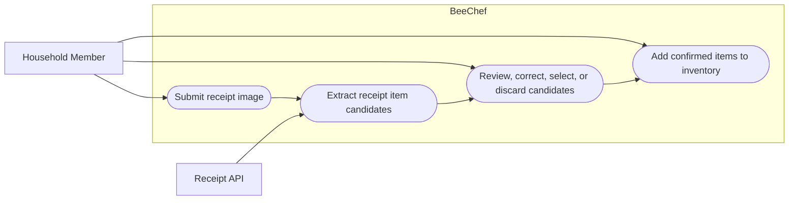
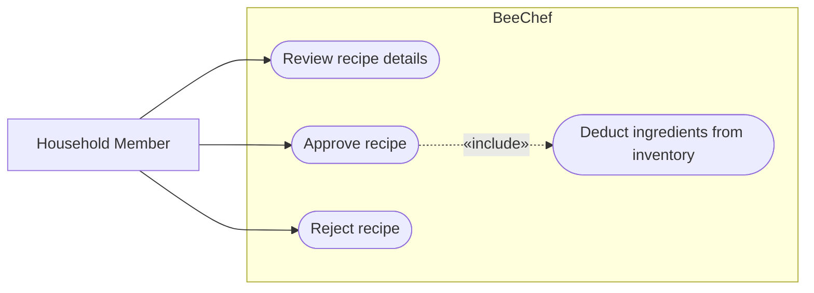
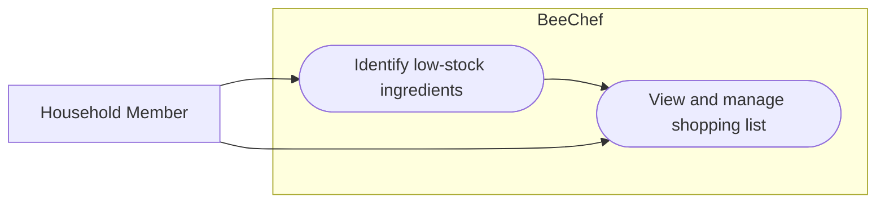

# Software Engineering — Requirements Specification

## Cover Page

| Field | Details |
|---|---|
| **Course** | BLG 411E Software Engineering |
| **Report name** | Requirements Specification |
| **Project title** | BeeChef |
| **Group name / number** | Softies |
| **Group members** | Erdem Toruk 150220083, Eren Söylemez 150230045, Ahmet Yasir Göktepe 150220036, Mehmet Akif Ögrenir 150230097, Celal Gündoğdu 150230007 |
| **Instructor** | Tolga Ovatman |
| **Submission date** | 2026-11-07 |
| **Document version** | 1.0 |

---

## 1. Introduction

BeeChef is a web application with PWA capabilities for managing shared household food inventory and supporting meal planning. Users can manage ingredients and appliances, add items manually or from scanned receipts, maintain dietary preferences, and receive AI-generated recipe suggestions based on the household's available resources. Users can review and approve or reject suggestions; approved meals update inventory, while low-stock items can be managed through a shopping list. The system also provides a public feed for sharing meals.

This document defines BeeChef's functional and non-functional requirements and describes the user-facing behavior expected within the project scope. It is intended to guide implementation and verification, with requirements traceable to the tasks and deliverables in the Project Plan.

---

## 2. System Requirements

### 2.1 Functional Requirements

| Requirement ID | Related task ID(s) | Related deliverable ID(s) | Functional requirement | Priority | Verification / acceptance condition |
|---|---|---|---|---|---|
| FR-01 | T-01 | D-23 | The CI/CD pipeline shall build the application and run the checks configured for the project. | Must | Submit a change and verify that the pipeline runs the build and configured checks and reports their results. |
| FR-02 | T-02 | D-23 | The database setup shall provide initialization or migration scripts that prepare a clean PostgreSQL database with the schema required by the application. | Must | Run the scripts against a clean database and verify that the required schema is created and the application can use it. |
| FR-03 | T-03 | D-01 | The application shall provide responsive layouts. | Must | Verify that representative workflows are usable at representative desktop and mobile widths. |
| FR-04 | T-03 | D-01 | The application shall support installation as a PWA. | Must | Install the application as a PWA on a supported browser and verify that it launches as an installed application. |
| FR-05 | T-03 | D-01 | After the application shell has been cached, the application shall make that shell available when the device is offline. | Must | Cache the application shell, disconnect the device from the network, and verify that the shell loads. |
| FR-06 | T-04 | D-02 | The system shall allow a user to register an account. | Must | Register a new user and verify that an account is created; verify that invalid registration input is rejected. |
| FR-07 | T-04 | D-02 | The system shall allow a registered user to sign in with valid credentials and reject invalid credentials. | Must | Verify that valid credentials start an authenticated session and invalid credentials are rejected. |
| FR-08 | T-04 | D-02 | The system shall allow a signed-in user to sign out. | Must | Sign out and verify that the user's authenticated session is ended. |
| FR-09 | T-04 | D-02 | The system shall restrict functionality requiring authentication to signed-in users. | Must | Attempt to access protected functionality while signed out and verify that access is denied. |
| FR-10 | T-05 | D-03 | The system shall allow an authenticated user to create a household. | Must | Create a household and verify that it is available to its creator. |
| FR-11 | T-05 | D-03 | The system shall allow an authorized household member to view and update the household's basic details. | Must | View the household details, update them, and verify that the changes are saved and displayed. |
| FR-12 | T-05 | D-03 | The system shall allow an authorized household member to invite a user to the household. | Must | Send an invitation and verify that it is associated with the intended household and invitee. |
| FR-13 | T-05 | D-03 | The system shall allow an invited user to accept an invitation and join the household associated with it. | Must | Accept an invitation and verify that the user becomes a member of the correct household. |
| FR-14 | T-06 | D-04 | The system shall enforce the agreed Admin and Member permission rules for household operations in both the user interface and backend. | Must | For each role, verify permitted and forbidden operations through the user interface and backend endpoints against the agreed permission matrix. |
| FR-15 | T-07 | D-05 | The system shall allow authorized household members to view household ingredient inventory. | Must | Open the inventory and verify that its current ingredient items, quantities, and units are displayed. |
| FR-16 | T-07 | D-05 | The system shall allow authorized household members to update an inventory ingredient, including its quantity and unit. | Must | Update an ingredient's details, quantity, and unit and verify that the changes persist. |
| FR-17 | T-08 | D-06 | The system shall allow authorized household members to view the household's appliance list. | Must | Open the appliance list and verify that its current appliances are displayed. |
| FR-18 | T-08 | D-06 | The system shall allow authorized household members to update a household appliance. | Must | Update an appliance and verify that its changes are saved and displayed. |
| FR-19 | T-08 | D-06 | The system shall make the household's current appliance list available to recipe-generation workflows. | Must | Start a recipe-generation workflow and verify that it receives the current household appliance list. |
| FR-20 | T-09 | D-07 | The system shall allow a user to submit a receipt image for item extraction. | Must | Submit a supported receipt image and verify that it is accepted for processing; verify that invalid input is rejected. |
| FR-21 | T-09 | D-07 | The system shall extract potential inventory items from a submitted receipt image and present them as candidates. | Must | Submit a receipt image and verify that extracted candidates are presented for review. |
| FR-22 | T-09 | D-07 | The system shall allow a user to review, correct, select, or discard extracted item candidates before adding them to inventory. | Must | Change candidate details, select candidates, and discard others; verify that the user's selections are retained for confirmation. |
| FR-23 | T-09 | D-07 | The system shall add only user-confirmed receipt candidates to household inventory. | Must | Confirm selected candidates and verify that only those candidates are added to inventory. |
| FR-24 | T-10 | D-08 | The system shall allow a user to save and update personal dietary preferences, restrictions, and allergies. | Must | Save and edit preference values and verify that the updated values are associated with the user and persist. |
| FR-25 | T-11 | D-09 | When a user requests recipe suggestions, the system shall generate them using the applicable household ingredients, appliances, and dietary preferences. | Must | Verify that the recipe-generation request uses the applicable inventory, appliance list, and preferences. |
| FR-26 | T-11 | D-09 | The system shall present the recipe suggestions returned by the recipe-generation service to the user. | Must | Submit a valid recipe request and verify that returned suggestions are displayed to the user. |
| FR-27 | T-11 | D-09 | When the recipe-generation service fails or is unavailable, the system shall inform the user and leave household inventory unchanged. | Must | Simulate a service failure and verify that clear feedback is shown and inventory remains unchanged. |
| FR-28 | T-12 | D-10 | The system shall present generated recipe details to the user for review. | Must | Open a generated suggestion and verify that its recipe details are displayed. |
| FR-29 | T-12 | D-10 | The system shall allow a user to explicitly approve a generated recipe. | Must | Approve a generated recipe and verify that the approval is recorded. |
| FR-30 | T-12 | D-10 | The system shall allow a user to explicitly reject a generated recipe without deducting inventory. | Must | Reject a generated recipe and verify that the rejection is recorded and inventory remains unchanged. |
| FR-31 | T-13 | D-11 | When a user approves a meal, the system shall deduct the quantities of its used ingredients from household inventory. | Must | Approve a meal and verify that the corresponding ingredient quantities are deducted. |
| FR-32 | T-13 | D-11 | The system shall apply an approved meal's inventory deduction only once. | Must | Repeat or retry the same approval operation and verify that the ingredient quantities are deducted only once. |
| FR-33 | T-13 | D-11 | If applying an approved meal's inventory deduction fails, the system shall leave inventory unchanged. | Must | Simulate a deduction failure and verify that no partial inventory changes are persisted. |
| FR-34 | T-14 | D-12 | The system shall identify household inventory items whose quantities meet the agreed low-stock condition. | Must | Verify that items meeting the configured condition are identified and that items not meeting it are not identified as low-stock. |
| FR-35 | T-15 | D-13 | The system shall show qualifying low-stock items in the household's interactive shopping list. | Must | Verify that items meeting the low-stock condition are represented in the shopping list. |
| FR-36 | T-15 | D-13 | The system shall allow authorized household members to update or remove shopping-list entries. | Must | Update an entry and verify that the change persists; remove an entry and verify that it no longer appears in the list. |
| FR-37 | T-16 | D-14 | The system shall allow a user to publish a meal to the public feed. | Must | Publish a meal and verify that it appears in the public feed. |
| FR-38 | T-16 | D-14 | The system shall allow a user to browse meals published by other users on the public feed. | Must | Open the public feed as another user and verify that the published meal can be viewed. |
| FR-39 | T-17 | D-15 | The system should allow a user to save, view, and remove favorite recipes. | Should | Save a recipe as a favorite, verify that it appears in the user's favorites, and remove it from the list. |
| FR-40 | T-18 | D-16 | The system should allow a user to create, view, edit, and remove their own recipes. | Should | Create a recipe, verify that its owner can view it, edit it, and remove it. |

**Functional requirement notes:**  
The Owner and Member permission matrix and the low-stock condition must be agreed upon before their corresponding requirements can be verified.

### 2.2 Non-functional Requirements

| Requirement ID | Quality attribute | Non-functional requirement | Applies to | Verification / measurement |
|---|---|---|---|---|
| NFR-01 | Security | The system shall authenticate users with JWT, enforce household role-based permissions, and prevent unauthorized access to household and personal preference data. | Whole system | Test authenticated and unauthenticated requests and verify that each household role can access only permitted operations and data. |
| NFR-02 | Performance | Under normal expected usage, at least 95% of common non-AI actions shall complete within 2 seconds. | FR-11, FR-15–FR-16 | Measure response times for representative non-AI user flows under normal expected usage and verify that at least 95% complete within 2 seconds. Assess AI-powered operations separately because their response times depend on external services. |
| NFR-03 | Usability | The system shall provide a responsive experience optimized for desktop and mobile use, with clear workflows for inventory management, recipe review, and shopping lists. | FR-03, FR-15–FR-16, FR-28, FR-35–FR-36 | Walk through representative tasks on desktop and mobile and collect usability feedback from intended users. |
| NFR-04 | Reliability | The system shall handle failures or unavailable responses from receipt-scanning and recipe-generation APIs without silently applying incorrect inventory changes, and shall allow failed operations to be retried. | FR-20–FR-23, FR-27, FR-31–FR-33 | Simulate API errors and verify that users receive clear feedback, inventory remains consistent, and failed operations can be retried. |

**Non-functional requirement notes / assumptions:**  
The 2-second performance target applies to common non-AI actions under normal expected usage; AI-powered operation response times are assessed separately.

---

## 3. Use Cases

### 3.1 User Types

| User type ID | User type / actor | Description and responsibilities | Goals / typical actions | Related requirement ID(s) |
|---|---|---|---|---|
| UT-01 | Unauthenticated User | A visitor who has not registered or signed in. | Access the landing page and register or sign in. | FR-06–FR-09 |
| UT-02 | Authenticated User | A registered user who is signed in but has not yet joined or created a household. | Create a household, accept an invitation to join one, and manage personal dietary preferences. | FR-10, FR-13, FR-24 |
| UT-03 | Household Member | An authenticated user who joins a household by accepting an invitation and uses its shared features according to their permissions. | Use shared household features according to the agreed Member permissions. | FR-13–FR-14, FR-15–FR-40 |
| UT-04 | Household Admin | The authenticated user who creates and administers a household. The Admin has all Household Member capabilities. | Perform all actions available to a Household Member and change household settings. | FR-10–FR-12, FR-14–FR-40 |
| UT-05 | AI Recipe Generation API | An external AI service that receives applicable household ingredients, appliances, and user dietary preferences and returns recipe suggestions. | Generate and return recipe suggestions for the user to review. | FR-25–FR-27 |
| UT-06 | Receipt API | An external image-processing service that reads uploaded receipt images and returns extracted item candidates for review. | Process a submitted receipt image and return potential inventory items. | FR-20–FR-23 |

**Access or role distinctions:**  
Guests must register or sign in before accessing protected functionality. An authenticated individual who accepts a household invitation becomes a Household Member; a user who creates a household becomes its Household Admin. The Household Admin inherits Member capabilities and can additionally change household settings. The recipe-generation and receipt-scanning APIs are external system actors, not human user roles.

### 3.2 User Scenarios

**SC-01 — Install and Open BeeChef on a Mobile Device**  
**Persona:** P-01 — Alex, new BeeChef user  
**Related requirements:** FR-03–FR-05

Alex opens BeeChef on his phone and installs it as a PWA. After the application shell has been cached, he opens BeeChef while offline and the shell loads.

**SC-02 — Register an Account**  
**Persona:** P-01 — Alex, new BeeChef user  
**Related requirements:** FR-06

Alex opens the registration screen, enters the required information, and submits it. BeeChef validates the information and creates his account; if the input is invalid, BeeChef reports the problem and does not create the account.

**SC-03 — Sign In to BeeChef**  
**Persona:** P-02 — Omar, a returning user  
**Related requirements:** FR-07, FR-09

Omar enters his credentials on the sign-in screen. BeeChef starts his authenticated session when the credentials are valid and rejects the sign-in attempt when they are not.

**SC-04 — Sign Out of BeeChef**  
**Persona:** P-02 — Omar, a returning user  
**Related requirements:** FR-08–FR-09

Omar selects the sign-out option. BeeChef ends his session, and he can no longer access features that require authentication until he signs in again.

**SC-05 — Create a Household**  
**Persona:** P-01 — Alex, an authenticated user  
**Related requirements:** FR-10

After registering and signing in, Alex enters the household's basic details and submits the request. BeeChef creates the household and identifies Alex as its creator and Admin.

**SC-06 — Update Household Settings**  
**Persona:** P-01 — Alex, Household Admin  
**Related requirements:** FR-11, FR-14

Alex opens his household settings, changes the basic details, and saves them. BeeChef displays the updated information.

**SC-07 — Invite a User to a Household**  
**Persona:** P-01 — Alex, Household Admin  
**Related requirements:** FR-12, FR-14

Alex invites Maya to his household. BeeChef associates the invitation with the intended household and invitee; only a user authorized by the household role rules can send the invitation.

**SC-08 — Join a Household by Accepting an Invitation**  
**Persona:** P-03 — Maya, an authenticated user  
**Related requirements:** FR-13–FR-14

Maya signs in, opens her household invitation, and accepts it. BeeChef adds her to the household associated with the invitation and applies the Member role.

**SC-09 — View Household Inventory**  
**Persona:** P-03 — Maya, Household Member  
**Related requirements:** FR-14–FR-15

Maya opens the household inventory. BeeChef displays its current ingredients, quantities, and units, provided her role permits access.

**SC-10 — Update an Inventory Item**  
**Persona:** P-03 — Maya, Household Member  
**Related requirements:** FR-14, FR-16

Maya selects an ingredient, changes its details, quantity, or unit, and saves the update. BeeChef persists and displays the updated information if her role permits the operation.

**SC-11 — View Household Appliances**  
**Persona:** P-03 — Maya, Household Member  
**Related requirements:** FR-14, FR-17

Maya opens the household appliance list. BeeChef displays the current appliances, provided her role permits access.

**SC-12 — Update Household Appliances for Recipe Suggestions**  
**Persona:** P-03 — Maya, Household Member  
**Related requirements:** FR-14, FR-18–FR-19

Maya updates an appliance in the household list. BeeChef saves the change and makes the current appliance list available to recipe-generation requests, subject to her role permissions.

**SC-13 — Add Confirmed Items from a Receipt**  
**Persona:** P-04 — Jordan, Household Member
**Related requirements:** FR-14, FR-20–FR-23

Jordan submits a receipt image. BeeChef obtains extracted item candidates from the receipt-scanning service and presents them for review. Jordan corrects or discards candidates and confirms the items to add; BeeChef adds only the confirmed items to inventory.

**SC-14 — Save Dietary Preferences**  
**Persona:** P-05 — Sara, Household Member
**Related requirements:** FR-24

Sara enters or updates her dietary preferences, restrictions, and allergies, then saves them. BeeChef associates the saved values with her account for use in recipe-generation requests.

**SC-15 — Get Recipe Suggestions**  
**Persona:** P-05 — Sara, Household Member
**Related requirements:** FR-19, FR-24–FR-27

Sara requests recipe suggestions. BeeChef sends the applicable household and preference information to the recipe-generation service and presents the returned suggestions. If the service fails, BeeChef informs her and leaves inventory unchanged.

**SC-16 — Decide Whether to Prepare a Suggested Recipe**  
**Persona:** P-06 — Deniz, Household Member
**Related requirements:** FR-28–FR-33

Deniz opens a suggestion and reviews its details. If Deniz approves it, BeeChef records the decision and deducts the required ingredient quantities from inventory once. If Deniz rejects it, inventory is unchanged; if the deduction fails, BeeChef leaves inventory unchanged rather than applying a partial update.

**SC-17 — Prepare a Shopping List**  
**Persona:** P-07 — Leo, Household Member
**Related requirements:** FR-34–FR-36

Leo opens the shopping list. BeeChef identifies inventory items that meet the agreed low-stock condition and shows them in the list. Leo can update or remove entries, and BeeChef saves those changes.

**SC-18 — Publish a Meal to the Public Feed**  
**Persona:** P-08 — Priya, Household Member
**Related requirements:** FR-37

Priya submits a meal to the public feed. BeeChef publishes it so that other users can view it.

**SC-19 — Browse the Public Meal Feed**  
**Persona:** P-02 — Omar, a returning user  
**Related requirements:** FR-38

Omar opens the public meal feed. BeeChef displays meals published by other users, including meals shared by Priya.

**SC-20 — Save and Revisit Favorite Recipes**  
**Persona:** P-09 — Elif, Household Member
**Related requirements:** FR-39

Elif saves a recipe as a favorite and later views her favorites. When it is no longer useful, she removes it from the list.

**SC-21 — Manage a User-Created Recipe**  
**Persona:** P-09 — Elif, Household Member
**Related requirements:** FR-40

Elif creates a recipe and saves it to her account. Later, she views and edits it or removes it when it is no longer needed.

#### User Stories Linked to the Project Plan

The **Project Plan Section 2** notes that user stories for WBS subtasks belong in the separate requirements document. Write a user story for each relevant user-facing WBS activity (or explain if an activity is purely internal/technical), and keep the original `WBS-#.#` IDs.

| Scenario ID | Project Plan WBS activity ID | User story | Related requirement ID(s) |
|---|---|---|---|
| — | WBS-1.1 | No user story: configuring the CI/CD pipeline is an internal development activity, not a BeeChef user goal. | FR-01 |
| — | WBS-2.1 | No user story: initializing and migrating the database is an internal technical activity. | FR-02 |
| SC-01 | WBS-3.1 | As a BeeChef user, I want the application layout to adapt to my screen so that I can use it on desktop and mobile devices. | FR-03 |
| SC-01 | WBS-3.2 | As a BeeChef user, I want to install the application and open its cached shell offline so that I can access BeeChef conveniently on my device. | FR-04–FR-05 |
| SC-02, SC-03 | WBS-4.1 | As a visitor, I want to register for an account or sign in so that I can access BeeChef features available to my account. | FR-06–FR-07 |
| SC-03, SC-04 | WBS-4.2 | As a signed-in user, I want my session and sign-out to be handled securely so that only I can access my protected account features. | FR-07–FR-09 |
| SC-05, SC-06 | WBS-5.1 | As an authenticated user, I want to create a household and maintain its basic details so that my household can use BeeChef together. | FR-10–FR-11 |
| SC-07, SC-08 | WBS-5.2 | As a household user, I want to invite someone or accept an invitation so that we can join the same household. | FR-12–FR-13 |
| SC-07, SC-08 | WBS-5.3 | As a Household Admin, I want to view household membership and make permitted membership changes so that household access stays current. The specific membership display and change operations need further requirement detail. | FR-12–FR-14 |
| — | WBS-6.1 | No separate user story: defining the Owner/Member permission matrix is a requirements and design activity; its resulting behavior is covered by FR-14. | FR-14 |
| SC-06–SC-13 | WBS-6.2 | As a household user, I want BeeChef to enforce my role's permissions so that household operations and data are accessed only as allowed. | FR-14 |
| SC-09, SC-10 | WBS-7.1 | As a household member, I want to view and update ingredient inventory so that the recorded stock stays useful and current. | FR-15–FR-16 |
| SC-10 | WBS-7.2 | As a household member, I want ingredient quantities and units to be validated so that inventory updates remain consistent. | FR-16 |
| SC-11, SC-12 | WBS-8.1 | As a household member, I want to view and update the household appliance list so that it reflects the equipment available at home. | FR-17–FR-18 |
| SC-12, SC-15 | WBS-8.2 | As a user requesting recipes, I want BeeChef to use the current household appliance list so that suggestions account for available equipment. | FR-19, FR-25 |
| SC-13 | WBS-9.1 | As a household member, I want to submit a receipt image so that BeeChef can identify purchased items for my inventory. | FR-20 |
| SC-13 | WBS-9.2 | No separate user story: integrating the receipt-scanning service is an internal technical activity; its user-visible result is covered by SC-13. | FR-21 |
| SC-13 | WBS-9.3 | As a household member, I want to review and correct extracted receipt items and confirm which ones to add so that only accurate items enter the inventory. | FR-22–FR-23 |
| SC-14 | WBS-10.1 | As a user, I want to save and update my dietary preferences and restrictions so that they reflect my needs. | FR-24 |
| SC-15 | WBS-10.2 | No separate user story: adding saved preferences to a recipe request is internal processing covered by the recipe-suggestion goal in SC-15. | FR-25 |
| SC-15 | WBS-11.1 | No separate user story: assembling household and preference context is internal processing needed to fulfill the recipe-suggestion goal in SC-15. | FR-25 |
| SC-15 | WBS-11.2 | As a household user, I want recipe suggestions based on my household context so that I can find suitable meals to prepare. | FR-25–FR-27 |
| SC-16 | WBS-12.1 | As a household user, I want to review a suggested recipe's details so that I can decide whether to prepare it. | FR-28 |
| SC-16 | WBS-12.2 | As a household user, I want to approve or reject a suggested recipe so that BeeChef records my decision before any stock change. | FR-29–FR-30 |
| SC-16 | WBS-13.1 | No separate user story: matching recipe quantities to inventory is internal processing required to update stock after approval. | FR-31 |
| SC-16 | WBS-13.2 | As a household user, I want approved recipes to update inventory reliably so that ingredients are deducted once and failed updates do not leave partial changes. | FR-31–FR-33 |
| SC-17 | WBS-14.1 | No separate user story: defining the low-stock condition is a product rule; the user-facing result is covered by SC-17. | FR-34 |
| SC-17 | WBS-14.2 | As a household member, I want BeeChef to identify low-stock ingredients so that I know which items may need replenishing. | FR-34 |
| SC-17 | WBS-15.1 | As a household member, I want to view and manage shopping-list entries so that I can keep track of items to buy. | FR-35–FR-36 |
| SC-17 | WBS-15.2 | As a household member, I want qualifying low-stock ingredients to appear in the shopping list so that I can plan replenishment. | FR-34–FR-35 |
| SC-18 | WBS-16.1 | As a user, I want to publish a meal so that other BeeChef users can see what I prepared. | FR-37 |
| SC-19 | WBS-16.2 | As a user, I want to browse meals shared by others so that I can discover what the BeeChef community has prepared. | FR-38 |
| SC-20 | WBS-17.1 | As a user, I want to save or remove favorite recipes so that I can maintain a personal collection of recipes I like. | FR-39 |
| SC-20 | WBS-17.2 | As a user, I want to view my favorite recipes so that I can revisit them later. | FR-39 |
| SC-21 | WBS-18.1 | As a user, I want to create and edit my own recipes so that I can keep personal recipes in BeeChef. | FR-40 |
| SC-21 | WBS-18.2 | As a user, I want to view and remove my own recipes so that I can manage the recipes I have added. | FR-40 |
| — | WBS-19.1–WBS-24.1 | No user story: these WBS activities prepare the Project Charter, Project Plan, Requirement Specification Report, Requirement Analysis Report, Software Design Report, and Software Test Report; they are project documentation activities, not application user goals. | — |
| — | WBS-25.1 | No user story: integrating and packaging the codebase is a development and delivery activity, not an application user goal. | — |
| — | WBS-26.1 | No user story: preparing and rehearsing the project demo is a project delivery activity, not an application feature. | — |
| — | WBS-27.1 | No user story: preparing the final presentation is a project delivery activity, not an application feature. | — |

### 3.3 Use Case Diagrams

#### 3.3.1 Whole-System Use Case Diagram

**Whole-system diagram notes:**  
The diagram shows BeeChef's actors, system boundary, and use cases. Household roles inherit the capabilities of the roles below them.

#### 3.3.2 Application Access and Authentication

**Functionality covered:** T-03–T-04 / FR-03–FR-09  
**Diagram notes:** Covers PWA access, account registration, sign-in, and sign-out.

#### 3.3.3 Household Creation and Membership

**Functionality covered:** T-05–T-06 / FR-10–FR-14  
**Diagram notes:** Household Admin inherits Household Member capabilities and can manage household details and invitations.

#### 3.3.4 Dietary Preferences and Recipe Generation

**Functionality covered:** T-10–T-11 / FR-19, FR-24–FR-27  
**Diagram notes:** Recipe suggestions use the applicable household appliances and saved dietary preferences.

#### 3.3.5 Public Meal Feed

**Functionality covered:** T-16 / FR-37–FR-38  
**Diagram notes:** Users browse the public feed; household members can publish meals.

#### 3.3.6 Favorite and User-Created Recipes

**Functionality covered:** T-17–T-18 / FR-39–FR-40  
**Diagram notes:** Covers the personal recipe features.

#### 3.3.7 Inventory and Appliance Management

**Functionality covered:** T-07–T-08 / FR-14–FR-19  
**Diagram notes:** Authorized household members view and update ingredients and appliances.

#### 3.3.8 Receipt Scanning and Inventory Review

**Functionality covered:** T-09 / FR-20–FR-23  
**Diagram notes:** Only candidates confirmed by the user are added to inventory.

#### 3.3.9 Recipe Review and Inventory Update

**Functionality covered:** T-12–T-13 / FR-28–FR-33  
**Diagram notes:** Approving a recipe includes deducting its ingredients; rejecting it does not change inventory.

#### 3.3.10 Low-Stock Items and Shopping List

**Functionality covered:** T-14–T-15 / FR-34–FR-36  
**Diagram notes:** Qualifying low-stock ingredients are shown in the shopping list.

### 3.4 Use Cases

#### 3.4.1 Use Case Coverage Matrix

| Project Plan task ID | Functional requirement ID(s) | Use case ID(s) | Scenario ID(s) |
|---|---|---|---|
| T-01 | FR-01 | — | — |
| T-02 | FR-02 | — | — |
| T-03 | FR-03–FR-05 | UC-01 | SC-01 |
| T-04 | FR-06–FR-09 | UC-02–UC-04 | SC-02–SC-04 |
| T-05 | FR-10–FR-13 | UC-05–UC-08 | SC-05–SC-08 |
| T-06 | FR-14 | UC-05–UC-13 | SC-05–SC-13 |
| T-07 | FR-15–FR-16 | UC-09–UC-10 | SC-09–SC-10 |
| T-08 | FR-17–FR-19 | UC-11–UC-12, UC-15 | SC-11–SC-12, SC-15 |
| T-09 | FR-20–FR-23 | UC-13 | SC-13 |
| T-10 | FR-24 | UC-14 | SC-14 |
| T-11 | FR-25–FR-27 | UC-15 | SC-15 |
| T-12 | FR-28–FR-30 | UC-16 | SC-16 |
| T-13 | FR-31–FR-33 | UC-16 | SC-16 |
| T-14 | FR-34 | UC-17 | SC-17 |
| T-15 | FR-35–FR-36 | UC-17 | SC-17 |
| T-16 | FR-37–FR-38 | UC-18–UC-19 | SC-18–SC-19 |
| T-17 | FR-39 | UC-20 | SC-20 |
| T-18 | FR-40 | UC-21 | SC-21 |
| T-19–T-24 | — | — | — |

T-01 (CI/CD configuration) and T-02 (database initialization) are internal technical activities, not user-goal use cases. T-19–T-24 cover project documentation deliverables, so no use case or scenario ID applies to these tasks.

#### 3.4.2 UC-01 — Install and Open BeeChef on a Mobile Device

| Field | Description |
|---|---|
| **Use case ID** | UC-01 |
| **Use case name** | Install and Open BeeChef on a Mobile Device |
| **Goal / Purpose** | Use BeeChef through a responsive mobile interface and, after installation and caching, open its application shell offline. |
| **Actor(s)** | UT-01 — Unauthenticated User |
| **Related Project Plan task(s)** | T-03 |
| **Related functional requirement(s)** | FR-03–FR-05 |

**Pre-condition(s):**  
BeeChef is available online, and the user has a mobile device with a supported browser.

**Main success flow:**

1. **Actor:** Opens BeeChef in the mobile browser.
2. **System:** Displays BeeChef using a layout suitable for the device's screen.
3. **Actor:** Chooses to install BeeChef as a PWA.
4. **System:** Installs BeeChef and caches the application shell.
5. **Actor:** Disconnects the device from the network and opens the installed BeeChef application.
6. **System:** Loads and displays the cached application shell.

**Alternative flows:**

- **A1 — Continue in the browser (branches from step 3):**
  1. The actor chooses not to install BeeChef.
  2. The actor continues using BeeChef in the browser, and the system keeps the responsive layout.
  3. The use case ends; offline availability is not established by this flow.

**Exception / error flows (if applicable):**

None specified.

**Post-condition(s):**  
In the main flow, BeeChef is installed on the device and its cached application shell loads while offline. In A1, BeeChef remains accessible through the responsive browser interface while online.

#### 3.4.3 UC-02 — Register an Account

| Field | Description |
|---|---|
| **Use case ID** | UC-02 |
| **Use case name** | Register an Account |
| **Goal / Purpose** | Create a BeeChef account so the user can sign in and access account features. |
| **Actor(s)** | UT-01 — Unauthenticated User |
| **Related Project Plan task(s)** | T-04 |
| **Related functional requirement(s)** | FR-06 |

**Pre-condition(s):**  
The user is not signed in and can access BeeChef's registration screen.

**Main success flow:**

1. **Actor:** Opens the registration screen.
2. **System:** Presents the registration form.
3. **Actor:** Enters the required information and submits the form.
4. **System:** Validates the submitted information and creates the account.
5. **System:** Confirms that registration is complete.

**Alternative flows:**

- **A1 — Invalid registration input (branches from step 4):**
  1. The system determines that the submitted information is invalid.
  2. The system reports the input problem and does not create an account.
  3. The actor can correct the information and resubmit, returning to step 3, or end the use case.

**Exception / error flows (if applicable):**

- **E1 — Account creation cannot be completed (occurs at step 4):** The system informs the actor that registration could not be completed and does not report success. The actor may retry later.

**Post-condition(s):**  
In the main flow, a new account exists. In A1 or E1, no account is created by the unsuccessful attempt.

#### 3.4.4 UC-03 — Sign In to BeeChef

| Field | Description |
|---|---|
| **Use case ID** | UC-03 |
| **Use case name** | Sign In to BeeChef |
| **Goal / Purpose** | Start an authenticated session to access BeeChef features available to the user's account. |
| **Actor(s)** | UT-01 — Unauthenticated User |
| **Related Project Plan task(s)** | T-04 |
| **Related functional requirement(s)** | FR-07, FR-09 |

**Pre-condition(s):**  
The user has a registered account and is not currently signed in.

**Main success flow:**

1. **Actor:** Opens the sign-in screen.
2. **System:** Presents the sign-in form.
3. **Actor:** Enters account credentials and submits them.
4. **System:** Verifies the credentials.
5. **System:** Starts an authenticated session and provides access to features allowed for the account.

**Alternative flows:**

- **A1 — Invalid credentials (branches from step 4):**
  1. The system determines that the credentials are invalid.
  2. The system rejects the sign-in attempt and informs the actor.
  3. The actor may correct the credentials and return to step 3, or end the use case without an authenticated session.

**Exception / error flows (if applicable):**

- **E1 — Sign-in cannot be completed (occurs at step 4):** The system informs the actor that sign-in could not be completed and does not start an authenticated session.

**Post-condition(s):**  
In the main flow, the user has an authenticated session. In A1 or E1, the user remains unauthenticated.

#### 3.4.5 UC-04 — Sign Out of BeeChef

| Field | Description |
|---|---|
| **Use case ID** | UC-04 |
| **Use case name** | Sign Out of BeeChef |
| **Goal / Purpose** | End the user's authenticated session so protected features are no longer accessible until the user signs in again. |
| **Actor(s)** | UT-02 — Authenticated User |
| **Related Project Plan task(s)** | T-04 |
| **Related functional requirement(s)** | FR-08–FR-09 |

**Pre-condition(s):**  
The user is signed in to BeeChef.

**Main success flow:**

1. **Actor:** Selects the sign-out option.
2. **System:** Asks the actor to confirm that they want to sign out.
3. **Actor:** Confirms the sign-out request.
4. **System:** Ends the user's authenticated session.
5. **System:** Shows the signed-out state.
6. **Actor:** Attempts to access a feature that requires authentication.
7. **System:** Denies access until the user signs in again.

**Alternative flows:**

- **A1 — Cancel sign-out (branches from step 3):**
  1. The actor declines the confirmation.
  2. The system keeps the current session active, and the use case ends.

**Exception / error flows (if applicable):**

- **E1 — Session cannot be ended (occurs at step 4):** The system informs the actor that sign-out could not be completed and does not report the session as ended.

**Post-condition(s):**  
In the main flow, the session has ended and protected features are inaccessible until the user signs in again. In A1, the existing session remains active.

#### 3.4.6 UC-05 — Create a Household

| Field | Description |
|---|---|
| **Use case ID** | UC-05 |
| **Use case name** | Create a Household |
| **Goal / Purpose** | Create a shared household so the user can use BeeChef's household features. |
| **Actor(s)** | UT-02 — Authenticated User |
| **Related Project Plan task(s)** | T-05, T-06 |
| **Related functional requirement(s)** | FR-10, FR-14 |

**Pre-condition(s):**  
The user is signed in and can access the household creation feature.

**Main success flow:**

1. **Actor:** Selects the option to create a household.
2. **System:** Presents the household creation form.
3. **Actor:** Enters the household's basic details and submits the form.
4. **System:** Creates the household.
5. **System:** Associates the household with its creator and identifies the creator as its Admin.
6. **System:** Confirms that the household is available to the creator.

**Alternative flows:**

- **A1 — Actor cancels creation (branches from step 3):**
  1. The actor cancels instead of submitting the form.
  2. The system does not create a household, and the use case ends.

**Exception / error flows (if applicable):**

- **E1 — Household creation fails (occurs at step 4):** The system informs the actor that creation could not be completed and does not report success.

**Post-condition(s):**  
In the main flow, the household exists and its creator is identified as its Admin. In A1 or E1, no household is created by this attempt.

#### 3.4.7 UC-06 — Update Household Settings

| Field | Description |
|---|---|
| **Use case ID** | UC-06 |
| **Use case name** | Update Household Settings |
| **Goal / Purpose** | Change a household's basic details and have the saved information reflected in BeeChef. |
| **Actor(s)** | UT-04 — Household Admin |
| **Related Project Plan task(s)** | T-05, T-06 |
| **Related functional requirement(s)** | FR-11, FR-14 |

**Pre-condition(s):**  
The actor is signed in and belongs to a household as its Admin.

**Main success flow:**

1. **Actor:** Opens the household settings.
2. **System:** Displays the current basic household details.
3. **Actor:** Changes one or more details and submits the update.
4. **System:** Saves the changes.
5. **System:** Displays the updated household details.

**Alternative flows:**

- **A1 — Actor cancels the update (branches from step 3):**
  1. The actor leaves the settings without submitting the changes.
  2. The system retains the previously saved details, and the use case ends.

**Exception / error flows (if applicable):**

- **E1 — Update cannot be saved (occurs at step 4):** The system informs the actor that the update failed and retains the previously saved details.

**Post-condition(s):**  
In the main flow, the household's updated details are saved and displayed. In A1 or an error flow, the previously saved details remain unchanged.

#### 3.4.8 UC-07 — Invite a User to a Household

| Field | Description |
|---|---|
| **Use case ID** | UC-07 |
| **Use case name** | Invite a User to a Household |
| **Goal / Purpose** | Associate an invitation with the intended household and invitee so an authorized user can be invited to join. |
| **Actor(s)** | UT-04 — Household Admin |
| **Related Project Plan task(s)** | T-05, T-06 |
| **Related functional requirement(s)** | FR-12, FR-14 |

**Pre-condition(s):**  
The actor is signed in and belongs to a household as its Admin.

**Main success flow:**

1. **Actor:** Opens the household invitation feature.
2. **System:** Presents the invitation form.
3. **Actor:** Provides the intended invitee's information and submits the invitation.
4. **System:** Associates the invitation with the actor's household and the intended invitee.
5. **System:** Confirms that the invitation has been created.

**Alternative flows:**

- **A1 — Actor cancels the invitation (branches from step 3):**
  1. The actor cancels instead of submitting the invitation.
  2. The system creates no invitation, and the use case ends.

**Exception / error flows (if applicable):**

- **E1 — Invitation cannot be created (occurs at step 4):** The system informs the actor that the operation failed and does not report the invitation as created.

**Post-condition(s):**  
In the main flow, an invitation is associated with the intended household and invitee. In A1 or an error flow, no invitation is created by this attempt.

#### 3.4.9 UC-08 — Join a Household by Accepting an Invitation

| Field | Description |
|---|---|
| **Use case ID** | UC-08 |
| **Use case name** | Join a Household by Accepting an Invitation |
| **Goal / Purpose** | Join the household associated with an invitation as a Member. |
| **Actor(s)** | UT-02 — Authenticated User |
| **Related Project Plan task(s)** | T-05, T-06 |
| **Related functional requirement(s)** | FR-13–FR-14 |

**Pre-condition(s):**  
The user is signed in and has an invitation to a household that the user is permitted to join.

**Main success flow:**

1. **Actor:** Opens the household invitation.
2. **System:** Displays the household associated with the invitation and the option to accept it.
3. **Actor:** Accepts the invitation.
4. **System:** Verifies the invitation and applies the household role rules.
5. **System:** Adds the user to the household as a Member and confirms the result.

**Alternative flows:**

- **A1 — Actor declines or leaves the invitation (branches from step 3):**
  1. The actor chooses not to accept the invitation.
  2. The system does not add the user to the household, and the use case ends.

**Exception / error flows (if applicable):**

- **E1 — Invitation cannot be accepted (occurs at step 4):** The system informs the actor that the invitation could not be accepted and does not add the user to the household.

**Post-condition(s):**  
In the main flow, the user is a Member of the household associated with the invitation. In A1 or E1, the user is not added to that household by this attempt.

#### 3.4.10 UC-09 — View Household Inventory

| Field | Description |
|---|---|
| **Use case ID** | UC-09 |
| **Use case name** | View Household Inventory |
| **Goal / Purpose** | See the current household ingredients, quantities, and units. |
| **Actor(s)** | UT-03 — Household Member |
| **Related Project Plan task(s)** | T-06, T-07 |
| **Related functional requirement(s)** | FR-14–FR-15 |

**Pre-condition(s):**  
The actor is signed in, belongs to the household, and has inventory-view access under the household role rules.

**Main success flow:**

1. **Actor:** Opens the household inventory.
2. **System:** Retrieves and displays the current ingredient items, quantities, and units.
3. **Actor:** Reviews the displayed inventory.

**Alternative flows:**

- **A1 — Inventory is empty (branches from step 2):**
  1. The system finds no ingredient items in the household inventory.
  2. The system displays the empty inventory state.
  3. The use case ends.

**Exception / error flows (if applicable):**

- **E1 — Inventory cannot be retrieved (occurs at step 2):** The system informs the actor that the inventory could not be loaded.

**Post-condition(s):**  
The current inventory or its empty state is displayed to an authorized actor. No inventory data is changed.

#### 3.4.11 UC-10 — Update an Inventory Item

| Field | Description |
|---|---|
| **Use case ID** | UC-10 |
| **Use case name** | Update an Inventory Item |
| **Goal / Purpose** | Update an ingredient's details, quantity, or unit so the household inventory remains current. |
| **Actor(s)** | UT-03 — Household Member |
| **Related Project Plan task(s)** | T-06, T-07 |
| **Related functional requirement(s)** | FR-14, FR-16 |

**Pre-condition(s):**  
The actor is signed in, belongs to the household, and is authorized to update its inventory. The ingredient exists in that household's inventory.

**Main success flow:**

1. **Actor:** Opens the household inventory and selects an ingredient.
2. **System:** Displays the ingredient's current details, quantity, and unit.
3. **Actor:** Changes the ingredient information, quantity, or unit and submits the update.
4. **System:** Saves the updated ingredient.
5. **System:** Displays the updated ingredient information.

**Alternative flows:**

- **A1 — Actor cancels the update (branches from step 3):**
  1. The actor leaves the form without submitting the changes.
  2. The system retains the previously saved ingredient information, and the use case ends.

**Exception / error flows (if applicable):**

- **E1 — Update cannot be saved (occurs at step 4):** The system informs the actor that the update failed and retains the previously saved ingredient information.

**Post-condition(s):**  
In the main flow, the updated ingredient information, including its quantity and unit where changed, is saved and displayed. In A1 or an error flow, the previously saved information remains unchanged.

#### 3.4.12 UC-11 — View Household Appliances

| Field | Description |
|---|---|
| **Use case ID** | UC-11 |
| **Use case name** | View Household Appliances |
| **Goal / Purpose** | View the household's current appliance list. |
| **Actor(s)** | UT-03 — Household Member |
| **Related Project Plan task(s)** | T-06, T-08 |
| **Related functional requirement(s)** | FR-14, FR-17 |

**Pre-condition(s):**  
The actor is signed in, belongs to the household, and has access to its appliance list under the household role rules.

**Main success flow:**

1. **Actor:** Opens the household appliance list.
2. **System:** Displays the current household appliances.
3. **Actor:** Reviews the appliance list.

**Alternative flows:**

- **A1 — No appliances are listed (branches from step 2):**
  1. The system finds no appliances in the household list.
  2. The system displays the empty-list state, and the use case ends.

**Exception / error flows (if applicable):**

- **E1 — Appliance list cannot be retrieved (occurs at step 2):** The system informs the actor that the list could not be loaded.

**Post-condition(s):**  
The current appliance list or its empty state is displayed. No appliance data is changed.

#### 3.4.13 UC-12 — Update a Household Appliance

| Field | Description |
|---|---|
| **Use case ID** | UC-12 |
| **Use case name** | Update a Household Appliance |
| **Goal / Purpose** | Update a household appliance so the appliance list reflects the equipment available at home. |
| **Actor(s)** | UT-03 — Household Member |
| **Related Project Plan task(s)** | T-06, T-08 |
| **Related functional requirement(s)** | FR-14, FR-18 |

**Pre-condition(s):**  
The actor is signed in, belongs to the household, and has permission to update its appliances. The appliance exists in the household list.

**Main success flow:**

1. **Actor:** Opens the household appliance list and selects an appliance.
2. **System:** Displays the appliance's current details.
3. **Actor:** Changes the appliance details and submits the update.
4. **System:** Saves the changes.
5. **System:** Displays the updated appliance details.

**Alternative flows:**

- **A1 — Actor cancels the update (branches from step 3):**
  1. The actor leaves the form without submitting the changes.
  2. The system retains the previously saved details, and the use case ends.

**Exception / error flows (if applicable):**

- **E1 — Update cannot be saved (occurs at step 4):** The system informs the actor that the update failed and retains the previously saved appliance details.

**Post-condition(s):**  
In the main flow, the updated appliance details are saved and displayed. In A1 or E1, the previously saved details remain unchanged.

#### 3.4.14 UC-13 — Add Confirmed Items from a Receipt

| Field | Description |
|---|---|
| **Use case ID** | UC-13 |
| **Use case name** | Add Confirmed Items from a Receipt |
| **Goal / Purpose** | Extract potential inventory items from a receipt and add only the items confirmed by the user. |
| **Actor(s)** | UT-03 — Household Member; UT-06 — Receipt API |
| **Related Project Plan task(s)** | T-06, T-09 |
| **Related functional requirement(s)** | FR-14, FR-20–FR-23 |

**Pre-condition(s):**  
The actor is signed in, belongs to the household, and can add items to its inventory under the household role rules.

**Main success flow:**

1. **Actor:** Selects and submits a receipt image.
2. **System:** Sends the image to the receipt-scanning service for item extraction.
3. **Receipt API:** Returns potential inventory item candidates.
4. **System:** Presents the candidates for the actor to review.
5. **Actor:** Corrects candidate details as needed, including ingredient names, quantities, or units; selects candidates to add; and confirms the selection.
6. **System:** Adds only the confirmed candidates to the household inventory and reports the result.

**Alternative flows:**

- **A1 — Actor discards candidates (branches from step 5):**
  1. The actor discards one or more candidates, selects the remaining candidates to add, and confirms the selection.
  2. The system excludes discarded candidates and adds only the confirmed candidates.
- **A2 — No candidates are confirmed (branches from step 5):**
  1. The actor discards all candidates or confirms none.
  2. The system leaves the inventory unchanged, and the use case ends.

**Exception / error flows (if applicable):**

- **E1 — Invalid receipt image (occurs at step 1):** The system rejects the image and informs the actor that it cannot be processed.
- **E2 — Receipt-scanning service fails (occurs at step 2):** The system informs the actor that extraction could not be completed and does not change inventory.
- **E3 — Confirmed items cannot be added (occurs at step 6):** The system informs the actor that the update failed and does not report the candidates as added.

**Post-condition(s):**  
In the main flow, only actor-confirmed candidates are added to the household inventory. In A2 or an error flow, no receipt candidates are added by this attempt.

#### 3.4.15 UC-14 — Save Dietary Preferences

| Field | Description |
|---|---|
| **Use case ID** | UC-14 |
| **Use case name** | Save Dietary Preferences |
| **Goal / Purpose** | Save personal dietary preferences, restrictions, and allergies for use in recipe-generation requests. |
| **Actor(s)** | UT-02 — Authenticated User |
| **Related Project Plan task(s)** | T-10 |
| **Related functional requirement(s)** | FR-24 |

**Pre-condition(s):**  
The actor is signed in and can access personal dietary preferences.

**Main success flow:**

1. **Actor:** Opens personal dietary preferences.
2. **System:** Displays the saved preferences, if any, and allows them to be edited.
3. **Actor:** Enters or updates preferences, restrictions, and allergies, then submits them.
4. **System:** Saves the values associated with the actor's account.
5. **System:** Confirms that the preferences have been saved.

**Alternative flows:**

- **A1 — Actor cancels the update (branches from step 3):**
  1. The actor leaves without submitting the changes.
  2. The system retains the previously saved preferences, and the use case ends.

**Exception / error flows (if applicable):**

- **E1 — Preferences cannot be saved (occurs at step 4):** The system informs the actor that the update failed and retains the previously saved preferences.

**Post-condition(s):**  
In the main flow, the actor's preferences are saved and available for applicable recipe-generation requests. In A1 or E1, the previously saved preferences remain unchanged.

#### 3.4.16 UC-15 — Get Recipe Suggestions

| Field | Description |
|---|---|
| **Use case ID** | UC-15 |
| **Use case name** | Get Recipe Suggestions |
| **Goal / Purpose** | Receive recipe suggestions generated using the applicable household ingredients, appliances, and dietary preferences. |
| **Actor(s)** | UT-03 — Household Member; UT-05 — AI Recipe Generation API |
| **Related Project Plan task(s)** | T-08, T-10, T-11 |
| **Related functional requirement(s)** | FR-19, FR-24–FR-27 |

**Pre-condition(s):**  
The actor is signed in, belongs to a household, and can request recipes using the applicable household and personal information.

**Main success flow:**

1. **Actor:** Requests recipe suggestions.
2. **System:** Collects the applicable household ingredients, current appliances, and the actor's saved dietary preferences.
3. **System:** Sends the recipe-generation request with this context to the AI recipe-generation service.
4. **AI Recipe Generation API:** Returns recipe suggestions.
5. **System:** Presents the returned suggestions to the actor.

**Alternative flows:**

- **A1 — No suggestions are returned (branches from step 4):**
  1. The service returns no suggestions for the request.
  2. The system informs the actor that no suggestions are available.
  3. Inventory remains unchanged, and the use case ends.

**Exception / error flows (if applicable):**

- **E1 — Recipe-generation service fails or is unavailable (occurs at step 3 or 4):** The system informs the actor that suggestions could not be generated and leaves household inventory unchanged.

**Post-condition(s):**  
In the main flow, returned suggestions are displayed. In A1 or E1, household inventory remains unchanged.

#### 3.4.17 UC-16 — Decide Whether to Prepare a Suggested Recipe

| Field | Description |
|---|---|
| **Use case ID** | UC-16 |
| **Use case name** | Decide Whether to Prepare a Suggested Recipe |
| **Goal / Purpose** | Review and optionally edit a suggested recipe before approving or rejecting it; an approved recipe updates inventory exactly once. |
| **Actor(s)** | UT-03 — Household Member |
| **Related Project Plan task(s)** | T-12, T-13 |
| **Related functional requirement(s)** | FR-28–FR-33 |

**Pre-condition(s):**  
The actor is signed in, belongs to the household, and has a generated recipe suggestion available to review.

**Main success flow:**

1. **Actor:** Opens a generated recipe suggestion.
2. **System:** Displays the recipe's ingredients, instructions, and relevant context.
3. **Actor:** Approves the recipe.
4. **System:** Records the approval and calculates the required ingredient deductions.
5. **System:** Applies the inventory deductions once and confirms the result.

**Alternative flows:**

- **A1 — Edit the suggested recipe (branches from step 2):**
  1. The actor chooses to edit the suggested recipe.
  2. The system allows the actor to change one or more ingredients or their quantities.
  3. The actor submits the changes.
  4. The system updates the suggested recipe and returns to step 2 so the actor can review the revised details before deciding.
- **A2 — Reject the recipe (branches from step 3):**
  1. The actor rejects the recipe instead of approving it.
  2. The system records the rejection and leaves inventory unchanged.
  3. The use case ends.
- **A3 — Approval request is repeated (branches from step 5):**
  1. The same approval is retried or submitted again.
  2. The system recognizes that the approval has already been processed and does not deduct the ingredients again.

**Exception / error flows (if applicable):**

- **E1 — Inventory deduction fails (occurs at step 5):** The system informs the actor that the inventory update failed and leaves inventory unchanged without applying a partial deduction.

**Post-condition(s):**  
If approved successfully, the recipe decision is recorded and the ingredient quantities in the final, possibly edited recipe are deducted once. If rejected, or if the deduction fails, inventory remains unchanged.

#### 3.4.18 UC-17 — Prepare a Shopping List

| Field | Description |
|---|---|
| **Use case ID** | UC-17 |
| **Use case name** | Prepare a Shopping List |
| **Goal / Purpose** | Identify low-stock household ingredients and maintain the corresponding shopping-list entries. |
| **Actor(s)** | UT-03 — Household Member |
| **Related Project Plan task(s)** | T-14, T-15 |
| **Related functional requirement(s)** | FR-34–FR-36 |

**Pre-condition(s):**  
The actor is signed in, belongs to the household, and can access its inventory and shopping list.

**Main success flow:**

1. **Actor:** Opens the household shopping list.
2. **System:** Identifies inventory items that meet the agreed low-stock condition and displays qualifying items in the shopping list.
3. **Actor:** Selects a shopping-list entry and updates its details.
4. **System:** Saves and displays the updated entry.

**Alternative flows:**

- **A1 — Remove a shopping-list entry (branches from step 3):**
  1. The actor chooses to remove the selected entry instead of updating it.
  2. The system removes the entry and updates the displayed list.
- **A2 — No items meet the low-stock condition (branches from step 2):**
  1. The system finds no qualifying inventory items.
  2. The system displays the shopping list without newly identified low-stock items, and the actor may still manage existing entries.

**Exception / error flows (if applicable):**

- **E1 — Shopping list cannot be loaded or updated (occurs at step 2 or 4):** The system informs the actor that the operation failed and does not report unsaved changes as complete.

**Post-condition(s):**  
The shopping list displays qualifying low-stock items and any successfully saved changes. A removed entry no longer appears in the list.

#### 3.4.19 UC-18 — Publish a Meal to the Public Feed

| Field | Description |
|---|---|
| **Use case ID** | UC-18 |
| **Use case name** | Publish a Meal to the Public Feed |
| **Goal / Purpose** | Share a meal with other BeeChef users through the public feed. |
| **Actor(s)** | UT-03 — Household Member |
| **Related Project Plan task(s)** | T-16 |
| **Related functional requirement(s)** | FR-37 |

**Pre-condition(s):**  
The actor is signed in and can access the meal-publishing feature.

**Main success flow:**

1. **Actor:** Selects the option to publish a meal.
2. **System:** Presents the meal submission form.
3. **Actor:** Enters the meal information and submits it.
4. **System:** Publishes the meal to the public feed.
5. **System:** Confirms that the meal has been published.

**Alternative flows:**

- **A1 — Actor cancels publishing (branches from step 3):**
  1. The actor leaves the form without submitting the meal.
  2. The system does not publish it, and the use case ends.

**Exception / error flows (if applicable):**

- **E1 — Meal cannot be published (occurs at step 4):** The system informs the actor that publishing failed and does not report the meal as published.

**Post-condition(s):**  
In the main flow, the meal appears on the public feed. In A1 or E1, the meal is not published by this attempt.

#### 3.4.20 UC-19 — Browse the Public Meal Feed

| Field | Description |
|---|---|
| **Use case ID** | UC-19 |
| **Use case name** | Browse the Public Meal Feed |
| **Goal / Purpose** | Discover meals published by other BeeChef users. |
| **Actor(s)** | UT-02 — Authenticated User |
| **Related Project Plan task(s)** | T-16 |
| **Related functional requirement(s)** | FR-38 |

**Pre-condition(s):**  
The actor is signed in and can access the public meal feed.

**Main success flow:**

1. **Actor:** Opens the public meal feed.
2. **System:** Retrieves and displays meals published by other users.
3. **Actor:** Browses the displayed meals.

**Alternative flows:**

- **A1 — No meals are available (branches from step 2):**
  1. The system finds no meals published by other users.
  2. The system displays an empty-feed state, and the use case ends.

**Exception / error flows (if applicable):**

- **E1 — Feed cannot be retrieved (occurs at step 2):** The system informs the actor that the feed could not be loaded.

**Post-condition(s):**  
The available public meals or the empty-feed state is displayed. No meal data is changed.

#### 3.4.21 UC-20 — Manage Favorite Recipes

| Field | Description |
|---|---|
| **Use case ID** | UC-20 |
| **Use case name** | Manage Favorite Recipes |
| **Goal / Purpose** | Save recipes as favorites, revisit them, and remove them from the user's favorites. |
| **Actor(s)** | UT-02 — Authenticated User |
| **Related Project Plan task(s)** | T-17 |
| **Related functional requirement(s)** | FR-39 |

**Pre-condition(s):**  
The actor is signed in and can access personal favorites.

**Main success flow:**

1. **Actor:** Opens the favorites list.
2. **System:** Displays the actor's saved favorite recipes.
3. **Actor:** Opens a recipe and chooses to save it as a favorite.
4. **System:** Saves the recipe to the actor's favorites.
5. **System:** Displays the updated favorites list.

**Alternative flows:**

- **A1 — Remove a favorite (branches from step 2):**
  1. The actor selects a recipe in the favorites list and chooses to remove it.
  2. The system removes the recipe from the favorites and updates the list.
- **A2 — No favorites are saved (branches from step 2):**
  1. The system finds no saved favorites.
  2. The system displays an empty favorites state.

**Exception / error flows (if applicable):**

- **E1 — Favorites cannot be retrieved or saved (occurs at step 2 or 4):** The system informs the actor that the operation failed and does not report unsaved changes as complete.

**Post-condition(s):**  
The favorites list reflects successfully saved or removed recipes. Favorite management does not change the original recipe.

#### 3.4.22 UC-21 — Manage Personal Recipes

| Field | Description |
|---|---|
| **Use case ID** | UC-21 |
| **Use case name** | Manage Personal Recipes |
| **Goal / Purpose** | Create, view, edit, and remove recipes owned by the user. |
| **Actor(s)** | UT-02 — Authenticated User |
| **Related Project Plan task(s)** | T-18 |
| **Related functional requirement(s)** | FR-40 |

**Pre-condition(s):**  
The actor is signed in and can access personal recipes.

**Main success flow:**

1. **Actor:** Opens personal recipes.
2. **System:** Displays the actor's saved recipes and the option to create a recipe.
3. **Actor:** Chooses to create a recipe.
4. **System:** Presents the recipe form.
5. **Actor:** Enters the recipe information and submits it.
6. **System:** Saves the recipe under the actor's account.
7. **System:** Displays the saved recipe in the actor's personal recipes.

**Alternative flows:**

- **A1 — View an existing recipe (branches from step 3):**
  1. The actor selects one of their saved recipes instead of creating a recipe.
  2. The system displays the recipe details.
- **A2 — Edit an existing recipe (branches from step 3):**
  1. The actor selects one of their saved recipes and chooses to edit it.
  2. The system presents the saved details for editing.
  3. The actor changes the details and submits the update.
  4. The system saves and displays the updated recipe.
- **A3 — Remove an existing recipe (branches from step 3):**
  1. The actor selects one of their saved recipes and chooses to remove it.
  2. The system removes the recipe from the actor's personal recipes and updates the list.

**Exception / error flows (if applicable):**

- **E1 — Personal recipes cannot be loaded (occurs at step 2):** The system informs the actor that the recipe list could not be retrieved.
- **E2 — Recipe cannot be created (occurs at step 6):** The system informs the actor that the recipe could not be saved and does not report it as created.
- **E3 — Recipe cannot be updated (occurs in A2 at step 4):** The system informs the actor that the update failed and retains the previously saved recipe.
- **E4 — Recipe cannot be removed (occurs in A3 at step 2):** The system informs the actor that removal failed and keeps the recipe in the actor's personal recipes.

**Post-condition(s):**  
The actor's personal recipes reflect any successfully created, edited, or removed recipe. Viewing a recipe does not change it.