# Software Engineering — Requirements Specification

## Cover Page

| Field | Details |
|---|---|
| **Course** | BLG 411E Software Engineering |
| **Report name** | Requirements Specification |
| **Project title** | BeeChef |
| **Group name / number** | Softies |
| **Group members** | Erdem Toruk 150220083, Eren Söylemez 150230045, Ahmet Yasir Göktepe 150220036, Mehmet Akif Ögrenir 150230097, Celal Gündoğdu 150230007 |
| **Instructor** | Tolga Ovatman |
| **Submission date** | 2026-11-29 |
| **Document version** | 1.2 |

---

## Change Log

| Version | Date | Section(s) affected | Change type | Description |
|---|---|---|---|---|
| 1.2 | 2026-11-15 | 3.2–3.4 Low-stock and shopping-list analysis | Updated | Low-stock logic uses the user's recipe and cooking history to identify essential ingredients and flag low stock for personalized inventory alerts. |
| 1.2 | 2026-11-17 | 3.1–3.4 Social feed and household membership analysis | Added / Updated | Added friend management, Global Feed and Friends Feed views, and household invitations limited to accepted friends. |

---

## 1. Introduction

BeeChef is a PWA-enabled web application for shared household inventory and meal planning. It combines ingredient and appliance tracking, receipt-based stock entry, and AI recipe suggestions tailored to available resources and dietary preferences. Users review recipes before cooking; approved meals deduct ingredients from shared stock. Cooking history and current stock guide a saved household shopping list for replenishment. Global and Friends feeds let users share meals and discover what others are cooking, while household membership and permissions support shared kitchen management.

---

## 2. System Requirements

### 2.1 Functional Requirements

| Requirement ID | Related task ID(s) | Related deliverable ID(s) | Functional requirement | Priority | Verification |
|---|---|---|---|---|---|
| FR-01 | T-01 | D-18 | The CI/CD pipeline shall build the application and run configured checks. | Must | Submit a change; verify the pipeline reports build and check results. |
| FR-02 | T-02 | D-18 | Initialization or migration scripts shall prepare a clean PostgreSQL database with the required application schema. | Must | Run scripts on a clean PostgreSQL database; verify the schema and application access. |
| FR-03 | T-03 | D-01 | The application shall provide responsive layouts. | Must | Test representative workflows at desktop and mobile widths. |
| FR-04 | T-03 | D-01 | The application shall support installation as a PWA. | Must | Install in a supported browser; verify standalone launch. |
| FR-05 | T-03 | D-01 | The application shall make its cached shell available offline. | Must | Cache the shell, disconnect, and verify it loads. |
| FR-06 | T-04 | D-02 | The system shall allow a user to register an account. | Must | Verify valid input creates an account and invalid input is rejected. |
| FR-07 | T-04 | D-02 | The system shall accept valid sign-in credentials from registered users and reject invalid ones. | Must | Verify valid credentials start a session and invalid ones are rejected. |
| FR-08 | T-04 | D-02 | The system shall allow a signed-in user to sign out. | Must | Sign out and verify the session ends. |
| FR-09 | T-04 | D-02 | The system shall restrict protected functionality to signed-in users. | Must | Request protected functionality while signed out; verify access is denied. |
| FR-10 | T-05 | D-03 | The system shall allow an authenticated user to create a household. | Must | Create a household and verify the creator can access it. |
| FR-11 | T-05 | D-03 | The system shall allow authorized household members to view and update basic household details. | Must | View and update details; verify changes persist and display. |
| FR-12 | T-05 | D-03 | The system shall allow authorized household members to invite only accepted friends to their household. | Must | Verify accepted friends can be invited; pending, rejected, removed, and non-friends are denied in the UI and backend. |
| FR-13 | T-05 | D-03 | The system shall allow invited users to accept invitations and join the associated household. | Must | Accept an invitation; verify membership in the associated household. |
| FR-14 | T-06 | D-04 | The system shall enforce agreed Admin and Member permissions for household operations in the UI and backend. | Must | Test allowed and denied operations for each role against the permission matrix in the UI and backend. |
| FR-15 | T-07 | D-05 | The system shall allow authorized household members to view household ingredient inventory. | Must | Open inventory; verify items, quantities, and units. |
| FR-16 | T-07 | D-05 | The system shall allow authorized household members to manually add or update inventory ingredients, including quantity and unit. | Must | Add or update an ingredient; verify valid quantities, units, and persistence. |
| FR-17 | T-08 | D-06 | The system shall allow authorized household members to view the household appliance list. | Must | Open the appliance list; verify current appliances. |
| FR-18 | T-08 | D-06 | The system shall allow authorized household members to manually add or update household appliances. | Must | Add or update an appliance; verify persistence and display. |
| FR-19 | T-08 | D-06 | Recipe-generation workflows shall have access to the household's current appliance list. | Must | Request recipes; verify the current appliance list is provided. |
| FR-20 | T-09 | D-07 | The system shall allow a user to submit a receipt image for item extraction. | Must | Verify supported images are accepted and invalid input is rejected. |
| FR-21 | T-09 | D-07 | The system shall extract and present potential inventory items from receipt images as candidates. | Must | Submit a receipt; verify candidates are presented for review. |
| FR-22 | T-09 | D-07 | The system shall allow users to review, correct, select, or discard extracted candidates before adding them to inventory. | Must | Edit, select, and discard candidates; verify selections are retained for confirmation. |
| FR-23 | T-09 | D-07 | The system shall add only user-confirmed receipt candidates to household inventory. | Must | Confirm candidates; verify only selected items are added. |
| FR-24 | T-10 | D-08 | The system shall allow users to save and update personal dietary preferences, restrictions, and allergies. | Must | Save and edit preferences; verify they persist for the user. |
| FR-25 | T-11 | D-09 | The system shall generate recipe suggestions for household members using household ingredients, appliances, and dietary preferences. | Must | Verify requests use inventory, appliances, and preferences. |
| FR-26 | T-11 | D-09 | The system shall display suggestions returned by the recipe-generation service. | Must | Request recipes; verify returned suggestions are displayed. |
| FR-27 | T-11 | D-09 | If recipe generation fails or is unavailable, the system shall inform the user and leave household inventory unchanged. | Must | Simulate service failure; verify feedback and unchanged inventory. |
| FR-28 | T-12 | D-10 | The system shall display generated recipe details for user review. | Must | Open a suggestion; verify its details display. |
| FR-29 | T-12 | D-10 | The system shall allow a user to explicitly approve a generated recipe. | Must | Approve a recipe; verify approval is recorded. |
| FR-30 | T-12 | D-10 | The system shall allow a user to explicitly reject a generated recipe without deducting inventory. | Must | Reject a recipe; verify rejection is recorded and inventory unchanged. |
| FR-31 | T-13 | D-11 | On meal approval, the system shall deduct the used ingredient quantities from household inventory. | Must | Approve a meal; verify its ingredient quantities are deducted. |
| FR-32 | T-13 | D-11 | The system shall apply an approved meal's inventory deduction only once. | Must | Retry the same approval; verify ingredients are deducted only once. |
| FR-33 | T-13 | D-11 | If an approved meal's inventory deduction fails, the system shall leave inventory unchanged. | Must | Simulate deduction failure; verify no partial changes persist. |
| FR-34 | T-14 | D-12 | The system shall identify essential ingredients from the user's recipe/cooking history and flag quantities meeting the low-stock condition. | Must | Test qualifying quantities with different histories; verify personalized results. |
| FR-35 | T-15 | D-13 | The system shall persist one shopping list per household, and generate or regenerate it from current stock and user history on request. | Must | Regenerate and verify qualifying items replace it. |
| FR-36 | T-15 | D-13 | Authorized household members shall be able to add, edit, mark bought, or remove saved list entries and clear the list. Removing the last entry shall delete the list atomically. | Must | Verify saved changes, access restrictions, and list deletion on removal of its last entry. |
| FR-37 | T-16 | D-14 | The system shall allow household members to publish meals to the Global Feed. | Must | Verify membership is required and published meals appear globally. |
| FR-38 | T-16 | D-14 | The system shall allow users to browse other users' published meals in the Global Feed. | Must | Open the Global Feed as another user; verify the meal is visible. |
| FR-39 | T-17 | D-15 | The system should allow a user to save, view, and remove favorite recipes. | Should | Save a favorite, verify it appears, then remove it. |
| FR-40 | T-18 | D-16 | The system should allow household members to create, view, edit, and remove their own household-linked recipes. | Should | Verify membership and ownership checks for recipe creation, viewing, editing, and removal. |
| FR-41 | T-05 | D-03 | The system shall allow household Admins to view current household members. | Must | Open household membership; verify current members are displayed. |
| FR-42 | T-05 | D-03 | The system shall allow household Admins to remove household members. | Must | Remove a member; verify membership ends and household access is revoked. |
| FR-43 | T-28 | D-21 | The system shall allow authenticated users to send friend requests to other registered users. | Must | Send a request; verify persistence and reject self-requests or duplicate pending/accepted relationships. |
| FR-44 | T-28 | D-21 | The system shall allow users to view their sent and received friend requests. | Must | Verify both participants can see their requests and unrelated users cannot access them. |
| FR-45 | T-28 | D-21 | The system shall allow only a request's recipient to accept it and establish an accepted friendship. | Must | Accept as recipient; verify mutual friendship and deny responses by the sender or unrelated users. |
| FR-46 | T-28 | D-21 | The system shall allow only a request's recipient to reject it without creating a friendship. | Must | Reject as recipient; verify no friendship and deny rejection by other users. |
| FR-47 | T-28 | D-21 | The system shall allow users to view accepted friends and either participant to remove a friendship. | Must | Remove a friend; verify both lists update, new invitations and Friends Feed eligibility end, and household membership is unchanged. |
| FR-48 | T-16 | D-14 | The system shall display only accepted friends' published meals in the Friends Feed. | Must | Verify friend meals appear; pending, rejected, removed, and non-friends' meals are excluded by backend filtering. |

### 2.2 Non-functional Requirements

| Requirement ID | Quality attribute | Non-functional requirement | Applies to | Verification / measurement |
|---|---|---|---|---|
| NFR-01 | Security | The system shall authenticate users with JWT, enforce household role-based permissions, and prevent unauthorized access to household and personal preference data. | Whole system | Test authenticated and unauthenticated requests and verify that each household role can access only permitted operations and data. |
| NFR-02 | Performance | Under normal expected usage, at least 95% of common non-AI actions shall complete within 2 seconds. | FR-11, FR-15–FR-16 | Measure response times for representative non-AI user flows under normal expected usage and verify that at least 95% complete within 2 seconds. |
| NFR-03 | Usability | The system shall provide a responsive experience optimized for desktop and mobile use, with clear workflows for inventory management, recipe review, and shopping lists. | FR-03, FR-15–FR-16, FR-28, FR-35–FR-36 | Walk through representative tasks on desktop and mobile and collect usability feedback from intended users. |
| NFR-04 | Reliability | The system shall handle failures or unavailable responses from receipt-scanning and recipe-generation APIs without silently applying incorrect inventory changes, and shall allow failed operations to be retried. | FR-20–FR-23, FR-27, FR-31–FR-33 | Simulate API errors and verify that users receive clear feedback, inventory remains consistent, and failed operations can be retried. |

**Non-functional requirement notes:**  
The 2-second performance target applies to common non-AI actions.

---

## 3. Use Cases

### 3.1 User Types

| User Type ID | User Type | Description | Goals | Related Requirement ID(s) |
|---|---|---|---|---|
| UT-01 | Unauthenticated User | A visitor who is not signed in. | Access the landing page and register or sign in. | FR-06–FR-09 |
| UT-02 | Authenticated User | A signed-in user; household roles grant additional permissions. | Create or join households, manage preferences, friendships and favorites, and browse both feeds. | FR-10, FR-13, FR-24, FR-38–FR-39, FR-43–FR-48 |
| UT-03 | Household Member | A signed-in user who joins a household by accepting an invitation. | Use shared household features under agreed Member permissions and inherit authenticated-user capabilities. | FR-13–FR-14, FR-15–FR-40, FR-43–FR-48 |
| UT-04 | Household Admin | A signed-in user who creates and administers a household. | Use all Member capabilities, change household settings, and invite accepted friends. | FR-10–FR-12, FR-14–FR-40, FR-41–FR-48 |
| UT-05 | AI Recipe Generation API | An external AI service receiving applicable household ingredients, appliances, and user dietary preferences. | Generate and return recipe suggestions for user review. | FR-25–FR-27 |
| UT-06 | Receipt API | An external image-processing service that reads uploaded receipts. | Return potential inventory items as candidates for user review. | FR-20–FR-23 |

**Role Distinctions:**  
Protected functionality requires sign-in. The recipe-generation and receipt-scanning APIs are external actors.

### 3.2 User Scenarios

#### Personas

| Persona ID | Persona name | User type ID | Goals | Constraints |
|---|---|---|---|---|
| P-01 | Alex | UT-01, UT-02, UT-04 | Creates a household, manages its resources and members, and invites accepted friends. | Needs clear role controls, friendship status, and reliable household updates. |
| P-02 | Maya | UT-02, UT-03 | Accepts an invitation and uses household features, including inventory, recipes, and meal sharing. | Needs accurate shared stock, review before receipt items are added, and recipe suggestions that reflect her preferences. |
| P-03 | Omar | UT-01, UT-02 | Signs in, manages friendships, and browses Global and Friends Feeds. | Needs clear request status and feed filtering by accepted friendship. |

#### Scenario Narratives

**SC-01 — Install and Open BeeChef on a Mobile Device**  
**Persona:** P-01 — Alex  
**Related requirements:** FR-03–FR-05

Alex installs BeeChef as a PWA on his phone. Once its shell is cached, he opens it offline.

**SC-02 — Manage Account Access**  
**Persona:** P-01 — Alex  
**Related requirements:** FR-06–FR-09

Alex registers, signs in, and signs out. BeeChef validates registration and credentials, maintains his session, and blocks protected features after sign-out.

**SC-03 — Manage a Household**  
**Personas:** P-01 — Alex; P-02 — Maya  
**Related requirements:** FR-10–FR-14, FR-41–FR-42

Alex creates and updates a household, invites his accepted friend Maya, and views or removes members. Maya accepts and joins as a Member. BeeChef enforces household permissions and rejects non-friend invitations.

**SC-04 — View and Update Inventory**  
**Persona:** P-02 — Maya  
**Related requirements:** FR-14–FR-16

Maya views household ingredients, then manually adds or updates an item. BeeChef validates quantities and units and saves permitted changes.

**SC-05 — View and Update Appliances**  
**Persona:** P-02 — Maya  
**Related requirements:** FR-14, FR-17–FR-19

Maya views and updates the household appliance list. BeeChef saves the change and provides the current list to recipe-generation requests.

**SC-06 — Add Confirmed Receipt Items**  
**Persona:** P-02 — Maya  
**Related requirements:** FR-14, FR-20–FR-23

Maya submits a receipt image, reviews and corrects or discards extracted candidates, then confirms her selection. BeeChef adds only confirmed items to inventory.

**SC-07 — Save Dietary Preferences**  
**Persona:** P-02 — Maya  
**Related requirements:** FR-24

Maya saves dietary preferences, restrictions, and allergies to her account for recipe requests.

**SC-08 — Get Recipe Suggestions**  
**Persona:** P-02 — Maya  
**Related requirements:** FR-19, FR-24–FR-27

Maya requests recipes using applicable household and preference data. BeeChef sends this data to the generation service and displays suggestions, or reports service failure without changing inventory.

**SC-09 — Review a Suggested Recipe**  
**Persona:** P-02 — Maya  
**Related requirements:** FR-28–FR-33

Maya reviews and may edit a suggestion, then approves or rejects it. Approval deducts required ingredients once; rejection or a failed deduction leaves inventory unchanged.

**SC-10 — Manage the Shopping List**  
**Persona:** P-02 — Maya  
**Related requirements:** FR-34–FR-36

Maya opens the saved household shopping list or generates one from low stock and cooking history. She adds, edits, or removes items.

**SC-11 — Publish and Browse Global and Friends Feeds**  
**Personas:** P-02 — Maya; P-03 — Omar  
**Related requirements:** FR-37–FR-38, FR-48

Maya publishes a meal to the Global Feed. Omar sees it there and, if they are accepted friends, in his Friends Feed. Removing their friendship excludes her meals from his Friends Feed.

**SC-12 — Manage Favorite Recipes**  
**Persona:** P-02 — Maya  
**Related requirements:** FR-39

Maya saves a recipe as a favorite, views it later, and removes it when no longer needed.

**SC-13 — Manage Personal Recipes**  
**Persona:** P-02 — Maya  
**Related requirements:** FR-40

Maya creates a personal recipe, then views, edits, or removes it.

**SC-14 — Manage Friendships**  
**Personas:** P-01 — Alex; P-02 — Maya  
**Related requirements:** FR-43–FR-47

Alex sends Maya a friend request. Maya reviews and accepts or rejects it; acceptance adds them to each other's friend lists. Either can remove the friendship without changing household membership.

#### User Stories Linked to the Project Plan

| Scenario ID | WBS activity ID | User story | Related requirement ID(s) |
|---|---|---|---|
| SC-01 | WBS-3.1 | As a BeeChef user, I want a responsive layout for desktop and mobile. | FR-03 |
| SC-01 | WBS-3.2 | As a BeeChef user, I want to install the app and open its cached shell offline. | FR-04–FR-05 |
| SC-02 | WBS-4.1 | As a visitor, I want to register or sign in to access my account's features. | FR-06–FR-07 |
| SC-02 | WBS-4.2 | As a signed-in user, I want secure sessions and sign-out to protect my account. | FR-07–FR-09 |
| SC-03 | WBS-5.1 | As an authenticated user, I want to create a household and maintain its details. | FR-10–FR-11 |
| SC-03 | WBS-5.2 | As a household user, I want to invite accepted friends or accept a household invitation. | FR-12–FR-13 |
| SC-03 | WBS-5.3 | As a household Admin, I want to view members and remove a member to manage household membership. | FR-41–FR-42 |
| SC-03–SC-06, SC-08–SC-11 | WBS-6.2 | As a household user, I want role-based permissions enforced for household data and operations. | FR-14 |
| SC-04 | WBS-7.1 | As a household member, I want to view and update ingredient inventory to keep stock current. | FR-15–FR-16 |
| SC-04 | WBS-7.2 | As a household member, I want quantity and unit validation for consistent inventory updates. | FR-16 |
| SC-05 | WBS-8.1 | As a household member, I want to view and update the appliance list to reflect available equipment. | FR-17–FR-18 |
| SC-05, SC-08 | WBS-8.2 | As a recipe requester, I want suggestions to use current household appliances. | FR-19, FR-25 |
| SC-06 | WBS-9.1 | As a household member, I want to submit a receipt image for item extraction. | FR-20 |
| SC-06 | WBS-9.3 | As a household member, I want to review, correct, and confirm receipt items before adding them. | FR-22–FR-23 |
| SC-07 | WBS-10.1 | As a user, I want to save and update my dietary preferences and restrictions. | FR-24 |
| SC-08 | WBS-11.2 | As a household user, I want context-based recipe suggestions to find suitable meals. | FR-25–FR-27 |
| SC-09 | WBS-12.1 | As a household user, I want to review a suggested recipe before deciding to prepare it. | FR-28 |
| SC-09 | WBS-12.2 | As a household user, I want my approval or rejection recorded before stock changes. | FR-29–FR-30 |
| SC-09 | WBS-13.2 | As a household user, I want approved recipes to deduct ingredients once without partial updates on failure. | FR-31–FR-33 |
| SC-10 | WBS-14.2 | As a household member, I want low-stock ingredients identified for replenishment. | FR-34 |
| SC-10 | WBS-15.1 | As a household member, I want to reopen and manage my household's saved shopping list. | FR-35–FR-36 |
| SC-10 | WBS-15.2 | As a household member, I want qualifying low-stock items added to the shopping list. | FR-34–FR-35 |
| SC-11 | WBS-16.1 | As a household member, I want to publish meals to the Global Feed. | FR-37 |
| SC-11 | WBS-16.2 | As a user, I want to browse all shared meals or only accepted friends' meals. | FR-38, FR-48 |
| SC-12 | WBS-17.1 | As a user, I want to save and remove favorite recipes. | FR-39 |
| SC-12 | WBS-17.2 | As a user, I want to view my favorites later. | FR-39 |
| SC-13 | WBS-18.1 | As a household member, I want to create and edit household-linked personal recipes. | FR-40 |
| SC-13 | WBS-18.2 | As a household member, I want to view and remove my personal recipes. | FR-40 |
| SC-14 | WBS-23.1 | As a user, I want to send and view friend requests and accept or reject received requests. | FR-43–FR-46 |
| SC-14 | WBS-23.2 | As a user, I want to view and remove accepted friends. | FR-47 |

### 3.3 Use Case Diagrams

#### 3.3.1 Whole-System Use Case Diagram

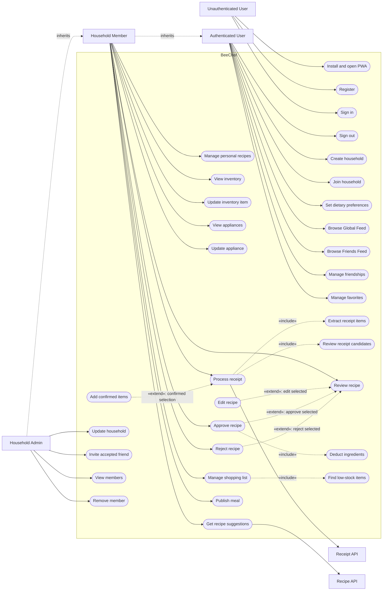

**Functionality covered:** T-03–T-18, T-28 / FR-03–FR-48 / UC-01–UC-14

**Whole-system diagram notes:**  
The diagram shows BeeChef's actors, system boundary, and use cases. Household roles inherit the capabilities of the roles below them.

#### 3.3.2 Application Access and Authentication

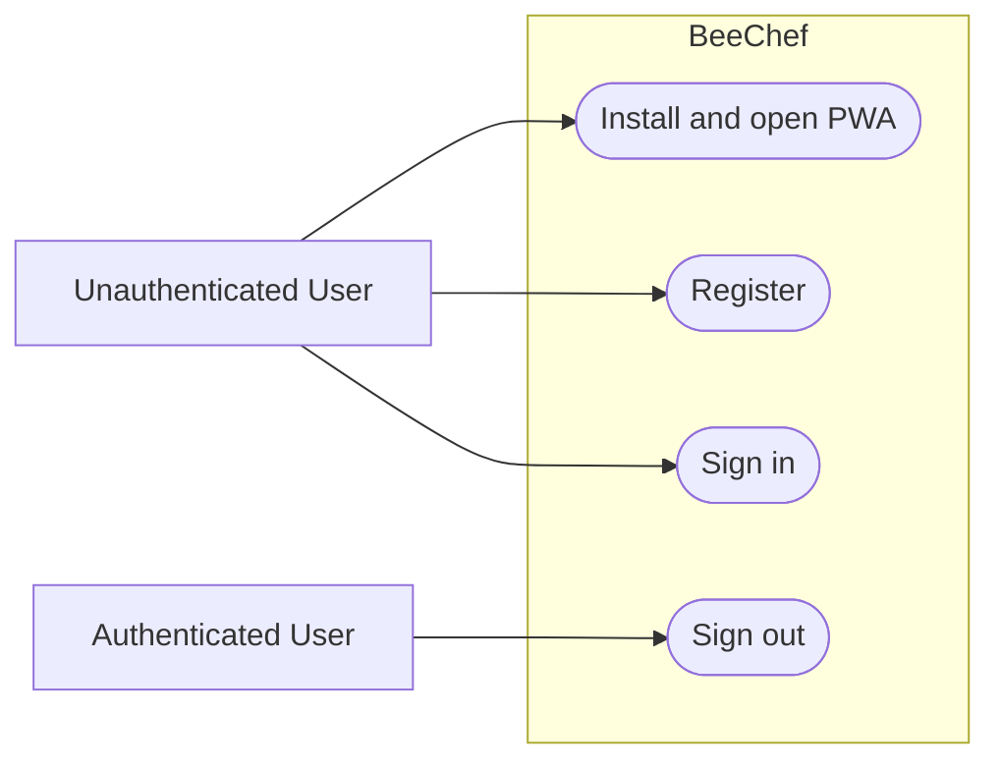

**Functionality covered:** T-03–T-04 / FR-03–FR-09 / UC-01–UC-02

#### 3.3.3 Household Creation and Membership

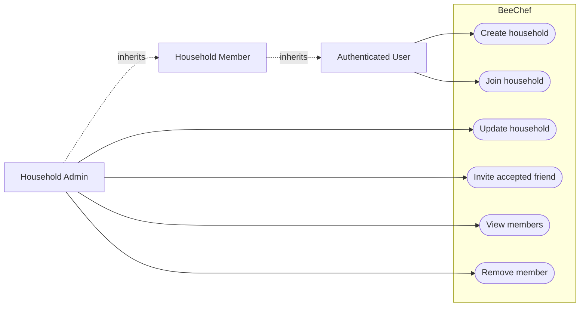

**Functionality covered:** T-05–T-06 / FR-10–FR-14, FR-41–FR-42 / UC-03  
**Diagram notes:** Household Admin inherits Household Member capabilities and can manage household details, invitations, and membership.

#### 3.3.4 Recipe Planning and Preparation

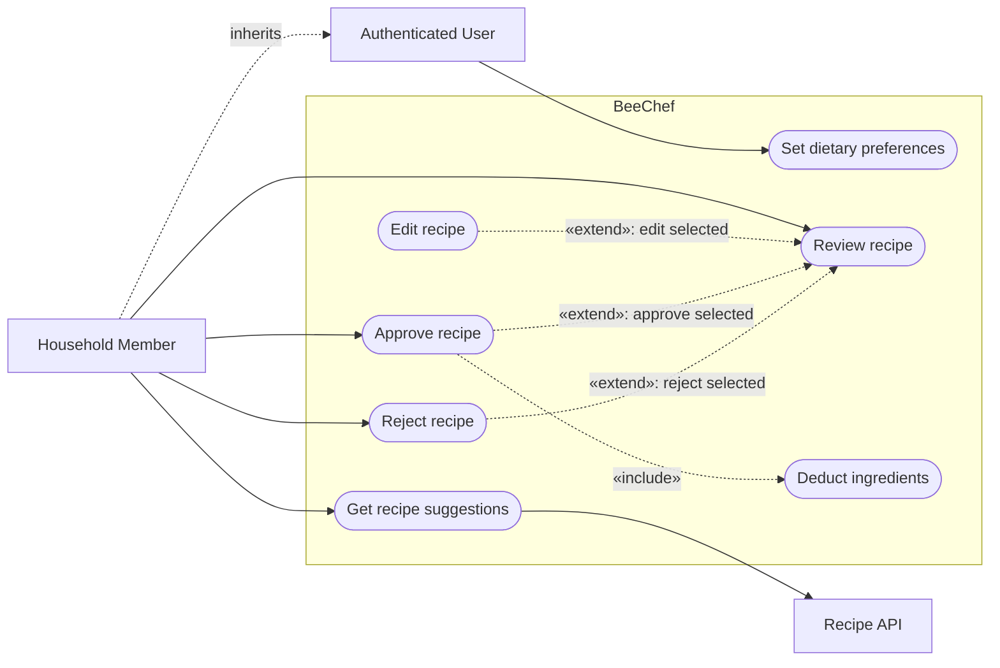

**Functionality covered:** T-08, T-10–T-13 / FR-19, FR-24–FR-33 / UC-07–UC-09  
**Diagram notes:** Suggestions use household appliances and saved dietary preferences. Approval deducts ingredients once; rejection leaves inventory unchanged.

#### 3.3.5 Social Feeds and Friendships

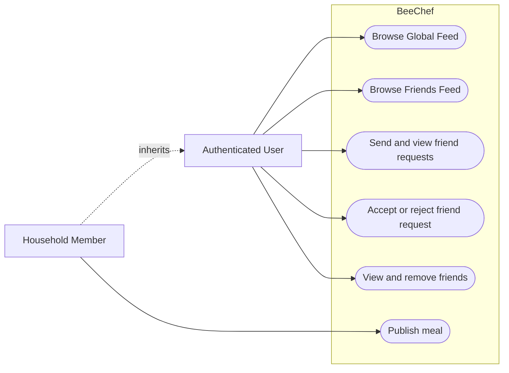

  **Functionality covered:** T-16, T-28 / FR-37–FR-38, FR-43–FR-48 / UC-11, UC-14  
  **Diagram notes:** Only recipients respond to requests. The Friends Feed includes only accepted friends' meals; removing a friendship does not change household membership.

#### 3.3.6 Favorite and User-Created Recipes

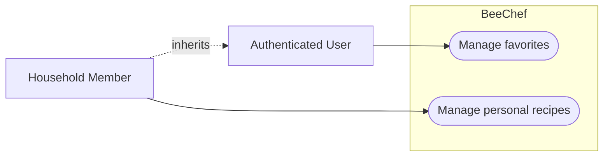

**Functionality covered:** T-17–T-18 / FR-39–FR-40 / UC-12–UC-13  
**Diagram notes:** Covers the personal recipe features.

#### 3.3.7 Household Inventory and Receipt Intake

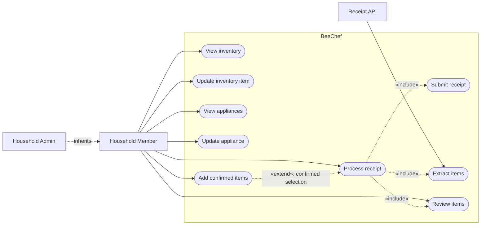

**Functionality covered:** T-06–T-09 / FR-14–FR-23 / UC-04–UC-06  
**Diagram notes:** Authorized household members manage inventory and appliances. Only receipt candidates they confirm are added to inventory.

#### 3.3.8 Low-Stock Items and Shopping List

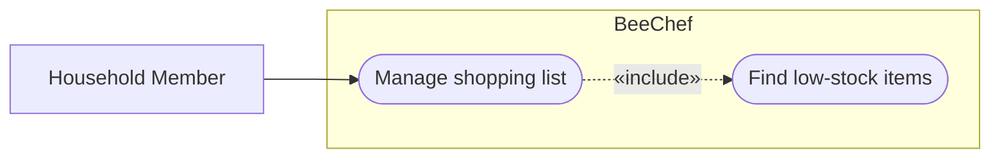

**Functionality covered:** T-14–T-15 / FR-34–FR-36 / UC-10  
**Diagram notes:** Generated low-stock items form a saved household list that members can manage.

### 3.4 Use Cases

**Common exception and cancellation rules:**

- If loading or saving fails, the system reports the failure, does not claim success, and retains the relevant saved data. Use-case-specific exceptions are listed below.
- If the actor cancels before submitting or confirming an operation, that operation makes no stored changes; previously completed operations remain saved.

#### 3.4.1 Use Case Coverage Matrix

| Project Plan task ID | Functional requirement ID(s) | Use case ID(s) | Scenario ID(s) |
|---|---|---|---|
| T-01 | FR-01 | — | — |
| T-02 | FR-02 | — | — |
| T-03 | FR-03–FR-05 | UC-01 | SC-01 |
| T-04 | FR-06–FR-09 | UC-02 | SC-02 |
| T-05 | FR-10–FR-13, FR-41–FR-42 | UC-03 | SC-03 |
| T-06 | FR-14 | UC-03–UC-06 | SC-03–SC-06 |
| T-07 | FR-15–FR-16 | UC-04 | SC-04 |
| T-08 | FR-17–FR-19 | UC-05, UC-08 | SC-05, SC-08 |
| T-09 | FR-20–FR-23 | UC-06 | SC-06 |
| T-10 | FR-24 | UC-07–UC-08 | SC-07–SC-08 |
| T-11 | FR-25–FR-27 | UC-08 | SC-08 |
| T-12 | FR-28–FR-30 | UC-09 | SC-09 |
| T-13 | FR-31–FR-33 | UC-09 | SC-09 |
| T-14 | FR-34 | UC-10 | SC-10 |
| T-15 | FR-35–FR-36 | UC-10 | SC-10 |
| T-16 | FR-37–FR-38, FR-48 | UC-11 | SC-11 |
| T-17 | FR-39 | UC-12 | SC-12 |
| T-18 | FR-40 | UC-13 | SC-13 |
| T-19–T-27 | — | — | — |
| T-28 | FR-43–FR-47 | UC-14 | SC-14 |

T-01 (CI/CD configuration), T-02 (database initialization), and T-19–T-27 (documentation and delivery) are internal project activities, not user-goal use cases.

#### 3.4.2 UC-01 — Install BeeChef PWA

| Field | Description |
|---|---|
| **Use case ID** | UC-01 |
| **Use case name** | Install BeeChef PWA |
| **Goal** | Use BeeChef on mobile and open its cached shell offline. |
| **Actor(s)** | UT-01 — Unauthenticated User |
| **Related Project Plan task(s)** | T-03 |
| **Related functional requirement(s)** | FR-03–FR-05 |

**Pre-condition(s):**  
BeeChef is online; the user has a supported mobile browser.

**Main success flow:**

1. **Actor:** Opens BeeChef in a mobile browser.
2. **System:** Displays a responsive layout.
3. **Actor:** Installs BeeChef as a PWA.
4. **System:** Installs the app and caches its shell.
5. **Actor:** Disconnects from the network and opens the app.
6. **System:** Loads the cached shell.

**Alternative flows:**

- **A1 — Continue in the browser (branches from step 3):**
  1. The actor skips installation and continues in the browser.
  2. BeeChef retains its responsive layout; offline availability is not established.

**Exception:**

None specified.

**Post-condition(s):**  
The installed app loads its cached shell offline. BeeChef remains available in the responsive browser while online.

#### 3.4.3 UC-02 — Manage Account Access

| Field | Description |
|---|---|
| **Use case ID** | UC-02 |
| **Use case name** | Manage Account Access |
| **Goal** | Register, sign in, and sign out of BeeChef. |
| **Actor(s)** | UT-01 — Unauthenticated User; UT-02 — Authenticated User |
| **Related Project Plan task(s)** | T-04 |
| **Related functional requirement(s)** | FR-06–FR-09 |

**Pre-condition(s):**  
The actor can access BeeChef; signing out requires an active session.

**Main success flow:**

1. **Actor:** Opens account access and chooses registration.
2. **System:** Displays the registration form.
3. **Actor:** Enters and submits the required information.
4. **System:** Validates the input, creates the account, and confirms registration.
5. **System:** Starts a session, and grants permitted access.
6. **Actor:** Later selects sign out and confirms.
7. **System:** Ends the session and blocks access to protected features.

**Alternative flows:**

- **A1 — Existing account (branches from step 1):** The actor chooses sign-in and continues at step 5.
- **A2 — Invalid registration input (step 4):** The system reports the error and creates no account; the actor may correct and resubmit at step 3.
- **A3 — Invalid credentials (step 5):** The system rejects sign-in; the actor may retry at step 5 or exit.

**Exception:**

- **E1 — Account access fails (steps 4, 5, or 7):** The system reports failure. Failed registration creates no account; failed sign-in starts no session; failed sign-out leaves the session active.

**Post-condition(s):**  
The account exists and the session is ended.

#### 3.4.4 UC-03 — Manage a Household

| Field | Description |
|---|---|
| **Use case ID** | UC-03 |
| **Use case name** | Manage a Household |
| **Goal** | Create and update a household, manage invitations, and view or remove members. |
| **Actor(s)** | UT-02 — Authenticated User; UT-04 — Household Admin |
| **Related Project Plan task(s)** | T-05, T-06 |
| **Related functional requirement(s)** | FR-10–FR-14, FR-41–FR-42 |

**Pre-condition(s):**  
The creator and invitee are signed in; updates and invitations require Admin permission. Sending an invitation also requires an accepted friendship with the invitee.

**Main success flow:**

1. **Actor:** Starts household creation.
2. **System:** Displays the creation form.
3. **Actor:** Submits household details.
4. **System:** Creates the household and assigns the creator as Admin.
5. **Admin:** Updates household details and submits the changes.
6. **System:** Saves the updated details.
7. **Admin:** Selects an accepted friend and submits a household invitation.
8. **System:** Verifies Admin permission and current accepted friendship, then creates the invitation for the household and invitee.
9. **Invitee:** Opens and accepts the invitation.
10. **System:** Verifies it, adds the invitee as a Member, and confirms membership.
11. **Admin:** Opens the household member list.
12. **System:** Displays the current members.
13. **Admin:** Selects a member and confirms removal.
14. **System:** Removes the member and confirms the change.

**Alternative flows:**

- **A1 — Existing household (step 1):** The Admin opens household settings and continues at step 5.
- **A2 — Decline invitation (step 9):** The invitee is not added to the household.
- **A3 — Manage existing membership (branches from step 1):** The Admin opens an existing household and continues at step 11. After step 12, the Admin may end the flow or continue at step 13 to remove a member.

**Exception:**

The common exception rule applies to creation, updates, invitations, member-list loading, and removal.

- **E1 — Invitation cannot be accepted (step 10):** The system reports failure and does not add the invitee.
- **E2 — Invitee is not an accepted friend (step 8):** The system rejects the invitation without creating it or changing membership.

**Post-condition(s):**  
The household, updates, invitation, and membership changes are saved.

#### 3.4.5 UC-04 — Manage Inventory

| Field | Description |
|---|---|
| **Use case ID** | UC-04 |
| **Use case name** | Manage Inventory |
| **Goal** | View and update household ingredients, quantities, and units. |
| **Actor(s)** | UT-03 — Household Member |
| **Related Project Plan task(s)** | T-06–T-07 |
| **Related functional requirement(s)** | FR-14–FR-16 |

**Pre-condition(s):**  
The signed-in actor belongs to the household and has inventory access.

**Main success flow:**

1. **Actor:** Opens the household inventory.
2. **System:** Displays current ingredients, quantities, and units.
3. **Actor:** Selects an item, edits its details, quantity, or unit, and submits.
4. **System:** Saves and displays the update.

**Alternative flows:**

- **A1 — Inventory is empty (step 2):** The system displays the empty state; no update is made.

- **A2 — Manual addition (step 3):** The actor selects Add and submits an ingredient, quantity, and unit; the system validates and saves it at step 4.

**Exception:**

The common exception rule applies to inventory loading and updates.

**Post-condition(s):**  
The current inventory is displayed and any successful update is saved.

#### 3.4.6 UC-05 — Manage Appliances

| Field | Description |
|---|---|
| **Use case ID** | UC-05 |
| **Use case name** | Manage Appliances |
| **Goal** | View and update household appliances used for recipe suggestions. |
| **Actor(s)** | UT-03 — Household Member |
| **Related Project Plan task(s)** | T-06, T-08 |
| **Related functional requirement(s)** | FR-14, FR-17–FR-19 |

**Pre-condition(s):**  
The signed-in actor belongs to the household and has appliance access.

**Main success flow:**

1. **Actor:** Opens the household appliance list.
2. **System:** Displays current appliances.
3. **Actor:** Selects an appliance, edits its details, and submits.
4. **System:** Saves the update and makes the current list available to recipe-generation workflows.

**Alternative flows:**

- **A1 — No appliances are listed (step 2):** The system displays the empty state.
- **A2 — Manual addition (step 3):** The actor selects Add and submits an appliance; the system validates and saves it at step 4.

**Exception:**

The common exception rule applies to appliance-list loading and updates.

**Post-condition(s):**  
The current appliance list is displayed and available to recipe-generation workflows.

#### 3.4.7 UC-06 — Add Receipt Items

| Field | Description |
|---|---|
| **Use case ID** | UC-06 |
| **Use case name** | Add Receipt Items |
| **Goal** | Extract receipt items and add only those the user confirms. |
| **Actor(s)** | UT-03 — Household Member; UT-06 — Receipt API |
| **Related Project Plan task(s)** | T-06, T-09 |
| **Related functional requirement(s)** | FR-14, FR-20–FR-23 |

**Pre-condition(s):**  
The signed-in actor belongs to the household and can add inventory items.

**Main success flow:**

1. **Actor:** Submits a receipt image.
2. **System:** Sends it to the receipt-scanning service.
3. **Receipt API:** Returns item candidates.
4. **System:** Presents candidates for review.
5. **Actor:** Corrects names, quantities, or units; selects items and confirms.
6. **System:** Adds only confirmed items to inventory and reports the result.

**Alternative flows:**

- **A1 — Actor discards candidates (branches from step 5):**
  1. The actor discards candidates and confirms the remaining selection.
  2. The system adds only confirmed candidates.
- **A2 — No candidates are confirmed (branches from step 5):**
  1. The actor confirms no candidates; inventory remains unchanged.

**Exception:**

- **E1 — Invalid image (step 1):** The system rejects it and reports that it cannot be processed.
- **E2 — Scanning fails (step 2):** The system reports failure; inventory is unchanged.

The common exception rule applies when confirmed items cannot be added (step 6).

**Post-condition(s):**  
Only confirmed candidates are added.

#### 3.4.8 UC-07 — Set Dietary Preferences

| Field | Description |
|---|---|
| **Use case ID** | UC-07 |
| **Use case name** | Set Dietary Preferences |
| **Goal** | Save dietary preferences, restrictions, and allergies for recipe requests. |
| **Actor(s)** | UT-02 — Authenticated User |
| **Related Project Plan task(s)** | T-10 |
| **Related functional requirement(s)** | FR-24 |

**Pre-condition(s):**  
The actor is signed in and can access personal preferences.

**Main success flow:**

1. **Actor:** Opens personal dietary preferences.
2. **System:** Displays saved values, if any.
3. **Actor:** Enters or updates preferences, restrictions, and allergies, then submits.
4. **System:** Saves the values to the actor's account and confirms.

**Alternative flows:**

The common cancellation rule applies at step 3.

**Exception:**

The common exception rule applies when preferences cannot be saved (step 4).

**Post-condition(s):**  
Preferences are saved for recipe requests.

#### 3.4.9 UC-08 — Get Recipe Suggestions

| Field | Description |
|---|---|
| **Use case ID** | UC-08 |
| **Use case name** | Get Recipe Suggestions |
| **Goal** | Get suggestions based on household ingredients, appliances, and dietary preferences. |
| **Actor(s)** | UT-03 — Household Member; UT-05 — AI Recipe Generation API |
| **Related Project Plan task(s)** | T-08, T-10, T-11 |
| **Related functional requirement(s)** | FR-19, FR-24–FR-27 |

**Pre-condition(s):**  
The signed-in actor belongs to a household and can request recipes using household and personal data.

**Main success flow:**

1. **Actor:** Requests recipe suggestions.
2. **System:** Collects household ingredients, appliances, and the actor's saved preferences and sends them to the AI service.
3. **AI Recipe Generation API:** Returns suggestions.
4. **System:** Displays the suggestions.

**Alternative flows:**

- **A1 — No suggestions are returned (branches from step 4):**
  1. The service returns no suggestions; the system informs the actor.
  2. Inventory remains unchanged.

**Exception:**

- **E1 — Service fails or is unavailable (step 2 or 3):** The system reports that suggestions could not be generated; inventory is unchanged.

**Post-condition(s):**  
Returned suggestions are displayed.

#### 3.4.10 UC-09 — Review Recipe

| Field | Description |
|---|---|
| **Use case ID** | UC-09 |
| **Use case name** | Review Recipe |
| **Goal** | Review, optionally edit, and approve or reject a suggestion; approval updates inventory once. |
| **Actor(s)** | UT-03 — Household Member |
| **Related Project Plan task(s)** | T-12, T-13 |
| **Related functional requirement(s)** | FR-28–FR-33 |

**Pre-condition(s):**  
The signed-in actor belongs to the household and has a suggestion to review.

**Main success flow:**

1. **Actor:** Opens a suggestion.
2. **System:** Displays its ingredients, instructions, and relevant context.
3. **Actor:** Approves the recipe.
4. **System:** Records approval, calculates required deductions, applies them once, and confirms.

**Alternative flows:**

- **A1 — Edit the suggested recipe (branches from step 2):**
  1. The actor edits ingredients or quantities and submits the changes.
  2. The system updates the suggestion and returns to step 2 for review.
- **A2 — Reject the recipe (branches from step 3):**
  1. The actor rejects the recipe; the system records the rejection and leaves inventory unchanged.
- **A3 — Approval request is repeated (branches from step 4):**
  1. The actor retries the same approval; the system recognizes it and does not deduct again.

**Exception:**

- **E1 — Deduction fails (step 4):** The system reports failure and leaves inventory unchanged, without a partial deduction.

**Post-condition(s):**  
Approval is recorded and the final recipe's ingredient quantities are deducted once.

#### 3.4.11 UC-10 — Manage Shopping List

| Field | Description |
|---|---|
| **Use case ID** | UC-10 |
| **Use case name** | Manage Shopping List |
| **Goal** | Load and manage a saved household shopping list, generated from stock and user history. |
| **Actor(s)** | UT-03 — Household Member |
| **Related Project Plan task(s)** | T-14, T-15 |
| **Related functional requirement(s)** | FR-34–FR-36 |

**Pre-condition(s):**  
The signed-in actor belongs to the household and can access its inventory and shopping list.

**Main success flow:**

1. **Actor:** Opens the household shopping list.
2. **System:** Loads the saved list, or displays an empty state with Generate list if none exists.
3. **Actor:** Updates a list entry.
4. **System:** Saves the change and displays the updated list.

**Alternative flows:**

- **A1 — Remove a shopping-list entry (branches from step 3):**
  1. The system removes the selected entry and displays the updated list.
- **A2 — Generate or regenerate (branches from step 2):**
  1. On request, the system generates items from current stock, the actor's cooking history, and the low-stock condition, then saves or replaces the household list atomically.
- **A3 — Add or mark an item bought (branches from step 3):**
  1. The system saves the new entry or bought status.
- **A4 — Clear the list (branches from step 3):**
  1. After confirmation, the system deletes the list and all its entries atomically.

**Exception:**

Loading, generation, or save failure is reported without changing stock or partially changing the saved list. Unauthorized household access is denied.

**Post-condition(s):**  
Saved changes remain available across app sessions.

#### 3.4.12 UC-11 — Publish and Browse Meal Feeds

| Field | Description |
|---|---|
| **Use case ID** | UC-11 |
| **Use case name** | Publish and Browse Meal Feed |
| **Goal** | Publish meals globally and browse all shared meals or accepted friends' meals. |
| **Actor(s)** | UT-03 — Household Member; UT-02 — Authenticated User |
| **Related Project Plan task(s)** | T-16 |
| **Related functional requirement(s)** | FR-37–FR-38, FR-48 |

**Pre-condition(s):**  
The actors are signed in; publishing requires current household membership, while browsing does not.

**Main success flow:**

1. **Household Member:** Submits meal information.
2. **System:** Verifies membership, publishes the meal to the Global Feed, and confirms.
3. **Authenticated User:** Selects the Global Feed or Friends Feed.
4. **System:** Retrieves published meals for the selected view; the Friends Feed query includes only current accepted friends' meals.

**Alternative flows:**

- **A1 — Browse without publishing (step 1):** The authenticated user skips publishing and continues at step 3.
- **A2 — No meals are available (step 4):** The system displays an empty-feed state.
- **A3 — Switch feed (step 3):** The user selects the other view; the system retrieves its meals using the corresponding filter.

**Exception:**

The common exception rule applies to meal publishing and feed loading.

**Post-condition(s):**  
The meal is globally published; the selected feed displays only qualifying meals.

#### 3.4.13 UC-12 — Manage Favorites

| Field | Description |
|---|---|
| **Use case ID** | UC-12 |
| **Use case name** | Manage Favorites |
| **Goal** | Save, view, and remove favorite recipes. |
| **Actor(s)** | UT-02 — Authenticated User |
| **Related Project Plan task(s)** | T-17 |
| **Related functional requirement(s)** | FR-39 |

**Pre-condition(s):**  
The actor is signed in and can access favorites.

**Main success flow:**

1. **Actor:** Opens the favorites list.
2. **System:** Displays saved recipes.
3. **Actor:** Opens a recipe and chooses to save it as a favorite.
4. **System:** Saves it and displays the updated list.

**Alternative flows:**

- **A1 — Remove a favorite (branches from step 2):**
  1. The actor removes a recipe; the system updates the list.
- **A2 — No favorites are saved (branches from step 2):**
  1. The system displays an empty favorites state.

**Exception:**

The common exception rule applies to favorites loading and saving.

**Post-condition(s):**  
The list reflects saved or removed recipes; the original recipe is unchanged.

#### 3.4.14 UC-13 — Manage Personal Recipes

| Field | Description |
|---|---|
| **Use case ID** | UC-13 |
| **Use case name** | Manage Personal Recipes |
| **Goal** | Create, view, edit, and remove personal recipes linked to a household. |
| **Actor(s)** | UT-03 — Household Member |
| **Related Project Plan task(s)** | T-18 |
| **Related functional requirement(s)** | FR-40 |

**Pre-condition(s):**  
The actor is signed in and belongs to the selected household; existing recipes must belong to the actor and that household.

**Main success flow:**

1. **Actor:** Opens personal recipes.
2. **System:** Displays saved recipes and the create option.
3. **Actor:** Chooses to create a recipe.
4. **System:** Displays the recipe form.
5. **Actor:** Enters and submits recipe information.
6. **System:** Saves it under the actor and selected household and displays it.

**Alternative flows:**

- **A1 — View an existing recipe (branches from step 2):**
  1. The actor selects a saved recipe; the system displays its details.
- **A2 — Edit an existing recipe (branches from step 2):**
  1. The actor selects and edits a saved recipe, then submits the changes.
  2. The system saves and displays the update.
- **A3 — Remove an existing recipe (branches from step 2):**
  1. The actor removes a saved recipe; the system updates the list.

**Exception:**

The common exception rule applies to recipe loading, creation, updates, and removal.

**Post-condition(s):**  
Personal recipes reflect successful changes.

#### 3.4.15 UC-14 — Manage Friendships

| Field | Description |
|---|---|
| **Use case ID** | UC-14 |
| **Use case name** | Manage Friendships |
| **Goal** | Send and review friend requests, accept or reject them, and view or remove friends. |
| **Actor(s)** | UT-02 — Authenticated User, acting as sender or recipient |
| **Related Project Plan task(s)** | T-28 |
| **Related functional requirement(s)** | FR-43–FR-47 |

**Pre-condition(s):**  
Both users are registered and signed in for their respective actions. Only the recipient may respond to a pending request; only friendship participants may remove it.

**Main success flow:**

1. **Sender:** Selects another registered user and submits a friend request.
2. **System:** Validates and stores the pending request, visible to both participants.
3. **Recipient:** Opens received requests.
4. **System:** Displays the recipient's requests.
5. **Recipient:** Accepts the request.
6. **System:** Records acceptance and adds each user to the other's friend list.
7. **Either participant:** Views their friends and confirms removal of the friendship.
8. **System:** Removes the friendship from both lists and ends eligibility for new household invitations and Friends Feed inclusion.

**Alternative flows:**

- **A1 — View sent requests (step 3):** The sender opens their sent requests; the system displays their status.
- **A2 — Reject request (step 5):** The recipient rejects it; the system records rejection without creating a friendship.
- **A3 — View friends without removing (step 7):** The actor views the list and exits without changes.
- **A4 — Empty list (step 4 or 7):** The system displays an empty requests or friends state.

**Exception:**

The common exception and cancellation rules apply to request and friendship loading or saving.

- **E1 — Invalid or duplicate request (step 2):** Self-requests and duplicate pending or accepted relationships are rejected without creating a request.
- **E2 — Unauthorized action (step 5 or 8):** The backend denies responses by non-recipients and removal by unrelated users without changing data.
- **E3 — Request is no longer pending (step 6):** The system reports its current status without creating a duplicate friendship.

**Post-condition(s):**  
Acceptance establishes a mutual friendship; rejection does not. Removal updates both friend lists, new-invitation eligibility, and Friends Feed filtering.

---

## 4. User Interface Model

| Screen ID | Screen name | Scenario ID(s) | Project Plan component(s) | Related requirement or use case ID(s) |
|---|---|---|---|---|
| UI-01 | PWA Installation and Launch | SC-01 | Responsive PWA and offline shell — T-03 / D-01 | FR-03–FR-05; UC-01 |
| UI-02 | Account Access | SC-02, SC-07, SC-12 | Authentication and profile — T-04, T-10, T-17 / D-02, D-08, D-15 | FR-06–FR-09, FR-24, FR-39; UC-02, UC-07, UC-12 |
| UI-03 | Household | SC-03 | Household management and permissions — T-05–T-06 / D-03–D-04 | FR-10–FR-14, FR-41–FR-42; UC-03 |
| UI-04 | Inventory | SC-04–SC-06 | Inventory, appliances, and receipts — T-06–T-09 / D-04–D-07 | FR-14–FR-23; UC-04–UC-06 |
| UI-05 | Recipe Generation | SC-08–SC-09 | Recipe generation and review — T-08, T-10–T-13 / D-06, D-08–D-11 | FR-19, FR-24–FR-33; UC-08–UC-09 |
| UI-06 | Shopping List | SC-10 | Low-stock items and shopping list — T-14–T-15 / D-12–D-13 | FR-34–FR-36; UC-10 |
| UI-07 | Social | SC-11, SC-14 | Feed browsing and friend management — T-16, T-28 / D-14, D-21 | FR-38, FR-43–FR-48; UC-11, UC-14 |

### 4.1 UI-01 — PWA Installation and Launch

Users install BeeChef from a supported mobile browser and launch it from the home-screen icon without browser controls. Once cached, the application shell opens offline; network-dependent features remain unavailable, with Retry shown when disconnected.

### 4.2 UI-02 — Account Access

Successful login or registration opens Profile; registration signs users in automatically. Profile links to account information, dietary preferences, favorites, and password changes. Invalid input stays on the form; logout returns to login.

### 4.3 UI-03 — Household

The household selector switches the active household. Admins use the pencil icon to edit its name and manage members; Add member opens accepted-friend invitations. The delete icon removes a household. Save and Cancel return to the application page.

### 4.4 UI-04 — Inventory

Inventory provides ingredient/appliance tabs, search, category filters, and quantity or availability controls. Add from receipt opens photo capture or upload, extraction, and editable item review. Apply adds selected items; Cancel leaves stock unchanged.

### 4.5 UI-05 — Recipe Generation

Users enter a request and choose dietary/meal shortcuts, servings, cooking time, and whether to ignore missing ingredients or appliances. Saved preferences apply by default but can be disabled. Suggestions open editable recipe details with favorite, approve, and reject actions; only approval deducts stock.

### 4.6 UI-06 — Shopping List

Shopping reloads the saved household list. Users edit, add, remove, or mark items as bought; clearing requires confirmation. Generate list creates a saved list from recent recipes and current stock; regeneration replaces it.

### 4.7 UI-07 — Social

Social has no household selector. Global shows all users' posts newest first; Friends shows accepted friends' posts with the same image, caption, and like/dislike layout. The avatar opens friends and sent/received requests; + opens username search. Users send, accept, reject, or cancel requests, or remove friends.

---

## 5. Flow Diagrams

### 5.1 General Data Model

All entities use an `id` PK; FKs are required unless optional.

**Users and households**

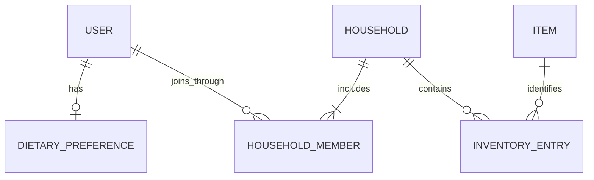

| Entity | Purpose and main attributes | Foreign keys |
|---|---|---|
| User | Account: `email`, `hashed_password`, `user_name`. | None. |
| DietaryPreference | Dietary preferences, restrictions, allergies. | `user_id` → User, unique. |
| Household | Shared kitchen: `name`. | None. |
| HouseholdMember | Membership: `role`. | `user_id` → User; `household_id` → Household. |
| Item | Catalog: `name`, `item_type`. | None. |
| InventoryEntry | Stock: `is_available`, optional `quantity` and `unit`. | `household_id` → Household; `item_id` → Item. |

Each household retains an Admin. Membership/inventory pairs and case-insensitive email/usernames are unique. Appliances use availability; ingredients also support nonnegative quantities and compatible units.

**Recipes, favorites, and history**

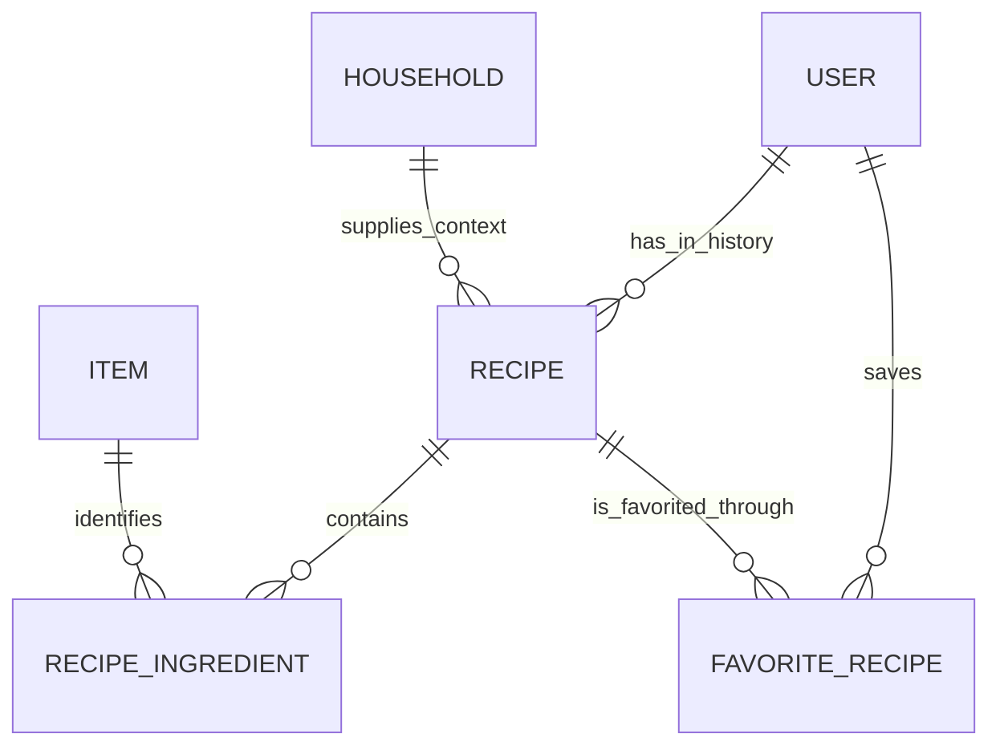

| Entity | Purpose and main attributes | Foreign keys |
|---|---|---|
| Recipe | Saved recipe: `title`, `instructions`, `status`. | `requested_by_user_id` → User; `household_id` → Household. |
| RecipeIngredient | Ingredient amount: `quantity`, `unit`. | `recipe_id` → Recipe; `item_id` → Item. |
| FavoriteRecipe | Bookmarked recipe. | `user_id` → User; `recipe_id` → Recipe. |

Saved recipes build user history from an empty collection. Favorite and recipe/ingredient pairs are unique. Only approval deducts stock, atomically and once.

**Shopping lists**

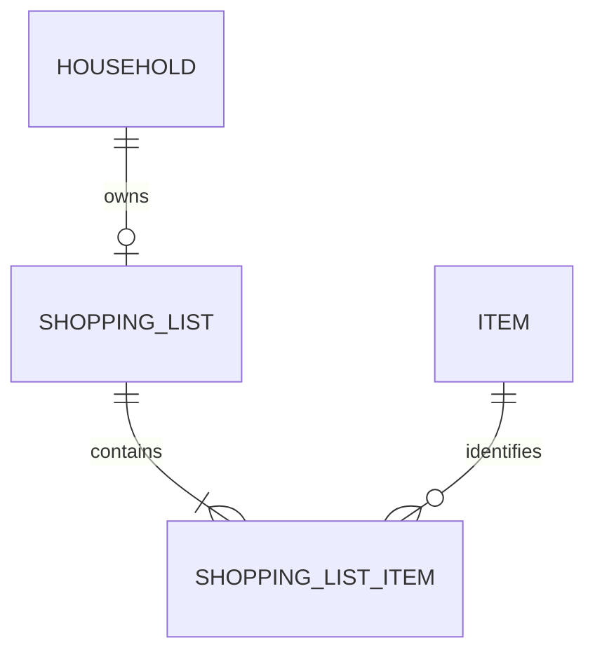

| Entity | Purpose and main attributes | Foreign keys |
|---|---|---|
| ShoppingList | Saved household list. | `household_id` → Household, unique. |
| ShoppingListItem | List entry: `quantity`, `unit`, `is_bought`. | `list_id` → ShoppingList; `item_id` → Item. |

Each household has at most one list; each list/item pair is unique. Only current household members manage it. Deleting a list removes its entries; deleting a household cascades to its list and entries.

**Friends, invitations, and social sharing**

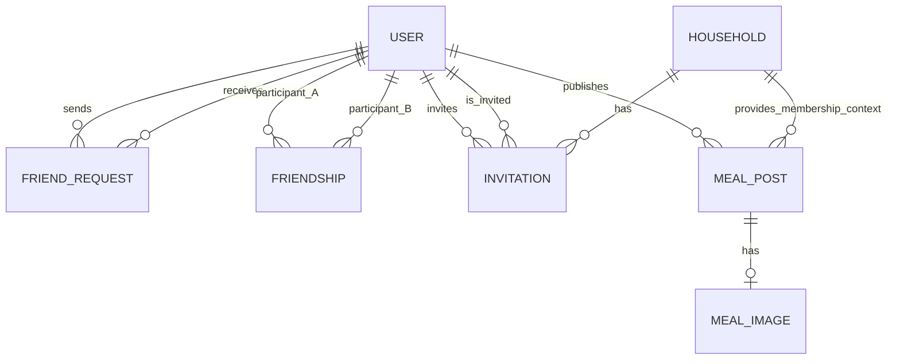

| Entity | Purpose and main attributes | Foreign keys |
|---|---|---|
| FriendRequest | Friend request: `status`. | `sender_user_id` and `recipient_user_id` → User. |
| Friendship | Mutual user link. | `user_a_id` and `user_b_id` → User. |
| Invitation | Household invitation: `status`. | `household_id` → Household; `invited_by_user_id` and `invitee_user_id` → User. |
| MealPost | Meal post: `title`, `description`. | `author_user_id` → User; `household_id` → Household. |
| MealImage | Persisted post image: `image_data`, `mime_type`. | `post_id` → MealPost, unique. |

Friendships join unique, distinct users; duplicate/existing-friend requests are blocked. Admins invite friends; one pending invitation per household/invitee. Publishing requires current membership in the post's household; Friends Feed filters posts by friendship. Each post has at most one DB image, deleted with it.

### 5.2 Important Data Considerations

| Data Exchange | Format | Reason | Constraints |
|---|---|---|---|
| Frontend ↔ backend | JSON; async Fetch | Non-blocking requests. | Backend schemas; JWT for protected endpoints. |
| Receipt images | Temporary local copy | AI extraction without retention. | JPEG/PNG/WebP, default 10 MB limit; delete copy after success/failure, preserve original. |
| Social images | `multipart/form-data` | Uploads images for meal posts. | JPEG/PNG/WebP; default 10 MB limit. |
| Backend ↔ AI | Images/recipe context | Extraction and recipe generation. | Validate items, quantities, units; confirm receipt items before stock updates. |
| Catalog import | CSV | Bulk seeding. | Required catalog headers; valid IDs/item types. |

Normalize AI outputs to backend fields/units; failed exchanges must not partially update stock.

### 5.3 Data Flow Diagrams

#### 5.3.1 Level 0

Users provide account, household, inventory, receipt, recipe, shopping, and social inputs; BeeChef returns results or errors. The AI service receives receipt images and recipe context, returning extracted items or suggestions.

#### 5.3.2 Level 1

Six processes manage accounts, households/stock, receipts, recipes, social features, and shopping lists. D1 stores accounts/preferences; D2 households/memberships/invitations; D3 catalog/inventory; D4 recipes/ingredients/favorites; D5 friend requests/friendships/posts/images; D6 saved household shopping lists and entries. Repeated User, AI Service, and store symbols denote the same entities.

#### 5.3.3 Level 2

Process 3.0 decomposes into upload/access validation, AI extraction, candidate matching, and confirmation. Temporary image copies are deleted after extraction or failure; originals remain untouched. Users correct/select candidates before confirmation; access is rechecked and stock updated atomically. Cancellation or failure leaves stock unchanged. External and store flows match 3.0.

